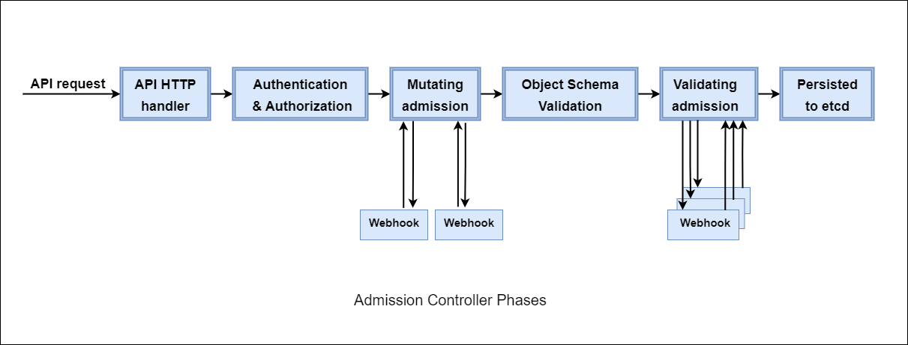

이 페이지는 Kubernetes 어드미션 컨트롤러를 개괄하는 선택 문서입니다. Kubernetes를 처음 쓰는 사용자나 어드미션 컨트롤러가 어떻게 동작하는지 더 알고 싶은 사용자에게 권합니다. 이 주제를 빠짐없이 다루는 레퍼런스 문서는 아니며, 읽기 쉽도록 고급 세부 사항과 세세한 내용은 많이 생략했습니다.

## 어드미션 컨트롤러 소개

Kubernetes에서 어드미션 컨트롤러는 어드미션 과정에서 요청을 검증하거나 변경하는 구성 요소입니다. Kubernetes의 "확장" 지점으로 볼 수 있으며, 주로 새 리소스가 생성될 때(admission) 그 결과를 제어하는 데 쓰입니다. 어드미션 컨트롤러는 Kubernetes API 서버에 직접 내장된 것("in-line", "in-process", "compiled-in" 어드미션 컨트롤러라고도 합니다)일 수도 있고 외부 컴포넌트일 수도 있습니다. 예를 들어 내장 어드미션 컨트롤러인 [ResourceQuota](https://kubernetes.io/docs/concepts/policy/resource-quotas/)는 새 Deployment를 검사해서, 요청한 리소스가 대상 네임스페이스에 설정된 임계값을 넘지 않는지 확인합니다. 적절한 권한을 가진 사용자가 정의하는 이 임계값을 초과하면 Deployment 생성 요청은 차단됩니다.

내장이든 외부든 어드미션 컨트롤러는 **검증(validating)** 또는 **변경(mutating)** 컨트롤러가 될 수 있고, 하나의 어드미션 컨트롤러가 두 가지를 동시에 할 수도 있습니다. 유형과 상관없이 모든 어드미션 컨트롤러는 요청의 인증과 인가가 끝난 뒤, 백엔드에 저장하기 전에 동작합니다. 이 단계의 흐름은 아래 다이어그램과 같습니다.

<br>



<center>
<i>출처: https://kubernetes.io/blog/2019/03/21/a-guide-to-kubernetes-admission-controllers/</i>
</center>
<br></br>

Kubernetes는 ResourceQuota 같은 내장 어드미션 컨트롤러와 [그 밖의 여러 컨트롤러](https://kubernetes.io/docs/reference/access-authn-authz/admission-controllers/#what-does-each-admission-controller-do)를 제공합니다. 하지만 이들은 한 가지 작업만 하도록 만든 매우 특수한 목적의 컨트롤러이고 수정할 수 없습니다. 실제 환경에서는 여러분을 포함한 많은 사용자가 내장 컨트롤러로 충족할 수 없는 요구를 갖고 있습니다. 이런 경우(곧 설명합니다)에는 사용자 정의 로직을 구현할 수 있는 무언가가 필요합니다. 내장 어드미션 컨트롤러 외에, 동적 어드미션 컨트롤러를 확장 기능으로 개발해 런타임에 설정하는 웹훅으로 실행할 수 있습니다.

웹훅으로 API 기능을 확장할 수 있게 해 주는 어드미션 컨트롤러는 두 가지입니다.

- **MutatingAdmissionWebhook**: 요청을 변경할 수 있습니다.
- **ValidatingAdmissionWebhook**: 요청한 리소스의 생성을 허용할지 검증할 수 있습니다.

이 두 유형은 내장 어드미션 컨트롤러와 달리 사용자 정의 판단을 구현할 수 있으므로 **동적 어드미션 컨트롤러**라고 부릅니다.

## 사용 사례

앞서 말했듯이 Kubernetes는 일부 어드미션 컨트롤러를 내장 컨트롤러로 "기본 제공"합니다. 하나 이상의 내장 어드미션 컨트롤러로 처리할 수 없는, 고유한 검증이나 변경이 필요하면 동적 어드미션 컨트롤러를 써야 합니다. 동적 어드미션 컨트롤러의 사용 사례는 다음과 같습니다.

- **보안:** 어드미션 컨트롤러는 네임스페이스나 클러스터 전체에 합리적인 보안 기준선을 의무화해서 보안을 높일 수 있습니다. 예를 들어 `PodSecurity`는 컨테이너가 root로 실행되거나 특권(privileged) 모드로 실행되지 못하게 하는 내장 어드미션 컨트롤러입니다. 그러나 흔히 [Pod Security Admission](https://kubernetes.io/docs/concepts/security/pod-security-admission/)이라고 부르는 이 어드미션 컨트롤러가 [여러 면에서 한계가 있다](/blog/general/psp-migration#comparison)고 느끼는 사용자가 많습니다. PodSecurity(Pod Security Admission) 같은 내장 어드미션 컨트롤러의 한계에 부딪히면 동적 어드미션 제어로 그 빈틈을 메울 수 있습니다.

- **거버넌스:** 어드미션 컨트롤러로 레이블, 어노테이션, 리소스 제한 등의 설정을 올바르게 갖추도록 강제할 수 있습니다. 예를 들어 여러 오브젝트에 레이블 검증(또는 변경)을 적용해 모든 오브젝트가 팀이나 프로젝트에 지정되게 하거나, 모든 Deployment가 `app` 레이블을 지정하게 할 수 있습니다. 이런 거버넌스는 조직마다 요구가 크게 다르므로, 그 요구를 강제하려면 동적 어드미션 컨트롤러가 필요합니다.

- **구성 관리:** 어드미션 컨트롤러로 클러스터에서 실행되는 오브젝트의 구성을 검증해 잘못된 구성을 막을 수 있습니다. 시맨틱 태그 없이 배포된 이미지를 찾아 고치거나, 리소스 requests와 limits를 자동으로 추가·검증하거나, 두 Ingress 리소스가 같은 호스트 이름을 쓰지 않게 하는 데 유용합니다. 거버넌스와 마찬가지로 이런 요구도 조직의 내부 표준과 관행에 맞춰 직접 정의해야 하는 경우가 많습니다. 이 수준의 제어를 사용자에게 제공하는 방법은 동적 어드미션 제어뿐입니다.

- **세밀한 RBAC:** 기존 RBAC(Role-Based Access Control)는 Kubernetes 클러스터에서 특정 작업을 수행할 역할과 권한을 정의하지만, 일부 시나리오에서는 세분성이 부족합니다. 동적 어드미션 컨트롤러는 관리자가 표준 RBAC 정책 위에 상세한 조건을 덧붙일 수 있게 해서 이 간극을 메웁니다. 예를 들어 특정 레이블이 붙은 네임스페이스를 삭제할 수 있는 사용자를 제한하는 일은 동적 어드미션 제어로만 할 수 있습니다.

- **멀티 테넌시:** 멀티 테넌시는 여러 팀이 같은 클러스터를 공유하면서 리소스 활용도를 높이고, 운영 비용을 줄이며, 민첩성과 협업을 촉진합니다. 많은 조직이 내부적으로 멀티 테넌트 방식으로 운영됩니다. Kubernetes에는 이런 테넌트 사이의 경계를 강제하는 기본 방법이 없습니다. 그래서 `ResourceQuota`와 `LimitRanger` 같은 어드미션 컨트롤러로, 지정한 네임스페이스 안에서 클러스터 리소스(CPU 시간, 메모리, 영구 스토리지 등)의 사용량과 생성량에 제한을 겁니다. Kyverno 같은 일부 동적 어드미션 컨트롤러는 한 걸음 더 나아가 새 네임스페이스의 리소스 생성 과정을 자동화해서, 새 테넌트나 고객을 위한 부트스트랩 기능을 제공합니다.

- **비용 관리:** Kubernetes를 운영하는 데는 돈이 들고, 적절한 점검과 관문이 없으면 비용이 금방 걷잡을 수 없이 늘어납니다. 예를 들어 AWS, GCP, Azure 같은 퍼블릭 클라우드에서 실행되는 Kubernetes 클러스터는 Kubernetes 리소스를 기반으로 계정에 다른 클라우드 서비스를 만들 수 있습니다. 이런 클라우드 리소스에는 추가 비용이 듭니다. 동적 어드미션 컨트롤러는 인프라 비용에 영향을 줄 수 있는 특정 리소스를 제한할 수 있습니다. 예를 들어 `LoadBalancer` 유형의 Kubernetes Service는 하나를 만들 때마다 클라우드 로드 밸런서가 생기므로, 클러스터에서 만들 수 있는 개수를 제한할 수 있습니다.

- **공급망 보안:** 어드미션 컨트롤러는 문지기 역할을 하며, 리소스를 클러스터에 허용하기 전에 미리 정의한 정책에 따라 요청을 검증합니다. 어드미션 컨트롤러로 이미지가 신뢰할 수 있는 회사 키로 서명되었는지, 권한 있는 제3자가 하나 이상의 품질 요건을 증명(attestation)했는지 확인하는 등 공급망 보안 조치를 갖출 수 있습니다. 이런 공급망 보안에는 이미지에 대한 추가 정보를 가져와야 하는 경우가 많으므로 동적 어드미션 컨트롤러를 써야 합니다.

## 동적 어드미션 컨트롤러 소개

동적 어드미션 컨트롤러는 [MutatingAdmissionWebhook](https://kubernetes.io/docs/reference/access-authn-authz/admission-controllers/#mutatingadmissionwebhook)과 [ValidatingAdmissionWebhook](https://kubernetes.io/docs/reference/access-authn-authz/admission-controllers/#validatingadmissionwebhook) 어드미션 컨트롤러의 일부로 구현되며, 웹훅과 컨트롤러 두 부분으로 구성됩니다.

- **웹훅**: API 서버에 내리는 지시문 집합을 담은 Kubernetes 리소스입니다. 지시문은 다음 부분으로 이루어집니다.
  1. 어떤 리소스를 보낼지
  2. 어디로 보낼지
  3. 응답 동작이 어떠해야 하는지

- **컨트롤러**: 보통 하나 이상의 파드로 배포되는 소프트웨어로, Kubernetes API 서버가 보내는 요청을 수신하고 응답합니다. 컨트롤러가 받는 요청은 웹훅에 정의된 지시에 따라 발생합니다.

### 웹훅

웹훅은 Pod, ConfigMap 같은 다른 리소스와 마찬가지로 Kubernetes 클러스터에 생성하는 Kubernetes API 리소스이며, API 서버와 별도의 소프트웨어를 잇는 일종의 "다리"를 정의합니다. 웹훅은 `ValidatingWebhookConfiguration` 또는 `MutatingWebhookConfiguration`입니다. `ValidatingWebhookConfiguration`은 검증에 관한 규약을, `MutatingWebhookConfiguration`은 변경에 관한 규약을 정의합니다. 이런 웹훅은 여러 개 만들 수 있으며, 하나의 클러스터에 두 유형이 여러 개씩 있는 경우도 드물지 않습니다.

아래는 `ValidatingWebhookConfiguration`을 줄여서 보여 주는 예시입니다. 주요 구성 요소는 주석으로 표시했으며, 이어서 자세히 설명합니다.

```yaml
apiVersion: admissionregistration.k8s.io/v1
kind: ValidatingWebhookConfiguration
metadata:
  name: kyverno-resource-validating-webhook-cfg
webhooks:
  - name: validate.kyverno.svc-fail ## 이 웹훅의 이름
    rules: ## 어떤 리소스를 보낼지
      - apiGroups:
          - apps
        apiVersions:
          - v1
        operations:
          - CREATE
        resources:
          - deployments
    clientConfig: ## 리소스를 어디로 보낼지
      caBundle: LS0t<snip>0tLS0K
      service:
        name: kyverno-svc
        namespace: kyverno
        path: /validate/fail
        port: 443
    timeoutSeconds: 10 ## API 서버가 얼마나 기다릴지
    failurePolicy: Fail ## 대기 시간이 끝난 뒤 어떻게 할지
```

이 예시에서 API 서버는 Deployment 생성 요청을 `kyverno` 네임스페이스에 있는 `kyverno-svc`라는 클러스터 내 Service로 보내도록 지시받았습니다. 다른 유형의 리소스에 대한 생성 요청을 받으면 이 Service로 보내지 않습니다. ValidatingWebhookConfiguration이므로 요청에 응답하는 서비스는 "허용(allowed)" 또는 "거부(denied)" 응답을 API 서버에 돌려줘야 합니다. API 서버는 이 응답을 10초 동안 기다리며, 응답이 없으면 해당 Deployment의 생성을 차단합니다.

### 컨트롤러

컨트롤러는 동적 어드미션 컨트롤러의 나머지 절반입니다. API 서버가 보내는 요청을 수신하고 응답할 준비가 된 무언가가 있어야 하며, 보통은 같은 클러스터에서 파드로 실행되는 컨트롤러가 이 일을 맡습니다. API 서버가 웹훅으로 지시를 받듯이, 컨트롤러도 요청에 어떻게 응답할지 지시를 받아야 합니다. 이 지시가 **정책**의 형태로 제공됩니다. 정책은 보통 또 하나의 Kubernetes 리소스이며, 이번에는 [커스텀 리소스](https://kubernetes.io/docs/concepts/extend-kubernetes/api-extension/custom-resources/)입니다. 컨트롤러는 이 정책으로 응답을 결정합니다. 컨트롤러가 정책을 확인하고 나면 수신한 리소스에 대해 판단할 준비가 끝납니다.

예를 들어 [검증 퀵 스타트 섹션](/docs/introduction/quick-start#validate-resources)에서 살펴봤듯이, `require-labels` 같은 정책으로 컨트롤러가 일치하는 요청을 받았을 때 어떻게 응답할지 지시할 수 있습니다. 파드에 `team`이라는 레이블이 있으면 생성을 허용하고, 없으면 막습니다.

컨트롤러는 Kubernetes API 서버가 보내는 요청을 HTTP/REST로 받습니다. 요청 내용은 웹훅에 정의된 리소스를 "포장"하거나 "감싼" 것에, 누가 또는 무엇이 요청했는지에 관한 기타 관련 정보를 더한 것입니다. 이 패키지를 `AdmissionReview`라고 합니다. Kubernetes 문서의 [요청 및 응답 형식](https://kubernetes.io/docs/reference/access-authn-authz/extensible-admission-controllers/#request-and-response)을 참고하세요.

웹훅과 컨트롤러가 함께 동작해서, 앞의 사용 사례에서 설명한 것과 같은 사용자 정의 판단이 이루어집니다. 웹훅은 Kubernetes API 서버에 내리는 지시이고, 정책은 컨트롤러에 내리는 지시입니다.

## 추가 세부 사항

기본 개념은 이미 설명했지만, 어드미션 컨트롤러 특히 동적 어드미션 컨트롤러가 어떻게 동작하는지 몇 가지를 더 알아 두면 좋은 환경을 만드는 데 도움이 됩니다.

### 순서

먼저 페이지 상단의 다이어그램으로 돌아가 이벤트 순서를 확인하세요. 동적 어드미션 제어에서는 모든 변경이 먼저 일어나고, 그다음에 모든 검증이 일어납니다. 변경 단계 이전에 API 서버가 이미 무엇을 했는지도 알아 두어야 합니다. 변경 단계 전에 API 서버는 이미 다음 작업을 수행한 상태입니다.

- 요청 인증
- 요청 인가
- 모든 필드 기본값 설정
- 모든 인프로세스 변경 적용

뒤의 두 가지는 정책을 작성할 때 특히 중요합니다. 컨트롤러가 받으리라 예상한 내용과 실제로 받는 내용이 크게 다를 수 있기 때문입니다.

Kyverno 같은 동적 어드미션 컨트롤러가 API 서버로부터 요청을 받을 때는, 그 요청이 변경용이든 검증용이든 상관없이 API 서버와 내장 어드미션 컨트롤러를 포함한 여러 내부 컨트롤러가 가한 변경이 모두 반영된 상태입니다.

예를 들어 사용자가 다음 Pod 정의를 작성하고 `kubectl create -f pod.yaml` 명령으로 생성한다고 해 보겠습니다.

```yaml
apiVersion: v1
kind: Pod
metadata:
  name: mypod
spec:
  containers:
    - name: busybox
      image: busybox
      args:
        - sleep
        - infinity
      resources:
        limits:
          memory: 64Mi
          cpu: 100m
```

동적 어드미션 컨트롤러가 파드 생성 이벤트를 통지받도록 요청해 두었다면, 컨트롤러가 보는 것은 다음과 같을 수 있습니다.

```yaml
apiVersion: v1
kind: Pod
metadata:
  creationTimestamp: '2024-02-11T00:53:09Z'
  managedFields:
    - apiVersion: v1
      fieldsType: FieldsV1
      fieldsV1:
        f:spec:
          f:containers:
            k:{"name":"busybox"}:
              .: {}
              f:args: {}
              f:image: {}
              f:imagePullPolicy: {}
              f:name: {}
              f:resources:
                .: {}
                f:limits:
                  .: {}
                  f:cpu: {}
                  f:memory: {}
                f:requests:
                  .: {}
                  f:cpu: {}
                  f:memory: {}
              f:terminationMessagePath: {}
              f:terminationMessagePolicy: {}
          f:dnsPolicy: {}
          f:enableServiceLinks: {}
          f:restartPolicy: {}
          f:schedulerName: {}
          f:securityContext: {}
          f:terminationGracePeriodSeconds: {}
      manager: kubectl-create
      operation: Update
      time: '2024-02-11T00:53:09Z'
  name: mypod
  namespace: default
  uid: 49fee716-d086-4806-9c87-9796f5d3f7aa
spec:
  containers:
    - args:
        - sleep
        - infinity
      image: busybox
      imagePullPolicy: Always
      name: busybox
      resources:
        limits:
          cpu: 100m
          memory: 64Mi
        requests:
          cpu: 100m
          memory: 64Mi
      terminationMessagePath: /dev/termination-log
      terminationMessagePolicy: File
      volumeMounts:
        - mountPath: /var/run/secrets/kubernetes.io/serviceaccount
          name: kube-api-access-kzw57
          readOnly: true
  dnsPolicy: ClusterFirst
  enableServiceLinks: true
  preemptionPolicy: PreemptLowerPriority
  priority: 0
  restartPolicy: Always
  schedulerName: default-scheduler
  securityContext: {}
  serviceAccount: default
  serviceAccountName: default
  terminationGracePeriodSeconds: 30
  tolerations:
    - effect: NoExecute
      key: node.kubernetes.io/not-ready
      operator: Exists
      tolerationSeconds: 300
    - effect: NoExecute
      key: node.kubernetes.io/unreachable
      operator: Exists
      tolerationSeconds: 300
  volumes:
    - name: kube-api-access-kzw57
      projected:
        defaultMode: 420
        sources:
          - serviceAccountToken:
              expirationSeconds: 3607
              path: token
          - configMap:
              items:
                - key: ca.crt
                  path: ca.crt
              name: kube-root-ca.crt
          - downwardAPI:
              items:
                - fieldRef:
                    apiVersion: v1
                    fieldPath: metadata.namespace
                  path: namespace
status:
  phase: Pending
  qosClass: Guaranteed
```

보다시피 새로 추가된 필드가 상당히 많습니다. 이 필드들은 Pod 컨트롤러의 기본값 설정 동작과 모든 내장 어드미션 컨트롤러가 만든 결과입니다. 예를 들어 원래 요청에는 볼륨도 볼륨 마운트도 없었는데 갑자기 둘 다 생겼습니다. 이는 [ServiceAccount 어드미션 컨트롤러](https://kubernetes.io/docs/reference/access-authn-authz/admission-controllers/#serviceaccount)가 `default` ServiceAccount에 해당하는 토큰을 파드에 자동으로 마운트한 결과입니다. 또 원래 Pod 매니페스트에는 limits만 있고 requests가 없었지만, 이제는 requests가 limits와 같게 설정되어 있습니다. 이는 limits만 지정하고 requests는 지정하지 않았으며 다른 컨트롤러가 requests 기본값을 설정하지도 않았을 때, Pod 컨트롤러가 [기본 동작](https://kubernetes.io/docs/concepts/configuration/manage-resources-containers/#requests-and-limits)을 적용한 결과입니다.

이러한 필드 기본값 설정과 변경의 수와 종류는 리소스 유형, 클러스터에서 활성화한 어드미션 컨트롤러 등 여러 요인에 따라 달라질 수 있습니다. 동적 어드미션 컨트롤러는 사람이 API 서버에 제출한 내용과 자신이 받은 내용을 구별할 방법이 없으므로, 정책을 작성하고 문제를 해결할 때 이 요인들을 고려해야 합니다.

동적 어드미션 컨트롤러가 호출되기까지 이어지는 이벤트 순서를 이해하는 것도 중요하지만, 호출 시점이 되었을 때 어떻게 호출되는지도 중요합니다.

동적 변경 어드미션 단계에서 웹훅은 하나를 호출하고 그다음 하나를 호출하는 식으로 순차적으로 호출됩니다. 무작위가 아니라 [사전식 순서](https://en.wikipedia.org/wiki/Lexicographic_order)로 호출됩니다. 예를 들어 `alpha`와 `bravo`라는 `MutatingWebhookConfigurations` 두 개가 있다면, `alpha` 웹훅이 먼저 호출되고 모든 응답이 반환된 뒤에 `bravo`가 호출됩니다. 호출 순서는 MutatingWebhookConfiguration 리소스 이름을 바꾸는 것 외에는 조정할 수 없습니다.

> 변경 웹훅을 순차적으로 호출하는 방식은 응답에도 적용됩니다. `alpha`가 요청을 변경하고 그 요청이 `bravo`로 전달되면, `bravo`는 `alpha`만 받은 원본 리소스가 아니라 `alpha`가 변경한 결과를 봅니다.

동적 검증 어드미션 단계에서는 변경과 달리 웹훅이 병렬로 호출됩니다. 이 단계에서는 모든 `ValidatingWebhookConfigurations`가 동시에 호출되고, 다운스트림 컨트롤러가 거의 같은 시점에 응답을 받습니다. 리소스가 저장되려면 검증 요청을 받은 모든 컨트롤러가 리소스를 허용한다고 응답해야 합니다. 따라서 검증 웹훅이 적용되는 리소스가 겪는 지연 시간은 모든 컨트롤러의 응답 시간을 합한 값이 아니라, 가장 느리게 응답하는 컨트롤러의 응답 시간입니다.

### 한계

다음으로, 동적 어드미션 제어의 능력과 한계를 이해해야 합니다. 동적 어드미션 제어에는 크게 두 가지 한계가 있습니다. 첫째는 제어할 수 있는 작업(operation)이고, 둘째는 제어할 수 있는 리소스 유형입니다.

Kubernetes (Cluster)Role은 `create`, `get`, `delete`, `patch` 같은 다양한 동사(verb)를 정의할 수 있지만, Kubernetes API 서버는 그중 일부만 동적 어드미션 컨트롤러로 보내도록 허용합니다. 웹훅에서는 이것을 "동사"가 아니라 "작업"이라고 부릅니다. API 서버가 인식하는 작업은 네 가지입니다.

- **CREATE**: 리소스를 생성할 때 발생합니다.
- **UPDATE**: 기존 리소스를 수정할 때 발생하며, "patch" 동사로 수정했는지 "update" 동사로 수정했는지는 상관없습니다. 업데이트는 리소스가 이미 생성되었다는 뜻이므로 `AdmissionReview` 리소스의 `oldObject` 구조에 값이 채워집니다. 자세한 내용은 [AdmissionReview 요청 형식](https://kubernetes.io/docs/reference/access-authn-authz/extensible-admission-controllers/#request-and-response)을 참고하세요.
- **DELETE**: 리소스를 삭제할 때 발생합니다. 항상 `kubectl delete` 명령과 일치하지는 않습니다. 삭제하는 리소스에 따라 UPDATE가 먼저 일어난 뒤 마지막에 DELETE 작업이 일어날 수도 있습니다.
- **CONNECT**: 사용자나 프로세스가 파드에 `kubectl exec` 명령을 실행할 때 발생합니다.

눈치채셨겠지만 "get", "list", "watch" 같은 동사에 해당하는 작업은 없습니다. Kubernetes API 서버는 이러한 읽기 관련 요청을 어드미션 컨트롤러로 보내지 않습니다. 따라서 동적 어드미션 컨트롤러로 이런 요청을 막을 수 없으며, 웹훅에 `GET` 같은 작업을 추가해도 무시됩니다.

제어할 수 있는 작업을 파악했으니, 제어할 수 있는 리소스와 없는 리소스도 알아야 합니다.

Kubernetes API 서버는 사실상 모든 API 리소스를 동적 어드미션 컨트롤러로 보내도록 허용하지만, `MutatingWebhookConfigurations`와 `ValidatingWebhookConfigurations` 두 가지는 예외입니다. 이 리소스들은 암묵적으로 제외되며 이 동작은 바꿀 수 없습니다. 이렇게 한 것은 "닭이 먼저냐 달걀이 먼저냐" 같은 상황이 벌어져 클러스터 전체가 교착 상태에 빠지는 일을 막기 위해서입니다. 웹훅은 다른 웹훅을 보내도록 구성할 수 없으므로, 동적 어드미션 제어 단계에서 이 리소스들을 검증하거나 변경할 수 없습니다.

### 주의 사항

동적 어드미션 컨트롤러는 클러스터를 구성하는 핵심 장치로 간주되므로 신중하게 배포, 구성, 운영해야 합니다. 강력한 기능을 가진 모든 소프트웨어가 그렇듯, 그렇게 하지 않으면 여러 면에서 문제가 생길 수 있습니다.

#### 성능

[웹훅 섹션](#웹훅)에서 단순화한 ValidatingWebhookConfiguration을 보여 드렸는데, 거기에 있던 `failurePolicy` 필드를 기억하실 것입니다. 이 필드의 값은 `timeoutSeconds` 안에 컨트롤러로부터 응답을 받지 못했을 때 API 서버가 요청을 어떻게 처리할지 지시합니다. 다만 이 값과 관계없이 어드미션 과정은 응답을 기다립니다. 동적 어드미션 컨트롤러는 어드미션 과정의 경로에 놓여 있으므로 성능 문제를 매우 신중하게 고려해야 합니다.

Kubernetes API 서버는 대부분의 API 리소스와 그 리소스에 대한 작업을 동적 어드미션 컨트롤러로 보낼 수 있어서, 다운스트림 컨트롤러에 요청이 몰릴 가능성이 있습니다. 웹훅은 각 필드에 `'*'`를 설정할 수 있고, 이는 모든 리소스와 모든 작업을 보내라는 뜻이므로 컨트롤러에 초당 수천 건의 요청이 도달할 수 있습니다. 컨트롤러는 어떤 응답을 내리든 이 요청 하나하나에 응답해야 합니다. 규모가 아주 크고 활동이 많은 클러스터에서는 성능이 바닥까지 떨어져 운영이 순식간에 멈출 수 있습니다. 웹훅을 수동으로 구성하든 정책을 통해 동적으로 구성하든 다음 요인에 주의해야 합니다.

1. 실제로 필요한 리소스만 요청합니다. 웹훅에 `'*'`를 설정하는 것은 최후의 수단이어야 합니다.
2. 의미 있는 작업의 종류를 제한합니다. 작업에 `UPDATE`를 포함하면 처리할 어드미션 요청이 한 자릿수 배 이상 늘어날 수 있습니다. 자세한 내용은 [이 표](/docs/installation/scaling#admissionreview-reference)를 참고하세요.
3. 클러스터를 탄력적으로 확장하는 빈도나 카오스 엔지니어링을 수행하는 빈도처럼 클러스터 관리 작업을 고려합니다. 이런 작업은 처리해야 할 어드미션 이벤트를 단시간에 크게 늘릴 수 있습니다.

컨트롤러와 정책 쪽에도 고려할 사항이 있습니다.

첫째는 컨트롤러 스케일링입니다. Kyverno는 성능을 높이기 위해 수평 확장(레플리카 여러 개)과 수직 확장(기존 레플리카에 더 많은 리소스 requests 할당)을 모두 지원합니다. 필요한 리소스를 적정하게 잡는 것은 좋은 성능을 보장하는 데 필수입니다. 기본값은 많은 설치 환경에서 충분했지만 모든 환경에서 충분한 것은 아닙니다. 개발/테스트 환경에서 동적 어드미션 컨트롤러를 먼저 테스트해서 requests와 limits 사이의 균형점을 찾아야 합니다. 또한 리소스 사용량 전체를 파악할 수 있도록 이 "시험" 기간에는 CPU나 메모리 limits를 쓰지 않을 것을 권장합니다. 파드가 재시작된다면 해당 워크로드에 limits를 너무 낮게 설정했다는 좋은 신호인 경우가 많습니다. 자세한 내용은 [Kyverno 스케일링](/docs/installation/scaling)을 참고하세요.

둘째는 정책이 하는 일입니다. 일부 동적 어드미션 컨트롤러는 이미지 레지스트리 같은 외부 서비스는 물론, 구성 관리 시스템이나 서비스 플랫폼 같은 임의의 서비스까지 호출할 수 있습니다. 이런 서비스는 세계 어디에서나 실행될 수 있어서 이 과정에서 상당한 추가 지연이 생길 수 있습니다. 앞서 말한 다른 성능 문제를 모두 해결했더라도 이런 호출은 지연 시간 측면에서 비용이 크고 병목이 되기 쉽습니다. Kubernetes가 아닌 API를 호출하는 정책을 작성할 때는 응답이 빠르고 안정적이도록 최선을 다하고, 가능하면 호출을 아예 피하세요.

#### 가용성

방금 [성능](#성능) 섹션에서 설명했듯이 동적 어드미션 컨트롤러는 어드미션 과정의 경로에 놓여 있습니다. 하지만 컨트롤러가 아예 응답할 수 없다면 응답 시간은 의미가 없습니다. 컨트롤러는 API 서버의 콜백을 받을 수 있도록 계속 사용 가능한 상태여야 합니다. 웹훅 구성 리소스가 존재하는 한 API 서버는 이것을 요청을 보낼 지시로 간주하며, 지정된 서비스에 엔드포인트가 없거나 서비스 자체가 없어도 마찬가지입니다.

클러스터 장애, 부적절한 노드 스케일링 절차, 사용자 실수 등 여러 원인으로 컨트롤러의 가용성이 떨어질 수 있습니다. 레플리카를 여러 개 두면 이러한 시나리오 중 일부는 완화되지만 전부는 아닙니다. Kyverno가 이 문제를 어떻게 다루는지는 [고가용성](/docs/guides/high-availability) 페이지를 참고하세요.

웹훅은 네임스페이스 셀렉터와 오브젝트 셀렉터로 구성해서 Kubernetes API가 일부 유형의 요청을 보내지 않게 할 수도 있습니다. 이는 컨트롤러가 있는 네임스페이스와 기타 핵심 클러스터 컴포넌트의 네임스페이스에서 특히 중요합니다. 파드 장애 같은 사건에서 복구할 수 있도록, 웹훅은 동적 어드미션 컨트롤러 자신의 네임스페이스를 제외하도록 구성하는 경우가 흔합니다(기본값이 그런 경우도 있습니다). 제외 구성이 필요한 이유를 보여 주는 예시 시나리오를 포함한 자세한 내용은 [보안 대 운영성](/docs/installation/installation#security-vs-operability) 섹션을 참고하세요.

#### 보안

동적 어드미션 컨트롤러는 클러스터의 권한 있는 장치이므로 cluster-admin 권한을 가진 사용자만 설치하고 구성해야 합니다. 컨트롤러는 다른 네임스페이스에 함께 두지 말고 자신만의 네임스페이스에 두도록 주의해야 합니다. 컨트롤러의 네임스페이스에는 다른 어떤 것도 배포하지 않아야 합니다. 또한 앞서 가용성 섹션에서 언급했듯이 제외 구성이 적용되어 있을 수 있으므로, 사용자에게 RBAC로 이 네임스페이스에 대한 권한을 부여해서는 안 됩니다.

RBAC에 관해서는 동적 어드미션 컨트롤러가 RBAC를 대체할 수 없습니다. 읽기 관련 요청은 이런 컨트롤러로 전달되지 않는다는 점을 떠올려 보십시오. 예를 들어 사용자에게 cluster-admin을 주고 나머지는 정책 엔진에 맡기는 방식은 불가능합니다. 이 접근 방식은 결함이 있으며, 웹훅이나 정책용 CRD를 삭제하는 등 여러 방법으로 쉽게 우회됩니다. 높은 수준의 보안은 표준 Kubernetes RBAC를 적절히 사용해서 확보하고, 더 세밀한 요구에만 동적 어드미션 컨트롤러를 동원해야 합니다.

가용성과 보안 사이에서 균형을 잡아야 하므로, 동적 검증 어드미션 제어의 대안으로 [ValidatingAdmissionPolicy](https://kubernetes.io/docs/reference/access-authn-authz/admission-controllers/#validatingadmissionpolicy)가 제안되었습니다. 이것은 내장 어드미션 컨트롤러이므로 가용성이 Kubernetes API 서버 자체의 가용성에 묶여 있어 교착 상태가 되는 많은 상황을 피할 수 있습니다. ValidatingAdmissionPolicy는 아직 개발 단계이며, 웹훅 기반 동적 어드미션 제어와 어떻게 비교될지는 시간이 지나야 알 수 있습니다.

## 링크

Kubernetes 어드미션 컨트롤러는 방대한 주제이며 이미 많은 글이 있습니다. 더 읽어 볼 만한 링크는 다음과 같습니다.

- [Admission Controllers Reference](https://kubernetes.io/docs/reference/access-authn-authz/admission-controllers/) (Kubernetes 레퍼런스 문서)
- [Dynamic Admission Control](https://kubernetes.io/docs/reference/access-authn-authz/extensible-admission-controllers/) (Kubernetes 레퍼런스 문서)
- [A Guide to Kubernetes Admission Controllers](https://kubernetes.io/blog/2019/03/21/a-guide-to-kubernetes-admission-controllers/) (Kubernetes 블로그)
- [Kubernetes admission controllers in 5 minutes](https://sysdig.com/blog/kubernetes-admission-controllers/) (Sysdig 블로그)
