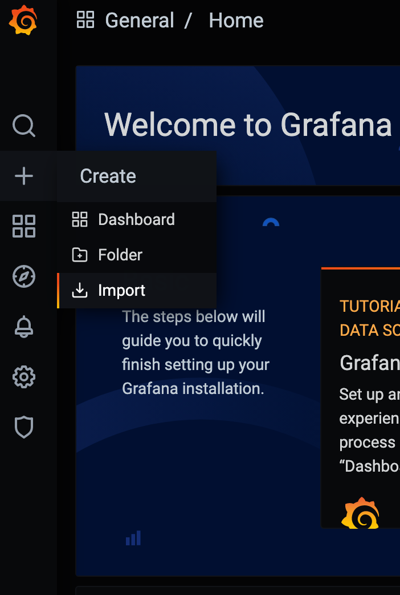
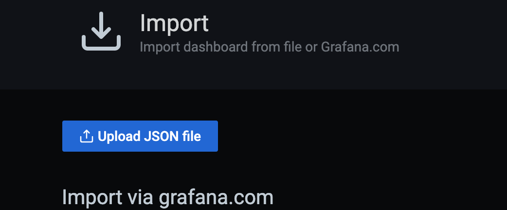
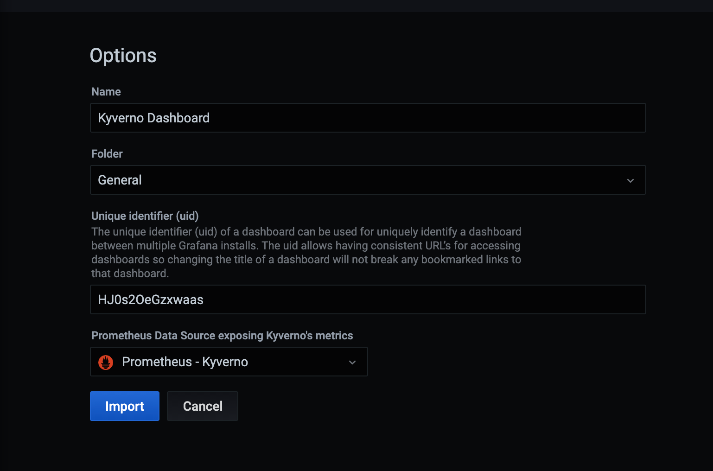
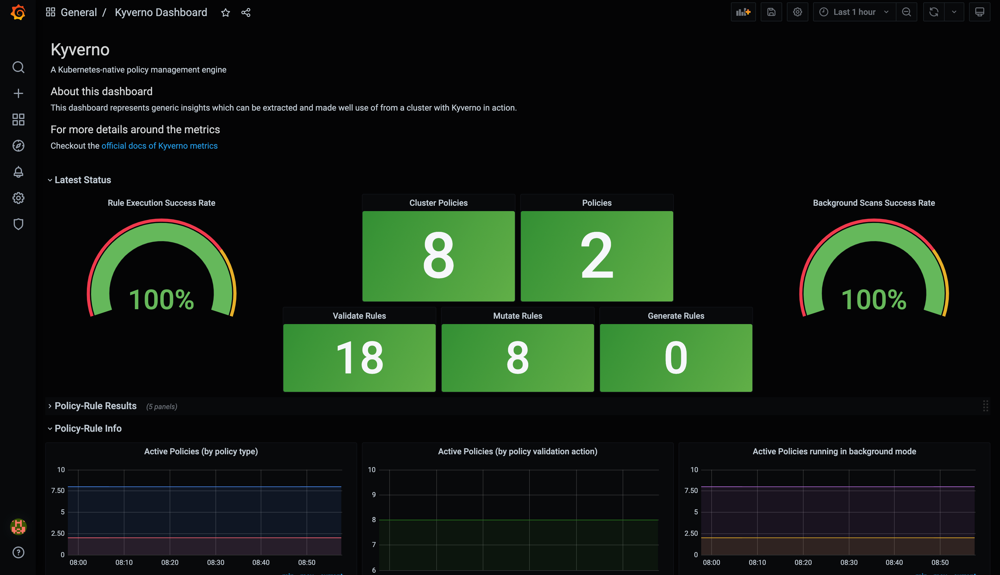
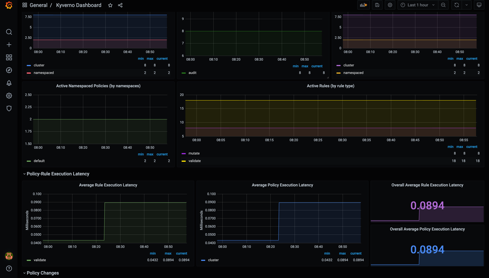

## 소개

클러스터 관리자는 클러스터에 적용된 Kyverno 정책의 상태와 실행을 모니터링하면 도움이 된다. 모니터링 대상에는 정책에 적용된 변경, 들어오는 요청과 관련된 모든 활동, 그 결과로 생기는 모든 결과가 포함된다. 모니터링을 활성화하면 적용된 정책을 시각화하고 알림을 설정할 수 있다. 클러스터 전반의 관찰 가능성과 컴플라이언스에도 꼭 필요한다.

또한 모니터링 대상의 범위를 규칙, 정책, 클러스터 수준 중에서 지정할 수 있으므로, 수집한 메트릭에서 더 세분화된 인사이트를 얻을 수 있다.

## 설치 및 설정

Helm으로 Kyverno를 설치하면 `kyverno` 네임스페이스 안에 포트 8000으로 메트릭을 노출하는 서비스가 추가로 만들어진다.

```sh
$ values.yaml

admissionController:
  metricsService:
    create: true
  # ...

backgroundController:
  metricsService:
    create: true
  # ...

cleanupController:
  metricsService:
    create: true
  # ...

reportsController:
  metricsService:
    create: true
  # ...
```

기본 서비스 유형은 `ClusterIP`이므로, 메트릭은 클러스터 안에 있는 프로메테우스 서버만 스크레이프할 수 있다.

프로메테우스 서버가 공유 서비스로서 워크로드 클러스터 밖에 있는 경우도 있다. 이때는 `kyverno-svc-metrics` 서비스를 외부에 공개해 메트릭(포트 8000)을 외부 프로메테우스 서버에 노출해야 한다.

서비스는 인그레스(Ingress)나 `LoadBalancer`, `NodePort` 서비스 유형으로 외부 클라이언트에 노출할 수 있다.

`kyverno-svc-metrics` 서비스를 호스트(노드)의 8000번 포트로 `NodePort`로 공개하려면, Helm 설치 전에 `values.yaml`을 다음과 같이 구성한다.

```sh
admissionController:
  metricsService:
    create: true
    type: NodePort
    port: 8000
    nodePort: 8000
  # ...

backgroundController:
  metricsService:
    create: true
    type: NodePort
    port: 8000
    nodePort: 8000
  # ...

cleanupController:
  metricsService:
    create: true
    type: NodePort
    port: 8000
    nodePort: 8000
  # ...

reportsController:
  metricsService:
    create: true
    type: NodePort
    port: 8000
    nodePort: 8000
  # ...
```

`kyverno-svc-metrics` 서비스를 `LoadBalancer` 유형으로 노출하려면, Helm 설치 전에 `values.yaml`을 다음과 같이 구성한다.

```sh
admissionController:
  metricsService:
    create: true
    type: LoadBalancer
    port: 8000
    nodePort:
  # ...

backgroundController:
  metricsService:
    create: true
    type: LoadBalancer
    port: 8000
    nodePort:
  # ...

cleanupController:
  metricsService:
    create: true
    type: LoadBalancer
    port: 8000
    nodePort:
  # ...

reportsController:
  metricsService:
    create: true
    type: LoadBalancer
    port: 8000
  nodePort:
  # ...
```

## 메트릭 구성

Helm으로 Kyverno를 설치할 때 노출할 메트릭도 구성할 수 있다. 이 구성은 `kyverno-metrics` 컨피그맵(ConfigMap)에 저장된다.

Helm 차트를 구성할 때 메트릭을 내보낼 네임스페이스를 `include`(포함)하거나 `exclude`(제외)할 수 있다. 테스트나 실험용 네임스페이스처럼 Kyverno 메트릭을 노출하고 싶지 않은 네임스페이스가 있을 때 유용하다. 반대로 핵심 네임스페이스 몇 개의 Kyverno 관련 활동만 모니터링하고 싶다면 해당 네임스페이스만 포함하면 된다. 모든 네임스페이스를 노출하지 않고 필요한 네임스페이스만 내보내면 Kyverno 메트릭 익스포터의 메모리 사용량을 크게 줄일 수 있다. 특정 메트릭의 노출 여부도 설정할 수 있어서, 메트릭을 완전히 비활성화하거나 일부 레이블 차원을 제거할 수 있다. 히스토그램은 기본 버킷 경계를 바꾸거나 특정 메트릭에 대해 따로 구성할 수도 있다.

```yaml

...
metricsConfig:
  # 'namespaces.include': list of namespaces to capture metrics for. Default: all namespaces included.
  # 'namespaces.exclude': list of namespaces to NOT capture metrics for. Default: [], none of the namespaces excluded.
  # `exclude` takes precedence over `include` in cases when a Namespace is provided under both.
  namespaces:
    include: []
    exclude: []

  # Configures the bucket boundaries for all Histogram metrics, the value below is the default.
  bucketBoundaries:
    [0.005, 0.01, 0.025, 0.05, 0.1, 0.25, 0.5, 1, 2.5, 5, 10, 15, 20, 25, 30]

  # Per Metric configuration, allows disabling metrics, dropping labels and change the bucket boundaries.
  # For detailed information about these metrics, see the [Metrics Reference](/docs/reference/metrics)
  metricsExposure:
    # Counter disabled
    # See [Validating Policy Results](/docs/reference/metrics#validating-policy-results) for details
    kyverno_validating_policy_results:
      enabled: false
    # Histogram disabled
    # See [Admission Review Latency](/docs/reference/metrics#admission-review-latency) for details
    kyverno_admission_review_duration_seconds:
      enabled: false
    # Counter with customized dimensions
    # See [Admission Requests Count](/docs/reference/metrics#admission-requests-count) for details
    kyverno_admission_requests:
      disabledLabelDimensions:
        ['resource_namespace', 'resource_kind', 'resource_request_operation']
    # Histogram with custom boundaries and dimensions
    # See [Validating Policy Execution Latency](/docs/reference/metrics#validating-policy-execution-latency) for details
    kyverno_validating_policy_execution_duration_seconds:
      disabledLabelDimensions:
        ['resource_kind', 'resource_namespace', 'resource_request_operation']
      bucketBoundaries: [0.005, 0.01, 0.025]
...
```

## 메트릭 비활성화

일부 메트릭은 데이터를 과도하게 만들어 추가 비용이 드는 경우가 있다. 일부 모니터링 제품과 솔루션은 수집기로 보낼 메트릭을 선택적으로 비활성화하고 나머지는 계속 켜 둘 수 있다.

### Kyverno 구성 쪽

[위](#메트릭-구성)에서 설명했듯이 Kyverno는 `kyverno-metrics` 컨피그맵을 수정해 메트릭 비활성화, 레이블 제거, 버킷 경계 변경을 지원한다. 위 예시를 참고한다.

### DataDog OpenMetrics 쪽

[DataDog OpenMetrics](https://docs.datadoghq.com/integrations/openmetrics/)에서 일부 메트릭을 비활성화하려면 아래와 같이 Kyverno 파드에 어노테이션을 지정한다.

**참고:** 이 메트릭에 대한 자세한 내용은 [메트릭 레퍼런스](/docs/reference/metrics)를 참고한다.

- [`kyverno_admission_requests`](/docs/reference/metrics#admission-requests-count) - 어드미션 요청 수
- [`kyverno_validating_policy_results_total`](/docs/reference/metrics#validating-policy-results) - ValidatingPolicy 결과

```yaml
apiVersion: v1
kind: Pod
metadata:
  annotations:
    ad.datadoghq.com/kyverno.checks: |
      {                                                                                                                                                      
        "openmetrics": {                                                                                                                                     
          "init_config": {},                                                                                                                                 
          "instances": [                                                                                                                                     
            {                                                                                                                                                
              "openmetrics_endpoint": "http://%%host%%:8000/metrics",                                                                                        
              "namespace": "kyverno",                                                                                                                        
              "metrics": [                                                                                                                                   
                {"kyverno_admission_requests": "admission_requests"}
              ],                                                                                                                                             
              "exclude_labels": [                                                                                                                            
                "resource_namespace"                                                                                                                         
              ]                                                                                                                                              
            },                                                                                                                                               
            {                                                                                                                                                
              "openmetrics_endpoint": "http://%%host%%:8000/metrics",                                                                                        
              "namespace": "kyverno",                                                                                                                        
              "metrics": [                                                                                                                                   
                {"kyverno_validating_policy_results": "validating_policy_results"}
              ]                                                                                                                                              
            }                                                                                                                                                
          ]                                                                                                                                                  
        }                                                                                                                                                    
      }
```

Kyverno Helm 차트는 values 파일에서 추가 파드 어노테이션을 지정할 수 있다. 예시는 다음과 같다.

**참고:** 이 메트릭에 대한 자세한 내용은 [메트릭 레퍼런스](/docs/reference/metrics)를 참고한다.

- [`kyverno_admission_requests`](/docs/reference/metrics#admission-requests-count) - 어드미션 요청 수
- [`kyverno_validating_policy_results_total`](/docs/reference/metrics#validating-policy-results) - ValidatingPolicy 결과

```yaml
podAnnotations:
  # https://github.com/DataDog/integrations-core/blob/master/openmetrics/datadog_checks/openmetrics/data/conf.yaml.example
  # Note: To collect counter metrics with names ending in `_total`, specify the metric name without the `_total`
  ad.datadoghq.com/kyverno.checks: |
    {
      "openmetrics": {
        "init_config": {},
        "instances": [
          {
            "openmetrics_endpoint": "http://%%host%%:8000/metrics",
            "namespace": "kyverno",
            "metrics": [
              {"kyverno_admission_requests": "admission_requests"}
            ],
            "exclude_labels": [
              "resource_namespace"
            ]
          },
          {
            "openmetrics_endpoint": "http://%%host%%:8000/metrics",
            "namespace": "kyverno",
            "metrics": [
              {"kyverno_validating_policy_results": "validating_policy_results"}
            ]
          }
        ]
      }
    }
```

## OpenTelemetry 설정

OpenTelemetry를 설정하려면 YAML 파일 몇 개를 구성해야 한다. 필요한 구성은 다음과 같다.

### Cert-Manager 설치

[문서](https://cert-manager.io/docs/installation/)에 따라 Cert-Manager를 설치한다.

### OpenTelemetry 컬렉터 설정 파일

`kyverno` 네임스페이스에 다음 내용으로 `configmap.yaml` 파일을 만든다.

```yaml
apiVersion: v1
kind: ConfigMap
metadata:
  name: collector-config
  namespace: kyverno
data:
  collector.yaml: |
    receivers:
      otlp:
        protocols: 
          grpc:
            endpoint: ":8000"
    processors:
      batch:
        send_batch_size: 10000
        timeout: 5s
    extensions:
      health_check: {}
    exporters:
      jaeger:
        endpoint: "jaeger-collector.observability.svc.cluster.local:14250"
        tls:
          insecure: true
      prometheus:
        endpoint: ":9090"
      logging:
        loglevel: debug
    service:
      extensions: [health_check]
      pipelines:
        traces:
          receivers: [otlp]
          processors: []
          exporters: [jaeger, logging]
        metrics:
          receivers: [otlp]
          processors: [batch]
          exporters: [prometheus, logging]
```

- 여기서 프로메테우스 익스포터 엔드포인트는 9090으로 설정되어 있다. 프로메테우스가 이 엔드포인트에서 서비스를 스크레이프해 메트릭을 수집할 수 있다는 뜻이다.
- 마찬가지로 Jaeger 엔드포인트는 기본 Jaeger 엔드포인트 14250에 있는 Jaeger 컬렉터를 참조한다.

<a id="컬렉터-deployment"></a>

### 컬렉터 디플로이먼트(Deployment)

`kyverno` 네임스페이스에 다음 내용으로 `deployment.yaml` 파일을 만든다.

```yaml
apiVersion: apps/v1
kind: Deployment
metadata:
  name: opentelemetrycollector
  namespace: kyverno
spec:
  replicas: 1
  selector:
    matchLabels:
      app.kubernetes.io/name: opentelemetrycollector
  template:
    metadata:
      labels:
        app.kubernetes.io/name: opentelemetrycollector
    spec:
      containers:
        - name: otelcol
          args:
            - --config=/conf/collector.yaml
          image: otel/opentelemetry-collector:0.50.0
          volumeMounts:
            - name: collector-config
              mountPath: /conf
      volumes:
        - configMap:
            name: collector-config
            items:
              - key: collector.yaml
                path: collector.yaml
          name: collector-config
```

이 디플로이먼트는 위 `configmap.yaml`에 정의한 컬렉터를 참조한다. 여기서는 레플리카가 하나뿐인 디플로이먼트를 사용하지만, 데몬셋(DaemonSet)이 더 바람직하다. 다른 배포 전략은 [OpenTelemetry 문서](https://opentelemetry.io/docs/instrumentation/go/getting-started)를 참고한다.

### 컬렉터 서비스

마지막으로 `kyverno` 네임스페이스에 다음 내용으로 `service.yaml` 파일을 만든다.

```yaml
apiVersion: v1
kind: Service
metadata:
  name: opentelemetrycollector
  namespace: kyverno
spec:
  ports:
    - name: otlp-grpc
      port: 8000
      protocol: TCP
      targetPort: 8000
    - name: metrics
      port: 9090
      protocol: TCP
      targetPort: 9090
  selector:
    app.kubernetes.io/name: opentelemetrycollector
  type: ClusterIP
```

컬렉터 디플로이먼트를 찾을 수 있도록 하는 서비스를 정의한다.

### Kyverno 설정과 필수 플래그 전달

Kyverno [설치 안내](/docs/installation/installation)를 참고한다. 사용하는 방법에 따라 다음 플래그를 전달해야 한다.

- `metricsPort` 플래그를 전달해 메트릭 수집용 OpenTelemetry 컬렉터 엔드포인트를 지정한다.
- `otelConfig=grpc` 플래그를 전달하면 메트릭과 트레이스를 메트릭 포트 엔드포인트의 OpenTelemetry 컬렉터로 내보낸다.

### Kyverno와 컬렉터 간 보안 연결 설정

Kyverno는 서버 측(컬렉터)에서 TLS를 사용해 OpenTelemetry 익스포터와 보안 연결을 설정하는 것도 지원한다. 이를 위해 개인 CA로 OpenTelemetry 컬렉터용 인증서-키 쌍을 만든 다음, 인증서를 Kyverno 네임스페이스의 시크릿에 `ca.pem`이라는 키로 저장해야 한다.

`server.pem`, `server-key.pem`, `ca.pem` 파일이 이미 있다고 가정한다(OpenSSL이나 cfssl 같은 도구로 만들 수 있다). 이에 맞춰 OpenTelemetry의 `configmap.yaml`과 `deployment.yaml` 파일도 달라진다.

`configmap.yaml`

```yaml
apiVersion: v1
kind: ConfigMap
metadata:
  name: collector-config
  namespace: kyverno
data:
  collector.yaml: |
    receivers:
      otlp:
        protocols: 
          grpc:
            endpoint: ":8000"
            tls:
              cert_file: /etc/ssl/certs/server/server.pem
              key_file: /etc/ssl/certs/server/server-key.pem
              ca_file: /etc/ssl/certs/ca/ca.pem
    processors:
      batch:
        send_batch_size: 10000
        timeout: 5s
    extensions:
      health_check: {}
    exporters:
      jaeger:
        endpoint: "jaeger-collector.observability.svc.cluster.local:14250"
        tls:
          insecure: true
      prometheus:
        endpoint: ":9090"
      logging:
        loglevel: debug
    service:
      extensions: [health_check]
      pipelines:
        traces:
          receivers: [otlp]
          processors: []
          exporters: [jaeger, logging]
        metrics:
          receivers: [otlp]
          processors: [batch]
          exporters: [prometheus, logging]
```

`deployment.yaml`

```yaml
apiVersion: apps/v1
kind: Deployment
metadata:
  name: opentelemetrycollector
  namespace: kyverno
spec:
  replicas: 1
  selector:
    matchLabels:
      app.kubernetes.io/name: opentelemetrycollector
  template:
    metadata:
      labels:
        app.kubernetes.io/name: opentelemetrycollector
    spec:
      containers:
        - name: otelcol
          args:
            - --config=/conf/collector.yaml
          image: otel/opentelemetry-collector:0.50.0
          volumeMounts:
            - name: collector-config
              mountPath: /conf
            - name: otel-collector-secrets
              mountPath: /etc/ssl/certs/server
            - name: root-ca
              mountPath: /etc/ssl/certs/ca
      volumes:
        - configMap:
            name: collector-config
            items:
              - key: collector.yaml
                path: collector.yaml
          name: collector-config
        - secret:
            secretName: otel-collector-secrets
          name: otel-collector-secrets
        - secret:
            secretName: root-ca
          name: root-ca
```

이렇게 하면 OpenTelemetry 컬렉터가 리시버 엔드포인트에서 암호화된 데이터만 받을 수 있다.

`ca.pem` 파일이 들어 있는 시크릿의 이름을 `transportCreds` 플래그로 전달한다(빈 문자열이면 비보안 연결을 사용한다).

### Prometheus 설정

- 메트릭 백엔드로 클러스터에 프로메테우스를 설치할 수 있다. 일반적인 예시로 바로 쓸 수 있는 구성을 제공한다. 다음을 실행해 프로메테우스를 설치한다.

```sh
kubectl apply -k github.com/kyverno/grafana-dashboard/examples/prometheus
```

- 프로메테우스 서비스를 포트 포워딩하면 localhost에서 메트릭을 볼 수 있다.

```sh
kubectl port-forward svc/prometheus-server 9090:9090 -n kyverno
```

### Jaeger 설정

트레이스는 포트 14250의 Jaeger 백엔드로 전송된다. Jaeger를 설치하는 방법은 다음과 같다.

먼저 Jaeger Operator를 설치한다. 버전은 필요에 맞게 바꾼다.

```sh
kubectl create namespace observability
kubectl create -n observability -f https://github.com/jaegertracing/jaeger-operator/releases/download/v1.33.0/jaeger-operator.yaml
kubectl wait --for=condition=Available deployment --timeout=2m -n observability --all
```

아래와 같이 Jaeger 리소스 구성을 만든다.

`jaeger.yaml`

```yaml
apiVersion: jaegertracing.io/v1
kind: Jaeger
metadata:
  name: jaeger
  namespace: observability
```

Jaeger 백엔드를 설치한다.

```sh
kubectl create -f jaeger.yaml
```

Jaeger 서비스를 16686 포트로 포트 포워딩하면 트레이스를 볼 수 있다.

```sh
kubectl port-forward svc/jaeger-query 16686:16686 -n observability
```

## Grafana 대시보드

### 설정

#### Helm 차트 사용

- Grafana에 디스커버리 사이드카가 구성되어 있다면 `grafana.enabled` 값을 `true`로 설정한다.
- Grafana Operator를 쓴다면 `grafana.enabled`를 `true`로, `grafana.grafanaDashboard.enabled` 값도 `true`로 설정한다.

더 많은 구성 옵션은 [여기](https://github.com/kyverno/kyverno/tree/main/charts/kyverno#grafana)를 참고한다.

#### Helm 차트 없이 사용

- 대시보드 JSON을 내려받아 `kyverno-dashboard.json`으로 저장한다.

```sh
curl -fsS https://raw.githubusercontent.com/kyverno/kyverno/main/charts/kyverno/charts/grafana/dashboard/kyverno-dashboard.json -o kyverno-dashboard.json
```

- Grafana 포털을 열고 대시보드 가져오기 옵션으로 이동한다.



- "Upload JSON file" 버튼에서 첫 단계에서 받은 `kyverno-dashboard.json`을 선택하고 Import를 클릭한다.



- 원하는 대로 필드를 구성하고 Import를 클릭한다.



- 그러면 대시보드가 준비된다.





### 튜토리얼

```sh
kind create cluster
```

Helm 저장소를 추가한다.

```sh
helm repo add prometheus-community https://prometheus-community.github.io/helm-charts
helm repo add kyverno https://kyverno.github.io/kyverno/
```

Helm 저장소를 업데이트한다.

```sh
helm repo update
```

Kyverno와 kube-prometheus-stack Helm 차트를 설치한다.

```sh
helm install kyverno kyverno/kyverno --namespace kyverno --create-namespace
helm install monitoring prometheus-community/kube-prometheus-stack -n monitoring --create-namespace

kubectl -n monitoring get po -l "release"
```

ServiceMonitor 리소스를 만든다.

다음 내용을 `service-monitor.yaml`이라는 파일에 추가한다.

```yaml
apiVersion: monitoring.coreos.com/v1
kind: ServiceMonitor
metadata:
  labels:
    app.kubernetes.io/instance: monitoring
    chart: kube-prometheus-stack-51.2.0
    heritage: Helm
    release: monitoring
  name: service-monitor-kyverno-service
  namespace: monitoring
spec:
  endpoints:
    - interval: 60s
      path: /metrics
      scheme: http
      targetPort: 8000
      tlsConfig:
        insecureSkipVerify: true
  namespaceSelector:
    matchNames:
      - kyverno
  selector:
    matchLabels:
      app.kubernetes.io/instance: kyverno
```

적절한 레이블을 추가한다.

```sh
kubectl label ns kyverno app.kubernetes.io/instance=kyverno
kubectl label ns kyverno app.kubernetes.io/name=kyverno
```

ServiceMonitor를 만든다.

```sh
kubectl apply -f service-monitor.yaml
```

`monitoring` 네임스페이스의 디플로이먼트와 스테이트풀셋(StatefulSet)을 재시작한다.

```sh
kubectl rollout restart deploy,sts -n monitoring
```

`monitoring` 네임스페이스의 서비스를 확인한다.

```sh
kubectl get svc -n monitoring

NAME                                      TYPE        CLUSTER-IP      EXTERNAL-IP   PORT(S)                      AGE
monitoring-kube-prometheus-prometheus     ClusterIP   10.96.238.189   <none>        9090/TCP,8080/TCP            4h16m
```

`monitoring-kube-prometheus-prometheus` 서비스를 로컬 포트로 포트 포워딩한다.

```sh
kubectl port-forward svc/monitoring-kube-prometheus-prometheus 81:9090 -n monitoring

Forwarding from 127.0.0.1:81 -> 9090
Forwarding from [::1]:81 -> 9090
```

마찬가지로 `monitoring-grafana` 서비스를 다른 로컬 포트로 포트 포워딩한다.

```sh
kubectl get svc -n monitoring

NAME                                      TYPE        CLUSTER-IP      EXTERNAL-IP   PORT(S)                      AGE
monitoring-grafana                        ClusterIP   10.96.188.20    <none>        80/TCP                       4h19m

kubectl port-forward svc/monitoring-grafana -n monitoring 82:3000

Forwarding from 127.0.0.1:82 -> 3000
Forwarding from [::1]:82 -> 3000
```

포트 9090의 프로메테우스로 가서 Status -> Targets에서 kyverno로 필터링해 메트릭이 스크레이프되고 있는지 확인한다.

포트 3000의 Grafana로 가서 Dashboards -> New -> import에서 아래 명령으로 받은 파일을 업로드하고 Data type을 프로메테우스로 지정한 뒤 import한다.

```sh
curl https://raw.githubusercontent.com/kyverno/grafana-dashboard/master/grafana/dashboard.json -o kyverno-dashboard.json
```

## 알림

Kyverno는 선택 사항인 `PrometheusRule` 리소스로 알림을 지원한다. [prometheus-operator](https://github.com/prometheus-operator/prometheus-operator)가 설치되어 있어야 하며, `serviceMonitor.enabled`와 같은 전제 조건이다. 위 [튜토리얼](#튜토리얼)을 따라 했다면 kube-prometheus-stack에 이미 포함되어 있다.

### PrometheusRule

리소스를 활성화하고 `values.yaml`의 `prometheusRule.spec`에 알림 규칙을 지정한다. `additionalLabels`는 프로메테우스 인스턴스의 `ruleSelector`와 일치해야 한다(kube-prometheus-stack에서는 보통 `release: prometheus`이다).

```yaml
prometheusRule:
  enabled: true
  additionalLabels:
    release: prometheus
  spec:
    - name: kyverno.admission
      rules:
        - alert: KyvernoAdmissionHighLatency
          expr: |
            histogram_quantile(0.99,
              sum(rate(kyverno_admission_review_duration_seconds_bucket[5m])) by (le)
            ) > 1
          for: 5m
          labels:
            severity: warning
          annotations:
            summary: Kyverno admission review p99 latency is elevated
            description: >-
              Admission review p99 latency is {{ $value | humanizeDuration }},
              above the 1s threshold. Kubernetes webhooks hard-timeout at 10s.
            runbook_url: https://kyverno.io/docs/guides/monitoring/#admission-latency-high
```

주석 처리된 추가 예시 규칙은 차트의 `values.yaml`에 있는 `prometheusRule.spec` 아래에 있다. 임계값은 환경에서 측정한 기준선에 맞게 조정해야 한다. 시작점으로는 [공개된 벤치마크](https://kyverno.io/docs/installation/scaling/)를 참고한다.

### 주요 메트릭

| 메트릭                                                 | 유형      | 설명                                                                                                     |
| ------------------------------------------------------ | --------- | -------------------------------------------------------------------------------------------------------- |
| `kyverno_admission_review_duration_seconds`            | Histogram | 엔드투엔드 어드미션 리뷰 지연 시간(모든 정책 합산)                                                       |
| `kyverno_validating_policy_execution_duration_seconds` | Histogram | `policy_name` 레이블이 붙는 ValidatingPolicy 평가 지연 시간                                              |
| `kyverno_admission_requests_total`                     | Counter   | 전체 어드미션 요청 수. `resource_kind`, `resource_request_operation`, `request_allowed` 레이블이 붙는다 |
| `kyverno_validating_policy_results_total`              | Counter   | ValidatingPolicy 결과. `result`와 `execution_cause` 레이블이 붙는다                                    |

두 히스토그램 메트릭 모두 `_bucket`, `_sum`, `_count` 시리즈를 노출하므로 `histogram_quantile`을 쓸 수 있다.

### 알림 런북 {#alerting-runbook}

#### 어드미션 지연 시간 높음 {#admission-latency-high}

**증상:** p99 어드미션 리뷰 처리 시간이 5분 넘게 임계값을 초과한다.

**가능한 원인:**

- 어드미션 요청량 급증(`sum(rate(kyverno_admission_requests_total[5m]))`로 확인)
- 최근 정책 수나 복잡도 증가(설치된 정책과 최근 GitOps 변경 사항 점검)
- Kyverno 파드의 리소스 부족(CPU 스로틀링과 메모리 압박 확인)
- 외부 데이터 소스 호출(글로벌 컨텍스트 항목, API 호출)로 인한 지연

**진단:**

```sh
kubectl exec -n kyverno deploy/kyverno -c kyverno -- \
  curl -s localhost:8000/metrics | grep admission_review_duration
kubectl top pod -n kyverno
kubectl get events -n kyverno --sort-by='.lastTimestamp' | tail -20
```

**완화 방법:**

1. CPU가 병목이면 `admissionController.resources.limits.cpu`를 늘리고 레플리카를 확장한다.
2. 정책 복잡도가 병목이면 최근 추가한 정책을 검토하고, 급하지 않은 검증 규칙은 백그라운드 모드로 옮기는 방안을 고려한다.
3. 쿠버네티스 타임아웃에 근접하면 [임시 비활성화 런북](https://kyverno.io/docs/operational-runbook/)에 따라 조사하는 동안 적용 범위를 줄인다.

#### 정책 실행 지연 시간 높음 {#policy-execution-latency-high}

**증상:** p99 규칙별 실행 시간이 5분 넘게 임계값을 초과한다.

**가능한 원인:**

- 큰 컨텍스트를 쓰는 복잡한 CEL 표현식
- 글로벌 컨텍스트 항목 가져오기(규칙 평가마다 외부 API 호출)

**진단:**

```sh
kubectl exec -n kyverno deploy/kyverno -c kyverno -- \
  curl -s localhost:8000/metrics | grep -E '(validating|mutating|generating|image_validating)_policy_execution_duration'
```

**완화 방법:**

1. `policy_name` 레이블과 정책별 실행 메트릭으로 해당 정책을 찾는다.
2. [GeneratingPolicy](/docs/policy-types/generating-policy)는 리소스 매칭과 기존 리소스 생성 설정을 검토한다.
3. 외부 조회를 쓰는 [MutatingPolicy](/docs/policy-types/mutating-policy)는 컨텍스트 데이터를 캐시하거나, 적절하다면 백그라운드 처리로 옮긴다.
