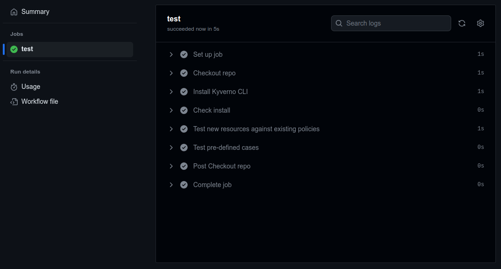
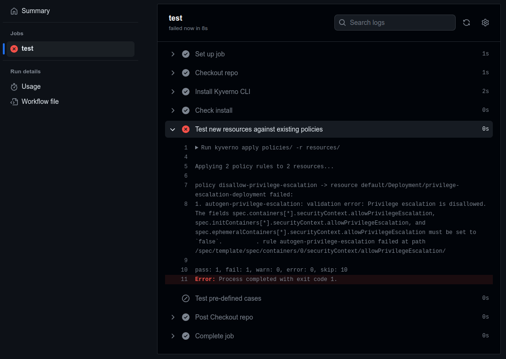

:::tip[팁]
[Kyverno CLI `test` 명령](/docs/kyverno-cli/reference/kyverno_test)으로 정책이 기대한 대로 동작하는지 테스트할 수 있다.

자세한 내용은 [`test` 명령 문서](/docs/kyverno-cli/reference/kyverno_test)를 참고한다. [샘플 정책 저장소](https://github.com/kyverno/policies)에서 예시도 볼 수 있다.
:::

## 지속적 통합

Kyverno CLI를 사용하면 지속적 통합(CI) 파이프라인에서 Kyverno 정책을 테스트할 수 있다. CI 연동의 주된 유스케이스는 두 가지이다.

첫 번째는 YAML 파일로 정의한 쿠버네티스 리소스를 실제 클러스터에 적용하기 전에 Kyverno 정책으로 테스트해 결과를 확인하는 경우이다. 리소스를 검사할 정책은 알지만 리소스는 미리 알 수 없을 때 유용하다. 예를 들어 개발 팀이 직접 매니페스트를 작성해 git 저장소에 푸시하고, 이 저장소에서 실행 중인 쿠버네티스 환경으로 배포한다고 하자. 이때 [풀 리퀘스트](https://www.pagerduty.com/resources/learn/what-is-a-pull-request/) 같은 시점에 풀 리퀘스트에 포함된 리소스에 정책을 적용하고 결과를 확인하는 식으로 테스트를 실행할 수 있다. 검증 규칙에서 테스트가 실패하면 그 리소스가 클러스터에 들어올 때 거부될 수 있다는 뜻이다. 테스트가 하나라도 실패하면 전체 파이프라인이 실패하므로, 문제를 일찍 드러내 사용자가 배포 과정의 앞 단계에서 수정할 수 있다.

두 번째는 정책과 리소스의 조합이 항상 미리 정해 둔 결과를 내는지 확인하는 경우이다. 정책이나 리소스를 전략적으로 수정할 때, 또는 클러스터를 업그레이드하기 전에 이후 버전의 Kyverno를 시험할 때 유용하다. 예를 들어 운영 팀은 표준 플랫폼 서비스가 항상 클러스터에 생성될 수 있도록, 통과해야 한다고 선언한 Kyverno 테스트 매니페스트를 정의할 수 있다. YAML 매니페스트로 표현한 이 서비스들은 새 이미지 버전이 나오는 등의 상황에서 의도적으로 바뀔 수 있다. 같은 테스트를 실행하면 기대 결과와 실제 결과를 비교할 수 있다. 차이가 있으면 테스트가 실패하므로 운영 팀은 어느 테스트가 실패했는지 알고, 클러스터를 변경하기 전에 문제를 해결할 수 있다.

### GitHub Actions

[GitHub Actions](https://github.com/features/actions)는 GitHub에 호스팅된 저장소를 위한 CI 시스템이다. CI 과정의 워크플로로 Kyverno 정책 테스트를 실행할 수 있다.

다음은 더 큰 CI 파이프라인의 일부로 쓸 수 있는 간단한 GitHub Actions 워크플로 예시이다. 저장소 구조는 다음과 같다고 가정한다.

```
.
├── .github
│   └── workflows
│       └── kyverno.yaml
├── README.md
├── policies
│   ├── disallow-privilege-escalation.yaml
│   └── disallow-privileged-containers.yaml
├── resources
│   ├── configmap.yaml
│   └── deployment.yaml
└── tests
    ├── require_labels
    │   ├── kyverno-test.yaml
    │   ├── require_labels.yaml
    │   └── resource.yaml
    └── restrict_image_registries
        ├── kyverno-test.yaml
        ├── resource.yaml
        └── restrict_image_registries.yaml
```

저장소에는 `policies/`에 Kyverno 정책, `resources/`에 쿠버네티스 리소스 매니페스트, `tests/`에 완성된 Kyverno 테스트 케이스가 있다. 샘플 워크플로를 `.github/workflows/kyverno.yaml` 경로에 아래 내용으로 추가하면, 풀 리퀘스트가 열릴 때와 저장소에서 수동으로 트리거할 때 다음 작업을 수행한다.

1. 저장소를 체크아웃한다.
2. 특정 버전을 지정해 Kyverno CLI용 GitHub 액션을 다운로드한다. 이 버전을 바꾸면 Kyverno 업그레이드가 클러스터에 미칠 영향을 시뮬레이션할 수 있다. Kyverno CLI용 GitHub 액션은 [kyverno-cli-installer](https://github.com/marketplace/actions/kyverno-cli-installer)를 참고한다.
3. Kyverno CLI 버전을 확인한다.
4. `resources/`의 미확인 매니페스트를 `policies/`에 저장된 기존 정책으로 테스트한다.
5. `tests/`에 저장된 사전 정의 테스트 케이스를 테스트한다. 이 케이스는 폴더별로 Kyverno 테스트 매니페스트, 정책, 리소스로 나뉘어 있다.

```yaml
name: kyverno-policy-test
on:
  - pull_request
  - workflow_dispatch
jobs:
  test:
    runs-on: ubuntu-latest
    permissions:
      contents: read
    steps:
      - name: Checkout repo
        uses: actions/checkout@v4
      - name: Install Kyverno CLI
        uses: kyverno/action-install-cli@v0.2.0
        with:
          release: 'v1.19.0'
      - name: Check install
        run: kyverno version
      - name: Test new resources against existing policies
        run: kyverno apply policies/ -r resources/
      - name: Test pre-defined cases
        run: kyverno test tests/
```

이 파일이 있는 저장소에 풀 리퀘스트가 올라오면 GitHub Actions 워크플로가 트리거된다. 모든 테스트가 성공하면 모든 단계가 성공으로 표시된다.



각 단계를 펼치면 전체 출력을 볼 수 있다.

예를 들어 `policies/`에 정의된 정책을 하나 이상 위반하는 새 매니페스트가 `resources/`에 추가되는 등 풀 리퀘스트가 작업의 어느 단계에서든 실패하면 파이프라인이 중단되고 전체 실행이 실패한다.



이번에도 각 단계의 출력을 확인할 수 있다. 위 스크린샷에서는 디플로이먼트(Deployment) 매니페스트가 검증 정책을 통과하지 못해 전체 실행이 실패했다.

Kyverno CLI의 전체 사용법은 [문서](/docs/subprojects/kyverno-cli)를 참고한다.
