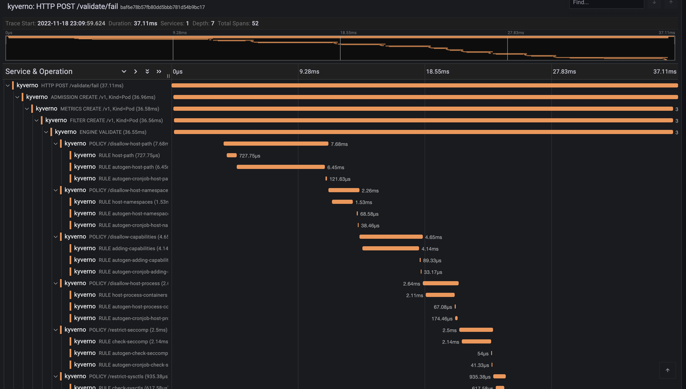
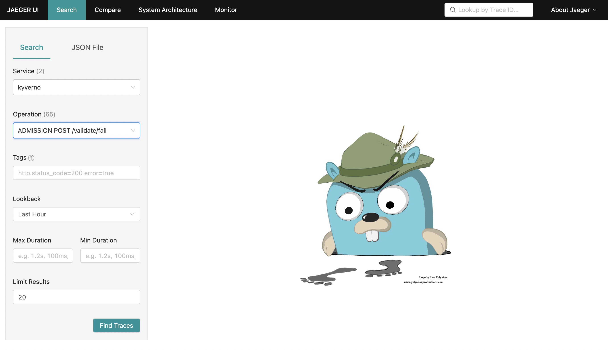
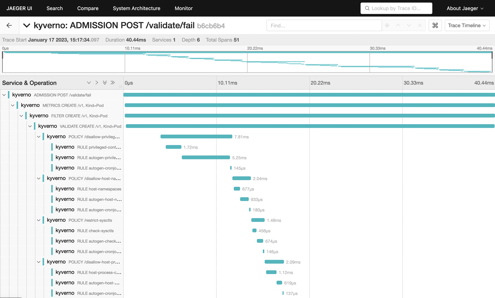
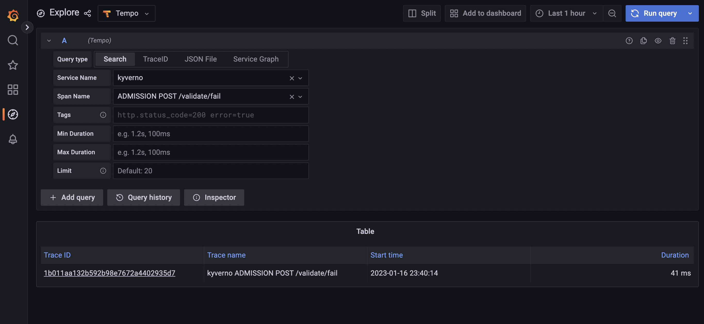
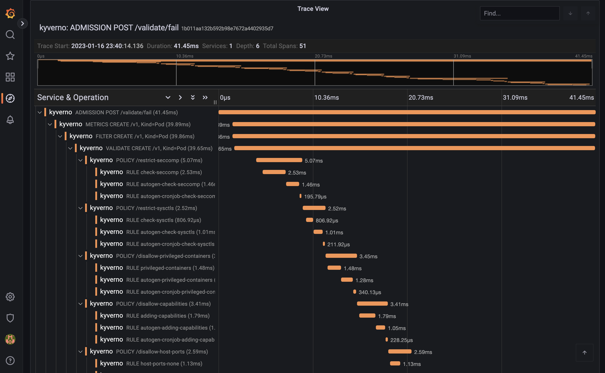

## 소개

트레이싱은 애플리케이션이 요청을 처리하는 과정을 추적하는 방법이다. 소프트웨어에 계측(instrumentation)을 적용하면 트레이스가 만들어지고, 트레이스는 계층 구조로 구성된 스팬(span)으로 이루어진다. 스팬은 시작 시각과 종료 시각, 경우에 따라 부모 스팬, 그리고 스팬의 특성(클라이언트 스팬, 서버 스팬 등)을 정의하는 여러 속성으로 구성된다.

트레이싱은 단일 애플리케이션에 국한되지 않는다. 트레이싱 컨텍스트를 네트워크로 전달할 수 있으므로 여러 애플리케이션에서 스팬을 수집해 하나의 트레이스로 합칠 수 있다.

Kyverno에서는 보통 어드미션 단계에서 쿠버네티스 API 서버가 Kyverno 서비스로 요청을 보낸다. Kyverno는 구성된 정책에 따라 어드미션 요청을 받아 처리한다. 어드미션 파이프라인의 모든 단계와 엔진의 정책 처리 과정에서 스팬이 만들어진다. 모든 클라이언트(쿠버네티스 클라이언트, 레지스트리 클라이언트, cosign 클라이언트)도 클라이언트 스팬을 만들고 트레이싱 컨텍스트를 네트워크로 전달하도록 계측되어 있다.

## 트레이스 예시

다음은 validating 어드미션 요청의 트레이스이다.



## 설치 및 설정

트레이싱에는 Kyverno가 트레이스를 보낼 백엔드가 필요하다. Kyverno는 계측에 OpenTelemetry를 사용하며 [Jaeger](https://www.jaegertracing.io/), [Grafana Tempo](https://grafana.com/oss/tempo/), [Datadog](https://docs.datadoghq.com/tracing/) 등 다양한 백엔드를 지원한다.

Helm으로 Kyverno를 설치할 때 트레이싱을 켜려면 몇 가지 값을 설정해야 한다.

```shell
$ values.yaml

# ...

# Enable tracing in the admission controller
admissionController:
  tracing:
    # -- Enable tracing
    enabled: true
    # -- Traces receiver address
    address: <backend url>
    # -- Traces receiver port
    port: 4317

# ...

# Enable tracing in the background controller
backgroundController:
  tracing:
    # -- Enable tracing
    enabled: true
    # -- Traces receiver address
    address: <backend url>
    # -- Traces receiver port
    port: 4317

# ...

# Enable tracing in the cleanup controller
cleanupController:
  tracing:
    # -- Enable tracing
    enabled: true
    # -- Traces receiver address
    address: <backend url>
    # -- Traces receiver port
    port: 4317

# ...

# Enable tracing in the reports controller
reportsController:
  tracing:
    # -- Enable tracing
    enabled: true
    # -- Traces receiver address
    address: <backend url>
    # -- Traces receiver port
    port: 4317

# ...
```

트레이싱은 기본으로 꺼져 있으며, 백엔드에 따라 관련 비용이 상당할 수 있다.

현재 Kyverno 트레이싱은 들어오는 모든 요청을 샘플링하도록 구성되어 있고, Kyverno에서 트레이싱 샘플러를 직접 설정할 방법은 없다. 더 나은 샘플링 결정이 필요하다면 [OpenTelemetry Collector](https://opentelemetry.io/docs/collector/)를 쓸 수 있지만, 그만큼 설정이 복잡해진다.

## Jaeger로 트레이싱하기

이 안내에서는 로컬 클러스터를 만들고 [ingress-nginx](https://github.com/kubernetes/ingress-nginx) 인그레스 컨트롤러, 트레이스를 저장·조회·시각화하는 [Jaeger](https://www.jaegertracing.io) 등 여러 컴포넌트를 배포한다.

준비한 클러스터에 트레이싱을 켠 Kyverno와 정책 몇 개를 배포한다.

마지막으로 파드를 만들어 Kyverno 웹훅을 동작시킨 뒤, Jaeger에서 해당 트레이스를 찾아 살펴본다.

**이 안내는 [kind](https://kind.sigs.k8s.io)로 로컬 클러스터를 만들며**, 컨트롤 플레인 노드에 특정 레이블을 붙인다.
kind에서 동작하도록 만든 [ingress-nginx](https://github.com/kubernetes/ingress-nginx) 배포를 쓰기 때문에 필요한 설정이다.
나머지 컴포넌트 설정은 kind에 한정되지 않지만, 대상 클러스터에 따라 구성이 달라질 수 있다.

### 클러스터 설정

첫 단계로 [kind](https://kind.sigs.k8s.io)로 로컬 클러스터를 만든다.

만들어지는 클러스터에는 마스터 노드 하나와 워커 노드 하나, 총 두 노드가 있다.
마스터 노드는 호스트의 `80`번과 `443`번 포트를 컨테이너 노드에 매핑한다.
이 포트를 이미 사용 중이라면 아래 구성 매니페스트의 `hostPort` 항목을 수정해 바꿀 수 있다.

로컬 클러스터를 만들려면 다음 명령을 실행한다.

```shell
kind create cluster --config - <<EOF
kind: Cluster
apiVersion: kind.x-k8s.io/v1alpha4
nodes:
  - role: control-plane
    kubeadmConfigPatches:
      - |-
        kind: InitConfiguration
        nodeRegistration:
          kubeletExtraArgs:
            node-labels: "ingress-ready=true"
    extraPortMappings:
      - containerPort: 80
        hostPort: 80
        protocol: TCP
      - containerPort: 443
        hostPort: 443
        protocol: TCP
  - role: worker
EOF
```

### Ingress NGINX 설정

브라우저에서 Grafana에 접속하려면 인그레스 컨트롤러를 배포해야 한다.

다음 명령으로 [ingress-nginx](https://github.com/kubernetes/ingress-nginx)를 설치한다.

```shell
kubectl apply -f https://raw.githubusercontent.com/kubernetes/ingress-nginx/main/deploy/static/provider/kind/deploy.yaml
sleep 15
kubectl wait --namespace ingress-nginx --for=condition=ready pod --selector=app.kubernetes.io/component=controller --timeout=90s
```

### Jaeger 설정

[Jaeger](https://www.jaegertracing.io)로 트레이스를 저장하고 검색하고 시각화한다.

Jaeger는 여러 컴포넌트로 구성되며 Elasticsearch, Cassandra 등 다양한 저장소를 쓸 수 있다. 이 튜토리얼에서는 올인원 버전의 Jaeger를 배포하고 메모리에 저장한다.

다음 명령으로 Helm을 사용해 Jaeger를 배포한다.

```shell
helm install jaeger --namespace monitoring --create-namespace --wait \
  --repo https://jaegertracing.github.io/helm-charts jaeger \
  --values - <<EOF
storage:
  type: none
provisionDataStore:
  cassandra: false
agent:
  enabled: false
collector:
  enabled: false
query:
  enabled: false
allInOne:
  enabled: true
  ingress:
    enabled: true
    hosts:
      - localhost
EOF
```

이제 http://localhost 에서 Jaeger UI에 접속할 수 있다.

### Kyverno 설정

이제 트레이싱을 켜고 Jaeger 컬렉터를 가리키도록 Kyverno를 설치한다.

다음 명령으로 Helm을 사용해 Kyverno를 배포한다.

```shell
helm install kyverno --namespace kyverno --create-namespace --wait \
  --repo https://kyverno.github.io/kyverno kyverno \
  --values - <<EOF
admissionController:
  tracing:
    # enable tracing
    enabled: true
    # jaeger backend url
    address: jaeger-collector.monitoring
    # jaeger backend port for opentelemetry traces
    port: 4317

backgroundController:
  tracing:
    # enable tracing
    enabled: true
    # jaeger backend url
    address: jaeger-collector.monitoring
    # jaeger backend port for opentelemetry traces
    port: 4317

cleanupController:
  tracing:
    # enable tracing
    enabled: true
    # jaeger backend url
    address: jaeger-collector.monitoring
    # jaeger backend port for opentelemetry traces
    port: 4317

reportsController:
  tracing:
    # enable tracing
    enabled: true
    # jaeger backend url
    address: jaeger-collector.monitoring
    # jaeger backend port for opentelemetry traces
    port: 4317
EOF
```

### Kyverno 정책 설정

마지막으로 Kyverno가 어드미션 웹훅을 알맞게 구성할 수 있도록 클러스터에 정책을 배포한다.

다음 [ValidatingPolicy](/docs/policy-types/validating-policy)를 `disallow-privileged-containers.yaml`로 저장한다. `validationActions: [Deny]` 설정은 어드미션 중에 검증을 강제한다.

```yaml
apiVersion: policies.kyverno.io/v1
kind: ValidatingPolicy
metadata:
  name: disallow-privileged-containers
spec:
  validationActions: [Deny]
  matchConstraints:
    resourceRules:
      - apiGroups: ['']
        apiVersions: ['v1']
        operations: ['CREATE', 'UPDATE']
        resources: ['pods', 'pods/ephemeralcontainers']
  validations:
    - expression: >-
        (object.spec.containers
          + object.spec.?initContainers.orValue([])
          + object.spec.?ephemeralContainers.orValue([])).all(container,
          !has(container.securityContext) ||
          !has(container.securityContext.privileged) ||
          !container.securityContext.privileged)
      message: Privileged containers are not allowed.
```

클러스터에 정책을 적용한다.

```shell
kubectl apply -f disallow-privileged-containers.yaml
```

### 파드를 만들고 해당 트레이스 확인하기

준비가 끝났으니 파드를 만들어 Kyverno 어드미션 웹훅을 동작시키고, Jaeger에서 해당 트레이스를 찾는다.

다음 명령으로 파드를 만든다.

```shell
kubectl run nginx --image=nginx
```

이어서 [Jaeger UI](http://localhost)로 이동해 다음 조건으로 트레이스를 검색한다.

- Service: `kyverno`. 모든 트레이스에는 서비스 이름이 있으며, Kyverno에서 오는 트레이스는 모두 `kyverno` 서비스 이름을 쓴다.
- Operation: `ADMISSION POST /validate/fail`. 모든 스팬에는 스팬 이름이 있고, Kyverno가 어드미션 요청을 받을 때 만드는 루트 스팬의 이름은 HTTP 작업과 경로로 정해진다(`ADMISSION <HTTP OPERATION> <HTTP PATH>`). `/validate/fail` 경로는 오류가 나면 어드미션 요청을 실패시키도록 구성된 validating 웹훅이라는 뜻이다. 실패 모드(fail mode)가 기본값이다.

목록에 앞서 만든 파드 생성 요청의 트레이스가 나타난다.



트레이스를 클릭하면 파드 어드미션 요청이 거친 모든 스팬을 보여 주는 트레이스 상세 화면으로 이동한다.



트레이스에는 방금 설치한 모든 정책의 개별 스팬이 나타나고, 검사한 모든 규칙(평가까지 이루어졌다고는 할 수 없음)마다 자식 스팬이 있다. 모든 스팬의 합은 트레이스 시간, 즉 Kyverno가 파드 어드미션 요청을 처리하는 데 쓴 전체 시간과 같다.

## Grafana Tempo로 트레이싱하기

이 안내에서는 로컬 클러스터를 만들고 [ingress-nginx](https://github.com/kubernetes/ingress-nginx) 인그레스 컨트롤러, [Grafana](https://grafana.com/grafana), 트레이스를 저장하는 [Tempo](https://grafana.com/oss/tempo) 백엔드 등 여러 컴포넌트를 배포한다.

준비한 클러스터에 트레이싱을 켠 Kyverno와 정책 몇 개를 배포한다.

마지막으로 파드를 만들어 Kyverno 웹훅을 동작시킨 뒤, Grafana에서 해당 트레이스를 찾아 살펴본다.

**이 안내는 [kind](https://kind.sigs.k8s.io)로 로컬 클러스터를 만들며**, 컨트롤 플레인 노드에 특정 레이블을 붙인다. kind에서 동작하도록 만든 [ingress-nginx](https://github.com/kubernetes/ingress-nginx) 배포를 쓰기 때문에 필요한 설정이다. 나머지 컴포넌트 설정은 kind에 한정되지 않지만, 대상 클러스터에 따라 구성이 달라질 수 있다.

### 클러스터 설정

첫 단계로 [kind](https://kind.sigs.k8s.io)로 로컬 클러스터를 만든다.

만들어지는 클러스터에는 마스터 노드 하나와 워커 노드 하나, 총 두 노드가 있다. 마스터 노드는 호스트의 `80`번과 `443`번 포트를 컨테이너 노드에 매핑한다. 이 포트를 이미 사용 중이라면 아래 구성 매니페스트의 `hostPort` 항목을 수정해 바꿀 수 있다.

로컬 클러스터를 만들려면 다음 명령을 실행한다.

```shell
kind create cluster --config - <<EOF
kind: Cluster
apiVersion: kind.x-k8s.io/v1alpha4
nodes:
  - role: control-plane
    kubeadmConfigPatches:
      - |-
        kind: InitConfiguration
        nodeRegistration:
          kubeletExtraArgs:
            node-labels: "ingress-ready=true"
    extraPortMappings:
      - containerPort: 80
        hostPort: 80
        protocol: TCP
      - containerPort: 443
        hostPort: 443
        protocol: TCP
  - role: worker
EOF
```

### Ingress NGINX 설정

브라우저에서 Grafana에 접속하려면 인그레스 컨트롤러를 배포해야 한다.

다음 명령으로 [ingress-nginx](https://github.com/kubernetes/ingress-nginx)를 설치한다.

```shell
kubectl apply -f https://raw.githubusercontent.com/kubernetes/ingress-nginx/main/deploy/static/provider/kind/deploy.yaml
sleep 15
kubectl wait --namespace ingress-nginx --for=condition=ready pod --selector=app.kubernetes.io/component=controller --timeout=90s
```

### Grafana 설정

[Grafana](https://grafana.com/grafana)로 트레이스를 탐색하고 검색하고 살펴본다.

다음 명령으로 Helm을 사용해 Grafana를 배포한다.

```shell
helm install grafana --namespace monitoring --create-namespace --wait \
  --repo https://grafana.github.io/helm-charts grafana \
  --values - <<EOF
adminPassword: admin
sidecar:
  enableUniqueFilenames: true
  dashboards:
    enabled: true
    searchNamespace: ALL
    provider:
      foldersFromFilesStructure: true
  datasources:
    enabled: true
    searchNamespace: ALL
grafana.ini:
  server:
    root_url: "%(protocol)s://%(domain)s:%(http_port)s/grafana"
    serve_from_sub_path: true
ingress:
  enabled: true
  path: /grafana
  hosts: []
EOF
```

이제 http://localhost/grafana 에서 Grafana에 접속할 수 있다(`admin` / `admin`으로 로그인).

### Tempo 설정

[Tempo](https://grafana.com/oss/tempo)는 OpenTelemetry 형식의 트레이스를 받을 수 있는 트레이싱 백엔드이다. Grafana 팀이 개발하고 유지 관리하며 Grafana와 매우 잘 통합된다.

다음 명령으로 Helm을 사용해 Tempo를 배포한다.

```shell
helm install tempo --namespace monitoring --create-namespace --wait \
  --repo https://grafana.github.io/helm-charts tempo \
  --values - <<EOF
tempo:
  searchEnabled: true
EOF
```

Grafana에서 Tempo를 쓰려면 Tempo를 Grafana 데이터 소스로 등록해야 한다.

```shell
kubectl apply -f - <<EOF
apiVersion: v1
kind: ConfigMap
metadata:
  labels:
    grafana_datasource: "1"
  name: tempo-datasource
  namespace: monitoring
data:
  tempo-datasource.yaml: |-
    apiVersion: 1
    datasources:
    - name: Tempo
      type: tempo
      access: proxy
      url: "http://tempo.monitoring:3100"
      version: 1
      isDefault: true
EOF
```

이제 Grafana와 Tempo 백엔드가 설치된 클러스터가 실행 중이고, 인그레스 컨트롤러로 Grafana에 접속할 수 있다.

### Kyverno 설정

이제 트레이싱을 켜고 Tempo 백엔드를 가리키도록 Kyverno를 설치한다.

다음 명령으로 Helm을 사용해 Kyverno를 배포한다.

```shell
helm install kyverno --namespace kyverno --create-namespace --wait \
  --repo https://kyverno.github.io/kyverno kyverno \
  --values - <<EOF
admissionController:
  tracing:
    # enable tracing
    enabled: true
    # tempo backend url
    address: tempo.monitoring
    # tempo backend port for opentelemetry traces
    port: 4317

backgroundController:
  tracing:
    # enable tracing
    enabled: true
    # tempo backend url
    address: tempo.monitoring
    # tempo backend port for opentelemetry traces
    port: 4317

cleanupController:
  tracing:
    # enable tracing
    enabled: true
    # tempo backend url
    address: tempo.monitoring
    # tempo backend port for opentelemetry traces
    port: 4317

reportsController:
  tracing:
    # enable tracing
    enabled: true
    # tempo backend url
    address: tempo.monitoring
    # tempo backend port for opentelemetry traces
    port: 4317
EOF
```

### Kyverno 정책 설정

마지막으로 Kyverno가 어드미션 웹훅을 알맞게 구성할 수 있도록 클러스터에 정책을 배포한다.

다음 [ValidatingPolicy](/docs/policy-types/validating-policy)를 `disallow-privileged-containers.yaml`로 저장한다. `validationActions: [Deny]` 설정은 어드미션 중에 검증을 강제한다.

```yaml
apiVersion: policies.kyverno.io/v1
kind: ValidatingPolicy
metadata:
  name: disallow-privileged-containers
spec:
  validationActions: [Deny]
  matchConstraints:
    resourceRules:
      - apiGroups: ['']
        apiVersions: ['v1']
        operations: ['CREATE', 'UPDATE']
        resources: ['pods', 'pods/ephemeralcontainers']
  validations:
    - expression: >-
        (object.spec.containers
          + object.spec.?initContainers.orValue([])
          + object.spec.?ephemeralContainers.orValue([])).all(container,
          !has(container.securityContext) ||
          !has(container.securityContext.privileged) ||
          !container.securityContext.privileged)
      message: Privileged containers are not allowed.
```

클러스터에 정책을 적용한다.

```shell
kubectl apply -f disallow-privileged-containers.yaml
```

### 파드를 만들고 해당 트레이스 확인하기

준비가 끝났으니 파드를 만들어 Kyverno 어드미션 웹훅을 동작시키고, Grafana에서 해당 트레이스를 찾는다.

다음 명령으로 파드를 만든다.

```shell
kubectl run nginx --image=nginx
```

이어서 [Grafana 탐색 페이지](http://localhost/grafana/explore)로 이동해 왼쪽 위 드롭다운 목록에서 `Tempo`를 선택하고 `Search` 탭을 클릭한 다음, 다음 조건으로 트레이스를 검색한다.

- Service name: `kyverno`. 모든 트레이스에는 서비스 이름이 있으며, Kyverno에서 오는 트레이스는 모두 `kyverno` 서비스 이름을 쓴다.
- Span name: `ADMISSION POST /validate/fail`. 모든 스팬에는 스팬 이름이 있고, Kyverno가 어드미션 요청을 받을 때 만드는 루트 스팬의 이름은 HTTP 작업과 경로로 정해진다(`ADMISSION <HTTP OPERATION> <HTTP PATH>`). `/validate/fail` 경로는 오류가 나면 어드미션 요청을 실패시키도록 구성된 validating 웹훅이라는 뜻이다. 실패 모드(fail mode)가 기본값이다.

목록에 앞서 만든 파드 생성 요청의 트레이스가 나타난다.



트레이스를 클릭하면 파드 어드미션 요청이 거친 모든 스팬을 보여 주는 트레이스 상세 화면으로 이동한다.



트레이스에는 방금 설치한 모든 정책의 개별 스팬이 나타나고, 검사한 모든 규칙(평가까지 이루어졌다고는 할 수 없음)마다 자식 스팬이 있다. 모든 스팬의 합은 트레이스 시간, 즉 Kyverno가 파드 어드미션 요청을 처리하는 데 쓴 전체 시간과 같다.
