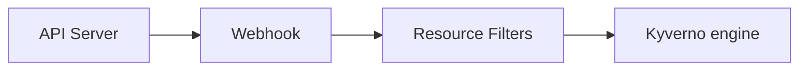

<a id="customizing-kyverno"></a>

## Kyverno 사용자 지정

Kyverno는 기능이 다양하고 폭넓은 사용자 지정을 지원한다. 이 절에서는 Kyverno의 지원 리소스와, 이를 사용자 지정해 특정 동작을 조정하는 방법을 설명한다.

<a id="certificate-management"></a>

### 인증서 관리

Kyverno 정책 엔진은 어드미션 웹훅으로 실행된다. 쿠버네티스 API 서버와 안전한 TLS 통신을 설정하려면 CA가 서명한 인증서와 키가 필요하다. Kyverno와 API 서버 사이의 보안 통신을 구성하는 방법은 두 가지다.

<a id="default-certificates"></a>

#### 기본 인증서

기본적으로 Kyverno는 자체 서명 인증 기관(CA)과 리프 인증서를 자동으로 생성해 웹훅 등록에 사용한다. CA 인증서는 1년 후 만료된다. Kyverno가 인증서를 직접 관리할 때는 만료 시 재생성도 알아서 처리한다. 기본 키는 RSA 2048비트이며, 다른 [키 알고리즘](#키-알고리즘)도 설정할 수 있다.

Kyverno를 설치한 뒤에는 [step CLI](https://smallstep.com/cli/)로 인증서 세부 정보를 확인하고 검증할 수 있다.

Kyverno 네임스페이스의 모든 시크릿(Secret)을 조회한다. 시크릿 이름은 설정할 수 있다. 자세한 내용은 [컨테이너 플래그 절](/docs/installation/customization#컨테이너-플래그)을 참고한다.

```sh
$ kubectl -n kyverno get secret
NAME                                                      TYPE                 DATA   AGE
kyverno-cleanup-controller.kyverno.svc.kyverno-tls-ca     kubernetes.io/tls    2      21d
kyverno-cleanup-controller.kyverno.svc.kyverno-tls-pair   kubernetes.io/tls    2      21d
kyverno-svc.kyverno.svc.kyverno-tls-ca                    kubernetes.io/tls    2      21d
kyverno-svc.kyverno.svc.kyverno-tls-pair                  kubernetes.io/tls    2      21d
```

어드미션 컨트롤러가 사용하는 CA 인증서를 가져와 디코딩한다.

```sh
$ kubectl -n kyverno get secret kyverno-svc.kyverno.svc.kyverno-tls-ca -o jsonpath='{.data.tls\.crt}' | \
  step base64 -d | step certificate inspect --short
X.509v3 Root CA Certificate (RSA 2048) [Serial: 0]
  Subject:     *.kyverno.svc
  Issuer:      *.kyverno.svc
  Valid from:  2023-04-14T18:33:37Z
          to:  2024-04-13T19:33:37Z
```

쿠버네티스 API 서버에 웹훅을 등록할 때 쓰는 인증서를 가져와 디코딩하면(검증 정책이 하나 이상 설치되어 있어야 한다) 같은 루트 CA 인증서가 사용되고 있음을 확인할 수 있다.

```sh
$ kubectl get validatingwebhookconfiguration kyverno-resource-validating-webhook-cfg -o jsonpath='{.webhooks[0].clientConfig.caBundle}' | \
  step base64 -d | step certificate inspect --short
X.509v3 Root CA Certificate (RSA 2048) [Serial: 0]
  Subject:     *.kyverno.svc
  Issuer:      *.kyverno.svc
  Valid from:  2023-04-14T18:33:37Z
          to:  2024-04-13T19:33:37Z
```

<a id="certificates-rotation"></a>

#### 인증서 갱신

기본적으로 Kyverno가 인증서를 생성하고 관리한다. CA 인증서의 유효 기간은 1년, TLS 인증서의 유효 기간은 150일이다.

관리 대상 인증서는 최소 12시간마다 유효성을 확인한다. 관리 대상 인증서가 들어 있는 시크릿에서 이벤트가 발생할 때도 유효성을 확인한다.

갱신 절차는 다음과 같다.

1. 시크릿에 들어 있는 만료된 인증서를 제거한다.
1. 남은 인증서가 15일 안에 무효가 되는지 확인한다.
1. 필요하면 위에 기재한 유효 기간으로 새 인증서를 생성한다.
1. 새 인증서를 아직 유효한 현재 인증서와 함께 해당 시크릿에 추가한다.
1. 새 인증서 번들로 웹훅을 다시 구성한다.
1. Kyverno 서버가 새 인증서를 사용하도록 업데이트한다.

정리하면, 인증서는 만료 약 15일 전에 갱신된다.

<a id="key-algorithm"></a>

#### 키 알고리즘

Kyverno가 인증서를 직접 관리하는 기본 동작에서는, CA와 TLS 인증서 생성에 쓰는 암호화 알고리즘을 설정할 수 있다. 지원하는 알고리즘은 다음과 같다.

| 알고리즘  | 설명                        |
| --------- | --------------------------- |
| `RSA`     | RSA 2048비트 키(기본값)     |
| `ECDSA`   | ECDSA P-256 키              |
| `Ed25519` | Ed25519 키                  |

키 알고리즘은 어드미션 컨트롤러와 정리 컨트롤러 모두 Helm 값으로 설정할 수 있다.

```yaml
admissionController:
  tlsKeyAlgorithm: ECDSA

cleanupController:
  tlsKeyAlgorithm: ECDSA
```

`--tlsKeyAlgorithm` 컨테이너 플래그로 직접 지정할 수도 있다([컨테이너 플래그](#컨테이너-플래그) 참고).

:::note[참고]
키 알고리즘 설정은 Kyverno가 인증서를 직접 관리할 때만 적용된다. 사용자 지정 인증서나 cert-manager로 인증서를 발급한다면 인증서 생성 과정에서 알고리즘을 설정해야 한다.
:::

Kyverno를 설치한 뒤 인증서 종류를 확인할 수 있다.

```sh
$ kubectl -n kyverno get secret kyverno-svc.kyverno.svc.kyverno-tls-ca -o jsonpath='{.data.tls\.crt}' | \
  base64 -d | openssl x509 -noout -text | grep "Public Key Algorithm"
        Public Key Algorithm: id-ecPublicKey
```

<a id="custom-certificates"></a>

#### 사용자 지정 인증서

CA가 서명한 자체 인증서를 설치하거나, 자체 서명 CA를 생성해 어드미션 컨트롤러와 정리 컨트롤러의 인증서에 서명할 수 있다. CA와 X.509 인증서-키 쌍을 준비했다면 이를 클러스터에 쿠버네티스 시크릿으로 설치한다. Kyverno는 이 시크릿을 찾으면 사용하고, 없으면 기본 인증서 관리 방식으로 돌아간다. 직접 준비한 인증서를 쓸 때는 재생성과 교체를 사용자가 직접 관리해야 한다.

##### 자체 서명 CA와 서명된 인증서-키 쌍 생성

:::caution[주의]
별도의 자체 서명 루트 CA는 관리하기 어려우므로 프로덕션 환경에서는 권장하지 않는다.
:::

이미 CA와 서명된 인증서가 있다면 바로 2단계로 넘어간다.

다음은 [step CLI](https://smallstep.com/cli/)로 자체 서명 루트 CA를 만들고 서명된 인증서와 키를 생성하는 과정이다.

1. 자체 서명 CA를 생성한다.

```sh
step certificate create kyverno-ca rootCA.crt rootCA.key --profile root-ca --insecure --no-password --kty=RSA
```

2. 만료 기간이 5년인 리프 인증서를 생성한다.

```sh
step certificate create kyverno-svc tls.crt tls.key --profile leaf \
            --ca rootCA.crt --ca-key rootCA.key \
            --san kyverno-svc --san kyverno-svc.kyverno --san kyverno-svc.kyverno.svc --not-after 43200h \
            --insecure --no-password --kty=RSA

step certificate create kyverno-cleanup-controller cleanup-tls.crt cleanup-tls.key --profile leaf \
            --ca rootCA.crt --ca-key rootCA.key \
            --san kyverno-cleanup-controller --san kyverno-cleanup-controller.kyverno --san kyverno-cleanup-controller.kyverno.svc --not-after 43200h \
            --insecure --no-password --kty=RSA
```

3. 인증서 내용을 확인한다.

```sh
step certificate inspect tls.crt --short
```

인증서의 `X509v3 extensions` 섹션에 SAN 정보가 있어야 한다.

```sh
X509v3 extensions:
    X509v3 Subject Alternative Name:
        DNS:kyverno-svc, DNS:kyverno-svc.kyverno, DNS:kyverno-svc.kyverno.svc
```

##### CA와 TLS 인증서-키 쌍용 시크릿 구성

다음 파일로 시크릿을 만든다.

- `rootCA.crt`
- `tls.crt`
- `tls.key`
- `cleanup-tls.crt`
- `cleanup-tls.key`

필요한 시크릿은 다음 명령으로 만든다(시크릿 이름은 바꾸지 않는다).

```sh
kubectl create ns <namespace>

kubectl create secret tls kyverno-svc.kyverno.svc.kyverno-tls-pair --cert=tls.crt --key=tls.key -n <namespace>
kubectl create secret generic kyverno-svc.kyverno.svc.kyverno-tls-ca --from-file=rootCA.crt -n <namespace>

kubectl create secret tls kyverno-cleanup-controller.kyverno.svc.kyverno-tls-pair --cert=cleanup-tls.crt --key=cleanup-tls.key -n <namespace>
kubectl create secret generic kyverno-cleanup-controller.kyverno.svc.kyverno-tls-ca --from-file=rootCA.crt -n <namespace>
```

| 시크릿                                                    | 데이터            | 내용                                                        |
| --------------------------------------------------------- | ----------------- | ----------------------------------------------------------- |
| `kyverno-svc.kyverno.svc.kyverno-tls-pair`                | tls.key & tls.crt | 키와 서명된 인증서(어드미션 컨트롤러)                       |
| `kyverno-svc.kyverno.svc.kyverno-tls-ca`                  | rootCA.crt        | 인증서 서명에 사용한 루트 CA(어드미션 컨트롤러)             |
| `kyverno-cleanup-controller.kyverno.svc.kyverno-tls-pair` | tls.key & tls.crt | 키와 서명된 인증서(정리 컨트롤러)                           |
| `kyverno-cleanup-controller.kyverno.svc.kyverno-tls-ca`   | rootCA.crt        | 인증서 서명에 사용한 루트 CA(정리 컨트롤러)                 |

Kyverno는 위에서 만든 시크릿으로 쿠버네티스 API 서버와 TLS 통신을 설정한다. 또한 어드미션 웹훅 구성과 정리 웹훅 구성에서 웹훅 서버 인증서를 검증할 CA 번들로도 이 시크릿을 지정한다.

##### Kyverno 설치

이제 [설치 절](/docs/installation/installation)에서 사용할 수 있는 방법 중 하나를 골라 Kyverno를 설치한다.

<a id="role-based-access-controls"></a>

### 역할 기반 접근 제어

Kyverno는 쿠버네티스 역할 기반 접근 제어(RBAC)로 Kyverno 컨트롤러가 다른 리소스에 접근할 권한을 구성한다.

Kyverno는 롤(Role), 클러스터롤(ClusterRole), 롤바인딩(RoleBinding), 클러스터롤바인딩(ClusterRoleBinding)을 여러 개 생성한다. 필요한 추가 기능에 따라 일부는 사용자 지정해야 할 수 있다.

Kyverno와 관련된 모든 클러스터롤과 롤을 보려면 `kubectl get clusterroles,roles -A | grep kyverno` 명령을 사용한다.

#### Role

Kyverno는 컨트롤러 유형마다 하나씩, 자신의 네임스페이스에 다음 롤을 생성한다.

- `kyverno:admission-controller`
  - 고가용성 구성을 처리하기 위해 Lease를 create, delete, get, patch, update한다.
  - Kyverno 디플로이먼트(Deployment) 자체를 관리할 수 있도록 디플로이먼트를 get, list, watch한다.
  - 웹훅 관리에 쓰는 인증서를 관리하기 위해 시크릿을 get, list, watch, create, update, patch, delete한다.
  - 구성 변경을 감지하기 위해 컨피그맵(ConfigMap)을 get, list, watch한다.
  - 웹훅 구성의 자동 삭제를 관리하기 위해 서비스어카운트(ServiceAccount)를 get, list, watch, create, update, patch, delete한다.
- `kyverno:reports-controller`
  - 구성 변경을 감지하기 위해 컨피그맵을 get, list, watch한다.
  - 고가용성 구성을 처리하기 위해 Lease를 create, delete, get, patch, update한다.
- `kyverno:background-controller`
  - 구성 변경을 감지하기 위해 컨피그맵을 get, list, watch한다.
  - 고가용성 구성을 처리하기 위해 Lease를 create, delete, get, patch, update한다.
- `kyverno:cleanup-controller`
  - 웹훅 관리에 쓰는 인증서를 관리하기 위해 시크릿을 get, list, watch, create, update, delete한다.
  - 구성 변경을 감지하기 위해 컨피그맵을 get, list, watch한다.
  - 고가용성 구성을 처리하기 위해 Lease를 create, delete, get, patch, update한다.
  - Kyverno 디플로이먼트 자체를 관리할 수 있도록 디플로이먼트를 get, list, watch한다.

#### ClusterRole

Kyverno는 컨트롤러 유형마다 하나씩 다음 클러스터롤을 생성한다.

- `kyverno:admission-controller`
  - 정상 여부 확인을 위해 커스텀리소스데피니션(CustomResourceDefinition)을 get한다.
  - 어드미션 변경용 웹훅 규칙을 구성하기 위해 MutatingWebhookConfiguration을 get, list, watch, create, update, patch, delete한다.
  - 어드미션 검증용 웹훅 규칙을 구성하기 위해 ValidatingWebhookConfiguration을 get, list, watch, create, update, patch, delete한다.
  - ValidatingAdmissionPolicy를 자동 생성하기 위해 ValidatingAdmissionPolicy를 get, list, watch, create, update, patch, delete한다.
  - ValidatingAdmissionPolicyBinding을 자동 생성하기 위해 ValidatingAdmissionPolicyBinding을 get, list, watch, create, update, patch, delete한다.
  - 웹훅 구성의 자동 삭제를 관리하기 위해 롤을 get, list, watch한다.
  - 웹훅 구성의 자동 삭제를 관리하기 위해 클러스터롤을 get, list, watch한다.
  - 웹훅 구성의 자동 삭제를 관리하기 위해 롤바인딩을 get, list, watch한다.
  - 웹훅 구성의 자동 삭제를 관리하기 위해 클러스터롤바인딩을 get, list, watch한다.
- `kyverno:reports-controller`
  - 정상 여부 확인을 위해 커스텀리소스데피니션을 get한다.
  - ValidatingAdmissionPolicy를 자동 생성하기 위해 ValidatingAdmissionPolicy를 get, list, watch, create, update, patch, delete한다.
  - ValidatingAdmissionPolicyBinding을 자동 생성하기 위해 ValidatingAdmissionPolicyBinding을 get, list, watch, create, update, patch, delete한다.
- `kyverno:background-controller`
  - 정상 여부 확인을 위해 커스텀리소스데피니션을 get한다.
- `kyverno:cleanup-controller`
  - 정상 여부 확인을 위해 커스텀리소스데피니션을 get한다.
  - TTL 정리 레이블에 따라 리소스를 삭제하기 위해 ValidatingWebhookConfiguration을 get, list, watch, create, update, delete한다.

Kyverno는 [집계 클러스터롤](https://kubernetes.io/docs/reference/access-authn-authz/rbac/#aggregated-clusterroles)을 사용해 Kyverno에 적용되는 클러스터롤을 찾아 하나로 합친다. 컨트롤러마다 별도의 클러스터롤 집합이 있다. 이름이 `core`로 끝나는 것이 집계 클러스터롤이며, `core` 접미사가 없는 최상위 롤이 이를 다시 집계한다.

다음 `ClusterRole`은 Kyverno가 모든 네임스페이스에 걸쳐 정책과 기타 쿠버네티스 리소스에 접근할 권한을 제공한다.

| 롤바인딩                           | 서비스어카운트                | 롤                            |
| ---------------------------------- | ----------------------------- | ----------------------------- |
| kyverno:admission-controller       | kyverno-admission-controller  | kyverno:admission-controller  |
| kyverno:admission-controller:view  | kyverno-admission-controller  | view                          |
| kyverno:admission-controller:core  | --                            | --                            |
| kyverno:background-controller      | kyverno-background-controller | kyverno:background-controller |
| kyverno:background-controller:view | kyverno-background-controller | view                          |
| kyverno:background-controller:core | --                            | --                            |
| kyverno:cleanup-controller         | kyverno-cleanup-controller    | kyverno:cleanup-controller    |
| kyverno:cleanup-controller:core    | --                            | --                            |
| kyverno:reports-controller         | kyverno-reports-controller    | kyverno:reports-controller    |
| kyverno:reports-controller:view    | kyverno-reports-controller    | view                          |
| kyverno:reports-controller:core    | --                            | --                            |

:::note[참고]
Kyverno 어드미션 컨트롤러, 백그라운드 컨트롤러, 리포트 컨트롤러는 기본 제공 `view` 롤에 대한 롤바인딩이 있다. 덕분에 이 컨트롤러들은 네임스페이스 범위 리소스 대부분을 볼 수 있다. Helm으로 설치할 때 `admissionController.rbac.viewRoleName`, `backgroundController.rbac.viewRoleName`, `reportsController.rbac.viewRoleName` 변수로 이 롤을 바꿀 수 있다.
:::

<a id="customizing-permissions"></a>

#### 권한 사용자 지정

Kyverno의 기본 권한은 자주 쓰이면서 보안상 위험이 크지 않은 리소스를 다루도록 설계되어 있다. 따라서 CRD에 접근하거나 보안상 중요한 리소스에 접근하게 하려면 Kyverno에 추가 권한을 구성해야 한다.

Kyverno가 설치하는 클러스터롤은 [클러스터롤 집계 기능](https://kubernetes.io/docs/reference/access-authn-authz/rbac/#aggregated-clusterroles)을 쓰므로 Kyverno 컨트롤러의 권한을 쉽게 확장할 수 있다. 컨트롤러의 권한을 확장하려면 다음 레이블 중 하나 이상을 붙인 새 롤을 추가한다.

| 컨트롤러              | 롤 집계 레이블                                             |
| --------------------- | ---------------------------------------------------------- |
| admission-controller  | rbac.kyverno.io/aggregate-to-admission-controller: "true"  |
| background-controller | rbac.kyverno.io/aggregate-to-background-controller: "true" |
| reports-controller    | rbac.kyverno.io/aggregate-to-reports-controller: "true"    |
| cleanup-controller    | rbac.kyverno.io/aggregate-to-cleanup-controller: "true"    |

업그레이드 문제를 피하려면 기본 롤은 수정하지 말고 새 롤로 확장하기를 강력히 권장한다.

컨트롤러마다 서비스어카운트가 따로 있으므로, Kyverno에 추가 권한을 부여하려면 알맞은 컨트롤러를 찾아 해당 클러스터롤에 집계되는 레이블을 사용해야 한다. 다음 표는 Kyverno 기능별 필요 권한을 정리한 것이다.

| 컨트롤러              | 권한 verb                                 | 필요한 기능        |
| --------------------- | ----------------------------------------- | ------------------ |
| admission-controller  | view, list, ...                           | API 호출           |
| admission-controller  | view, list, watch                         | 글로벌 컨텍스트    |
| background-controller | update, view, list, watch                 | 변경 정책          |
| background-controller | create, update, delete, view, list, watch | 생성 정책          |
| reports-controller    | view, list, watch                         | 정책 리포트        |
| cleanup-controller    | delete, view, list, watch                 | 정리 정책          |

예를 들어 새 Kyverno 생성 정책에서 Kyverno가 디플로이먼트를 만들고 업데이트해야 한다면 새 권한을 부여해야 한다. 생성 규칙은 백그라운드 컨트롤러가 처리하므로, 새 클러스터롤을 만들고 백그라운드 컨트롤러용 집계 레이블을 지정해야 이 권한이 적용된다.

다음 클러스터롤 예시는 Kyverno 백그라운드 컨트롤러에 디플로이먼트 생성 권한을 추가로 부여한다.

```yaml
apiVersion: rbac.authorization.k8s.io/v1
kind: ClusterRole
metadata:
  name: kyverno:create-deployments
  labels:
    rbac.kyverno.io/aggregate-to-background-controller: 'true'
rules:
  - apiGroups:
      - apps
    resources:
      - deployments
    verbs:
      - create
      - update
```

보충 클러스터롤을 만든 뒤에는 해당 컨트롤러의 최상위 클러스터롤을 확인해 집계가 이루어졌는지 점검한다.

```sh
kubectl get clusterrole kyverno:background-controller -o yaml
```

마찬가지로, Kyverno의 검증 정책과 변경 정책이 사용자 정의 리소스를 대상으로 동작한다면 백그라운드 컨트롤러와 리포트 컨트롤러에 해당 리소스를 관리할 권한을 부여해야 한다.

```yaml
apiVersion: rbac.authorization.k8s.io/v1
kind: ClusterRole
metadata:
  name: kyverno:crontab:edit
  labels:
    rbac.kyverno.io/aggregate-to-background-controller: 'true'
rules:
  - apiGroups:
      - stable.example.com
    resources:
      - crontabs
    verbs:
      - update
---
apiVersion: rbac.authorization.k8s.io/v1
kind: ClusterRole
metadata:
  name: kyverno:crontab:view
  labels:
    rbac.kyverno.io/aggregate-to-background-controller: 'true'
    rbac.kyverno.io/aggregate-to-reports-controller: 'true'
rules:
  - apiGroups:
      - stable.example.com
    resources:
      - crontabs
    verbs:
      - get
      - list
      - watch
```

쿠버네티스 ValidatingAdmissionPolicy와 그 바인딩의 생성은 어드미션 컨트롤러가 처리하므로, 이 타입들을 생성할 권한을 컨트롤러에 부여해야 한다. 이를 위해 클러스터롤을 만들고 어드미션 컨트롤러용 집계 레이블을 지정해야 권한이 적용된다.

다음 클러스터롤 예시는 Kyverno 어드미션 컨트롤러에 ValidatingAdmissionPolicy와 ValidatingAdmissionPolicyBinding 생성 권한을 추가로 부여한다.

```yaml
apiVersion: rbac.authorization.k8s.io/v1
kind: ClusterRole
metadata:
  name: kyverno:generate-validatingadmissionpolicy
  labels:
    rbac.kyverno.io/aggregate-to-admission-controller: 'true'
rules:
  - apiGroups:
      - admissionregistration.k8s.io
    resources:
      - validatingadmissionpolicies
      - validatingadmissionpolicybindings
    verbs:
      - get
      - list
      - watch
      - create
      - update
      - delete
```

<a id="configmap-keys"></a>

### ConfigMap 키

다음 키는 Kyverno의 동작을 제어하며 Kyverno 컨피그맵에 설정해야 한다. Kyverno는 이 컨피그맵의 변경을 감시하고 업데이트가 있으면 로드한다.

1. `defaultRegistry`: 지정하지 않았을 때 사용할 기본 이미지 레지스트리를 설정한다. 기본값은 `docker.io`이다. 호스트 이름 또는 경로 접미사가 붙은 호스트 이름(예: `registry.example.com/myorg`)을 받으며, 이 경우 `nginx:latest` 같은 레지스트리 없는 이미지는 `registry.example.com/myorg/nginx:latest`로 해석된다. 레지스트리 접두사가 이미 있는 이미지는 바뀌지 않는다.
2. `enableDefaultRegistryMutation`: 조건이 충족될 때 Kyverno가 내부 컨텍스트를 `defaultRegistry` 키의 값으로 업데이트할지 정한다. 기본값은 `"true"`이다.
3. `excludeGroups`: 지정한 그룹을 모든 처리에서 제외한다. 쉼표로 구분한 그룹 목록을 받는다. 기본값은 `system:nodes`이다.
4. `excludeUsernames`: 사용자 이름을 모든 처리에서 제외한다. `!` 연산자로 항목을 부정할 수 있다(예: `!john`은 다른 파라미터로 제외된 사용자 이름 `john`을 다시 포함시킨다). 기본값은 `'!system:kube-scheduler'`이다.
5. `excludeRoles`: 처리에서 제외할 롤 목록. 기본값은 정의되어 있지 않다.
6. `excludeClusterRoles`: 처리에서 제외할 클러스터롤 목록. 기본값은 정의되어 있지 않다.
7. `generateSuccessEvents`: 성공 이벤트를 생성할지(true/false) 지정한다. 기본값은 "false"이다.
8. `matchConditions`: 웹훅 구성에서 CEL 기반 표현식을 사용해 Kyverno로 전달할 어드미션 요청을 좁힌다. 쿠버네티스 1.27 이상에서 `AdmissionWebhookMatchConditions` 기능 게이트를 활성화해야 한다.
9. `resourceFilters`: 어드미션 웹훅이 정책을 평가하지 않을 쿠버네티스 리소스를 "[kind,namespace,name]" 형식으로 지정한다. 예: --filterKind "[Deployment, kyverno, kyverno]" --filterKind "[Deployment, kyverno, kyverno],[Events, *, *]". 리소스 필터는 백그라운드 스캔 모드에는 적용되지 않는다. 자세한 내용은 [리소스 필터](#리소스-필터) 절을 참고한다.
10. `updateRequestThreshold`: mutateExisting 정책과 generate 정책에서 생성되는 updaterequest의 총개수 임계값을 설정한다. 문자열 값을 받으며 기본값은 1000이다.
11. `webhooks`: Kyverno가 관리하는 웹훅에 구성할 네임스페이스 또는 오브젝트 제외 조건을 지정한다. 기본값은 `'[{"namespaceSelector":{"matchExpressions":[{"key":"kubernetes.io/metadata.name","operator":"NotIn","values":["kube-system"]},{"key":"kubernetes.io/metadata.name","operator":"NotIn","values":["kyverno"]}],"matchLabels":null}}]'`이다.
12. `webhookAnnotations`: AKS 지원을 위해 Kyverno가 웹훅에 어노테이션을 추가하도록 한다. 기본값은 정의되어 있지 않다. 자세한 내용은 [AKS 참고 사항](/docs/installation/platform-notes#notes-for-aks-users) 절을 참고한다.
13. `webhookLabels`: Kyverno가 웹훅에 레이블을 추가하도록 한다. 기본값은 정의되어 있지 않다.

<a id="container-flags"></a>

### 컨테이너 플래그

다음 플래그로 Kyverno 각 컨트롤러의 고급 동작을 제어할 수 있다. 플래그는 메인 컨테이너에 인수 형태로 설정한다. 모든 컨테이너 플래그 앞에는 대시를 한 개 또는 두 개 붙일 수 있다(예: `-admissionReports` 또는 `--admissionReports`). 각 플래그가 적용되는 컨트롤러는 괄호 안에 표시한다.

- A: 어드미션 컨트롤러
- B: 백그라운드 컨트롤러
- C: 정리 컨트롤러
- R: 리포트 컨트롤러

| 플래그 | 기본값 | 설명 |
| --- | --- | --- |
| `add_dir_header` (ABCR) | | 로그 메시지 헤더에 파일 디렉터리를 추가한다. |
| `admissionReports` (AR) | true | `Audit` 모드의 검증 규칙에서 생성되는 AdmissionReport 리소스를 활성화한다. 최종 PolicyReport에 반영하는 데 사용한다. |
| `aggregateReports` (R) | true | AdmissionReport의 리포트 집계 기능을 활성화한다(1.10.2+). |
| `aggregationWorkers` (R) | 10 | 리포트 집계를 수행하는 내부 워커 스레드 수를 설정한다(1.12.3+). |
| `allowedResults` (ABR) | `pass,fail,error,warn,skip` | 리포트를 생성할 결과 유형을 쉼표로 구분해 지정한다. 지정한 값과 일치하는 결과만 저장된다. 허용 값: `pass`, `fail`, `error`, `warn`, `skip` (1.17+). |
| `allowInsecureRegistry` (ABR) | `"false"` | [이미지 검증](/docs/policy-types/image-validating-policy)이나 [이미지 메타데이터 조회](/docs/policy-types/cel-libraries#image-library)에서 Kyverno가 안전하지 않은 레지스트리(인증서 검사를 건너뛰는 레지스트리)와 동작하도록 허용한다. 테스트 용도로만 사용하고 프로덕션 환경에서는 사용하지 않는다. |
| `alsologtostderr` (ABCR) | | 파일뿐 아니라 표준 오류에도 로그를 남긴다(-logtostderr=true이면 효과 없음). |
| `autoUpdateWebhooks` (A) | true | 웹훅 자동 구성을 끄려면 `false`로 설정한다. 이 기능을 끄면 Kyverno는 모든 리소스에 일치하는 기본 웹훅 구성을 생성하므로 컨피그맵을 통한 웹훅 구성은 무시된다. 다만 웹훅 리소스를 직접 패치해 수정할 수는 있다. `true`였던 값을 `false`로 바꾸면 기존 웹훅은 유지되지만 자동 업데이트는 중단되고, 이후 모든 변경은 수동으로 해야 한다. 웹훅이나 웹훅 구성 리소스를 삭제하면 와일드카드로 일치하는 리소스로 대체된다. |
| `backgroundServiceAccountName` (A) | | 백그라운드 컨트롤러의 서비스어카운트 이름. 어드미션 컨트롤러가 Kyverno 자신에게서 온 AdmissionReview 요청을 무시하도록 한다. 예를 들어 Kyverno가 방금 생성한 리소스를 변경해야 하는 경우에는 이 설정을 제거해야 할 수 있다. 기본값은 백그라운드 컨트롤러의 서비스어카운트이다. |
| `backgroundScan` (R) | true | 백그라운드 리포트 스캔을 켜거나 끈다. 백그라운드 컨트롤러의 백그라운드 조정(reconciliation)에는 영향을 주지 않는다. |
| `backgroundScanInterval` (R) | 1h | 리포트용 주기적 백그라운드 스캔의 시간 간격을 설정한다. 분 단위 기간도 지원한다(예: `10m`). |
| `backgroundScanWorkers` (R) | 2 | 백그라운드 스캔 리포트를 처리할 내부 워커 스레드 수를 정의한다. 워커가 많을수록 리포트 처리가 빨라지지만 리소스를 더 소비한다. 리포트 컨트롤러는 리더 선출을 사용하므로 리포트 처리는 한 번에 한 레플리카만 수행한다. |
| `caSecretName` (AC) | | 루트 CA 인증서의 기본 시크릿 이름을 덮어쓴다. 관련 플래그 `tlsSecretName`도 참고한다. |
| `cleanupServerHost` (C) | `""` | 정리 서버 웹훅이 사용할 주소를 정의한다. 매니페스트에 `hostNetwork: true`를 설정한 경우에만 사용해야 한다. |
| `cleanupServerPort` (C) | 9443 | 정리 서버 웹훅이 사용할 포트를 정의한다. |
| `clientRateLimitBurst` (ABCR) | 300 | 스로틀링의 최대 버스트를 설정한다. 0이면 클라이언트 기본값을 사용한다. |
| `clientRateLimitQPS` (ABCR) | 300 | Kyverno에서 API 서버로 보내는 최대 QPS를 설정한다. 0이면 클라이언트 기본값을 사용한다. |
| `disableCertManagerController` (AC) | false | Kyverno의 프로세스 내 인증서 관리자 컨트롤러를 끈다. 인증서 관리를 cert-manager에 맡길 때 TLS 시크릿 조정 충돌을 피하려고 사용한다. |
| `disableMetrics` (ABCR) | false | 메트릭 노출을 활성화할지 지정한다. |
| `dumpPayload` (AC) | false | 디버그 모드를 전환한다. 디버그 모드에서는 AdmissionReview 페이로드 전체를 로그에 남기며, 시크릿 종류의 리소스는 가려진다. 정책 개발이나 문제 해결 시에만 사용하고 계속 켜 두지 않는다. |
| `dumpPatches` (A) | false | 디버그 모드를 전환한다. 디버그 모드에서는 패치 페이로드 전체를 로그에 남긴다. |
| `eventsRateLimitBurst` (ABCR) | 2000 | 이벤트 스로틀링의 최대 버스트를 설정한다. 0이면 클라이언트 기본값을 사용한다. |
| `eventsRateLimitQPS` (ABCR) | 1000 | Kyverno에서 API 서버로 보내는 이벤트의 최대 QPS를 설정한다. 0이면 클라이언트 기본값을 사용한다. |
| `enableConfigMapCaching` (ABR) | true | 컨피그맵 캐싱 기능을 활성화한다. |
| `enableDeferredLoading` (A) | true | 변수의 지연 로딩을 활성화한다(1.10.1+). 1.10.0 미만 버전의 기본 동작이던 변수 지연 로딩을 끄려면 `false`로 설정한다. |
| `enablePolicyException` (ABR) | false | [PolicyException 기능](/docs/guides/exceptions)을 활성화하려면 `true`로 설정한다. |
| `enableReporting` (ABCR) | validate,mutate,mutateExisting,generate,imageVerify | 규칙 유형별 리포트를 활성화한다. 쉼표로 구분해 지정한다(validate,mutate,mutateExisting,generate,imageVerify). |
| `enableTracing` (ABCR) | false | 트레이스 노출을 활성화한다. |
| `enableTuf` (AR) | | 프라이빗 sigstore 배포에서 TUF를 활성화한다. |
| `enableCosginLogging` (A) | false | cosign 디버그 로깅을 활성화한다. |
| `exceptionNamespace` (ABR) | | [PolicyException](/docs/guides/exceptions)만 허용할 네임스페이스 이름을 설정한다. 다른 네임스페이스에서 만든 PolicyException은 경고를 발생시킨다. "\*"로 설정하면 모든 네임스페이스의 PolicyException을 허용한다. 와일드카드와 여러 네임스페이스 항목은 지원하지 않는다. `enablePolicyException` 플래그를 true로 설정했다면 필수이다. |
| `forceFailurePolicyIgnore` (A) | false | 실패 정책(failurePolicy)을 `Ignore`로 강제한다. |
| `generateValidatingAdmissionPolicy` (A) | false | 쿠버네티스 ValidatingAdmissionPolicy 생성을 활성화할지 지정한다. |
| `genWorkers` (B) | 10 | 생성 정책을 동시에 처리할 워커 수. |
| `imagePullSecrets` (ABR) | | 이미지 레지스트리 접근 자격 증명이 든 시크릿 리소스 이름을 지정한다. 참조하는 시크릿은 모두 Kyverno 네임스페이스에 있어야 한다. 여러 값은 쉼표로 구분한다. |
| `imageVerifyCacheEnabled` (A) | true | 검증된 이미지용 TTL 캐시를 활성화한다. |
| `imageVerifyCacheMaxSize` (A) | 1000 | TTL 캐시 항목의 최대 총비용. 키는 정책 요소와 이미지 참조의 조합이다. 검증 성공만 기록하는 항목의 비용은 1이므로 이때는 이 값이 항목 수의 최대치가 된다. 검증된 in-toto 증명(attestation) 페이로드도 저장하는 항목의 비용은 페이로드 크기(바이트) 정도이다. `0`이면 기본값으로 설정한다. |
| `imageVerifyCacheTTLDuration` (A) | 60m | 캐시의 최대 TTL 값을 기간으로 지정한다. `0`이면 기본값으로 설정한다. |
| `kubeconfig` (ABCR) | | Kyverno가 통신할 API 서버를 바꿀 때 사용할 kubeconfig 파일을 지정한다. Kyverno가 어드미션 요청을 처리하는 클러스터 밖에서 실행될 때만 사용한다. |
| `leaderElectionRetryPeriod` (ABCR) | `2s` | 리더 선출 갱신 주기를 제어한다. |
| `log_backtrace_at` (ABCR) | | 로깅이 file:N 줄에 도달하면 스택 트레이스를 출력한다. 한 번만 지정할 수 있다. |
| `log_dir` (ABCR) | | 비어 있지 않으면 이 디렉터리에 로그 파일을 쓴다(-logtostderr=true이면 효과 없음). |
| `log_file` (ABCR) | | 비어 있지 않으면 이 로그 파일을 사용한다(-logtostderr=true이면 효과 없음). |
| `log_file_max_size` (ABCR) | `1800` | 로그 파일의 최대 크기를 정의한다(-logtostderr=true이면 효과 없음). 단위는 메가바이트이며 0이면 크기 제한이 없다. |
| `loggingFormat` (ABCR) | `text` | 로그 출력 형식을 정한다. `json` 또는 `text`로 설정해 JSON 또는 텍스트 형식으로 출력할 수 있다. |
| `loggingtsFormat` (ABCR) | `RFC3339` | 로그 타임스탬프 형식을 정한다. `iso8601`(ISO8601), `rfc3339`(RFC3339), `rfc3339nano`(RFC3339NANO), `millis`(Epoch Millis), `nanos`(Epoch Nanos)로 설정해 타임스탬프를 다르게 지정할 수 있다. 생략하면 `RFC3339`이다. |
| `logtostderr` (ABCR) | true | 파일 대신 표준 오류에 로그를 남긴다. |
| `maxAPICallResponseLength` (ABCR) | `10000000` | API 호출 응답 본문의 최대 길이를 설정한다. |
| `maxAuditWorkers` (A) | `8` | 감사 정책 처리에 쓰는 최대 워커 수. |
| `maxBackgroundReports` (BR) | `10000` | 백그라운드 정책에 생성하는 ephemeralreport의 최대 개수. 이 값에 도달하면 새 리포트를 더 만들지 않는다. |
| `maxAuditCapacity` (A) | `1000` | 감사 정책 처리에 쓰는 최대 워커 수. |
| `maxQueuedEvents` (ABR) | `1000` | 내부에 대기시킬 이벤트의 상한을 정의한다. |
| `metricsHost` (ABCR) | `""` | 프로메테우스 메트릭을 노출할 주소를 지정한다. 매니페스트에 `hostNetwork: true`를 설정한 경우에만 사용해야 한다. `--otelConfig="grpc"`일 때는 사용하지 않는다. |
| `metricsPort` (ABCR) | `8000` | 프로메테우스 메트릭을 노출할 포트를 지정한다. `otelCollector`의 대상 포트도 지정한다. `otelConfig` 플래그가 `prometheus`인지 `grpc`인지에 따라 달라진다. |
| `omitEvents` (ABR) | `"PolicyApplied,PolicySkipped"` | 발생시키지 않을 Kyverno 이벤트 유형을 지정한다. `PolicyViolation`, `PolicyApplied`, `PolicyError`, `PolicySkipped` 값을 쉼표로 구분한 문자열로 받는다. 기본값은 `PolicyApplied`와 `PolicySkipped`이다. |
| `one_output` (ABCR) | | true이면 로그를 해당 심각도 수준에만 쓴다(그렇지 않으면 더 낮은 심각도 수준마다 함께 쓴다. -logtostderr=true이면 효과 없음). |
| `openreportsEnabled` (R) | false | 리포팅 그룹에 openreports.io/v1alpha1을 사용한다. |
| `otelCollector` (ABCR) | | OpenTelemetry 컬렉터 서비스 주소를 설정한다. Kyverno는 메트릭 포트로 여기에 연결을 시도한다. 기본값은 `opentelemetrycollector.kyverno.svc.cluster.local`이다. |
| `otelConfig` (ABCR) | `prometheus` | 프로메테우스와 OpenTelemetry 중 사용할 쪽을 정한다. OpenTelemetry를 활성화하려면 `grpc`로 설정한다. |
| `policyReports` (R) | true | 정책 리포트 시스템을 활성화한다(1.10.2+). 활성화하면 정책 리포트 사용자 정의 리소스가 클러스터에서 생성되고 관리된다. |
| `profile` (ABCR) | false | `true`로 설정하면 프로파일링을 활성화한다. |
| `profileAddress` (ABCR) | `""` | 프로파일링 서버의 주소를 설정한다. |
| `profilePort` (ABCR) | `6060` | 프로파일링을 활성화할 포트를 지정한다. |
| `protectGenerationLabels` (A) | true | 컨트롤러가 아닌 계정이 Kyverno 생성 메타데이터(`generate.kyverno.io/policy-name`)를 수정하지 못하도록 어드미션 웹훅으로 보호한다. 끄려면 `false`로 설정한다. AKS 같은 관리형 클러스터에서 중지/시작 작업을 하려면 이 웹훅을 꺼야 한다. |
| `protectManagedResources` (AC) | false | Kyverno 서비스어카운트 외에는 누구도 Kyverno 리소스를 변경하지 못하도록 보호한다. 활성화하려면 `true`로 설정한다. |
| `registryCredentialHelpers` (ABR) | `"default,google,amazon,azure,github"` | 클라우드 레지스트리별 인증 헬퍼를 활성화한다. 기본값은 `"default,google,amazon,azure,github"`이다. |
| `renewBefore` (AC) | `360h0m0s` | 만료 전 인증서를 갱신할 시점을 설정한다. Go 기간 형식(시, 분, 초)으로 지정한다. 예: 15일은 `360h0m0s`. |
| `reportsChunkSize` (R) | `1000` | 저장할 결과가 더 많을 때, 분할이 일어나기 전까지 생성된 리포트 하나에 담을 수 있는 최대 결과 수. 사용 중단(deprecated)되었다. |
| `serverIP` (AC) | | `kubeconfig` 플래그처럼, Kyverno를 서비스 대상 클러스터 밖에서 실행할 때 사용한다. |
| `servicePort` (AC) | `443` | Kyverno 서비스 리소스와 웹훅 구성에서 사용하는 포트. |
| `skipResourceFilters` (R) | true | 백그라운드 리포트 스캔을 수행할 때 컨피그맵의 resourceFilters를 따를지 정의한다. `true`로 설정하면 resourceFilters에 정의된 항목도 백그라운드 리포트에서 제외되지 않는다. 예를 들어 `true`일 때 resourceFilters에 `[*/*,kube-system,*]` 항목이 있어도 `kube-system` 네임스페이스의 모든 리소스에 백그라운드 스캔 리포트가 생성된다. 백그라운드 스캔 리포트에서 resourceFilters를 따르려면 `false`로 설정한다. 예를 들어 `false`일 때 resourceFilters에 `[*/*,kube-system,*]` 항목이 있으면 `kube-system` 네임스페이스의 어떤 리소스에도 백그라운드 스캔 리포트가 생성되지 않는다. |
| `skip_headers` (ABCR) | | true이면 로그 메시지에 헤더 접두사를 붙이지 않는다. |
| `skip_log_headers` (ABCR) | | true이면 로그 파일을 열 때 헤더를 쓰지 않는다(-logtostderr=true이면 효과 없음). |
| `stderrthreshold` (ABCR) | `2` | 파일과 표준 오류에 함께 쓸 때, 이 임계값 이상의 로그는 표준 오류로 보낸다(-logtostderr=true이거나 -alsologtostderr=false이면 효과 없음). |
| `tlsSecretName` (AC) | | TLS 인증서의 기본 시크릿 이름을 덮어쓴다. 관련 플래그 `caSecretName`도 참고한다. |
| `tlsKeyAlgorithm` (AC) | `RSA` | Kyverno가 관리하는 TLS 인증서의 키 알고리즘을 지정한다. 지원 값: `RSA`, `ECDSA`, `Ed25519`. Kyverno가 인증서를 직접 관리할 때만 사용한다(사용자 지정 인증서나 cert-manager를 쓸 때는 사용하지 않음). |
| `tracingAddress` (ABCR) | `''` | 트레이싱 수신기 주소. |
| `tracingCreds` (ABCR) | | OpenTelemetry 트레이싱 클라이언트가 사용하는 인증서가 든 CA 시크릿을 설정한다. 빈 문자열이면 안전하지 않은 연결을 사용한다. |
| `tracingPort` (ABCR) | `4137` | 트레이싱 수신기 포트. |
| `transportCreds` (ABCR) | `""` | OpenTelemetry 메트릭 클라이언트가 사용하는 인증서가 든 CA 시크릿을 설정한다. 빈 문자열이면 안전하지 않은 연결을 사용한다. |
| `ttlReconciliationInterval` (C) | `1m` | 정리 컨트롤러가 정리 TTL 레이블이 붙은 리소스를 조정하는 간격을 정의한다. 자세한 내용은 [정리 문서](/docs/guides/ttl-cleanup#cleanup-label)를 참고한다. |
| `tufMirror` (AR) | | sigstore용 대체 TUF 미러를 지정한다. 비워 두면 공개 sigstore 미러를 cosign 검증에 사용한다. |
| `tufRoot` (AR) | | sigstore용 대체 TUF root.json을 지정한다. 비워 두면 공개 sigstore root.json을 cosign 검증에 사용한다. |
| `v` (ABCR) | `2` | Kyverno 로그 출력의 상세 수준(verbosity)을 설정한다. 1부터 6까지의 정수를 받으며 6이 가장 상세하다. 수준 4에서는 변수 치환 메시지가 표시된다. |
| `validatingAdmissionPolicyReports` (R) | false | 쿠버네티스 ValidatingAdmissionPolicy의 정책 리포트 생성을 활성화할지 지정한다. |
| `vmodule` (ABCR) | | 파일별 필터링 로깅을 위한 pattern=N 설정을 쉼표로 구분해 나열한다. |
| `webhookRegistrationTimeout` (A) | `120s` | Kyverno가 API 서버에 웹훅 등록을 시도하는 시간을 지정한다. |
| `webhookServerHost` (A) | `""` | 웹훅 콜백에 사용할 주소를 지정한다. 매니페스트에 `hostNetwork: true`를 설정한 경우에만 사용해야 한다. |
| `webhookServerPort` (A) | `9443` | 웹훅 콜백에 사용할 포트를 지정한다. |
| `webhookTimeout` (A) | `10` | 웹훅 타임아웃을 초 단위로 지정한다. 타임아웃이 지나면 실패 정책에 따라 웹훅 호출이 무시되거나 API 호출이 실패한다. 타임아웃 값은 1에서 30(초) 사이의 정수여야 한다. |

<a id="http-calls"></a>

### HTTP 호출

Kyverno 1.18에서는 정책 안의 HTTP 사용에 대한 보안 강화가 추가되었다.

- 네임스페이스 범위 정책의 CEL HTTP는 기본적으로 비활성화되어 있으며, `--allowHTTPInNamespacedPolicies=true`(또는 `FLAG_ENABLE_HTTP_IN_NAMESPACED_POLICIES=true`)로 명시적으로 활성화해야 한다.
- 클러스터 범위 정책은 기본적으로 HTTP 호출을 허용한다. 이는 권한이 높은 기능이므로 클러스터 범위 정책을 만들 수 있는 사용자를 제한한다.
- 네임스페이스 범위 정책과 클러스터 범위 정책 모두 CEL HTTP 호출을 `--httpBlocklist`/`FLAG_HTTP_BLOCKLIST`와 `--httpAllowlist`/`FLAG_HTTP_ALLOWLIST`로 제어할 수 있다.

`httpBlocklist`의 기본 차단 대상은 다음과 같다.

- AWS/GCP/Azure 메타데이터 서비스: 169.254.169.254
- GCP 메타데이터 서비스 대체 주소: 169.254.169.253
- GCP 메타데이터 서비스 호스트 이름: metadata.google.internal
- IPv4 루프백: "127.0.0.0/8
- Pv6 루프백: "::1/128

배포 인수 예시는 다음과 같다.

```yaml
spec:
  template:
    spec:
      containers:
        - name: kyverno
          args:
            - --allowHTTPInNamespacedPolicies=true
            - --httpBlocklist=127.0.0.0/8,::1/128,169.254.0.0/16,fe80::/10
            - --httpAllowlist=https://api.example.com,https://webhook.corp/v1/
```

Kyverno는 정책 구성에서 `Authorization` 헤더를 지정하지 않은 경우, 외부로 나가는 HTTP 컨텍스트 요청에 범위가 제한된 서비스어카운트 토큰을 사용한다. 기본 서비스어카운트 토큰을 쓸 때보다 쿠버네티스 API 서버에 대한 토큰 재사용 공격 위험이 줄어든다.

### 정책 리포트 접근

Kyverno를 설치하면 `kyverno:rbac:admin:policyreports`라는 클러스터롤이 생성된다. 이 롤은 두 가지 주요 정책 리포트 사용자 정의 리소스인 `policyreport`와 `clusterpolicyreport`의 모든 작업 권한을 가진다. 네임스페이스 관리자에게 접근 권한을 부여하려면 다음 YAML 매니페스트를 필요에 맞게 구성한 뒤 클러스터에 적용한다.

- `metadata.namespace`를 바인딩할 네임스페이스로 바꾼다.
- 클러스터롤을 관리자의 ID에 바인딩하도록 `subjects` 필드를 알맞게 구성한다.

```yaml
apiVersion: rbac.authorization.k8s.io/v1
kind: RoleBinding
metadata:
  name: admin-policyreports
  namespace: default
roleRef:
  apiGroup: rbac.authorization.k8s.io
  kind: ClusterRole
  name: kyverno:rbac:admin:policyreports
subjects:
  - apiGroup: rbac.authorization.k8s.io
    kind: User
    name: mynsuser
  - apiGroup: rbac.authorization.k8s.io
    kind: Group
    name: mynsgroup
# - kind: ServiceAccount
#   name: default
#   namespace: default
```

<a id="webhooks"></a>

### 웹훅

Kyverno는 설치된 정책을 바탕으로 리소스 검증 웹훅과 변경 웹훅을 동적으로 등록하고 관리한다. 쿠버네티스 API 서버는 일치하는 어드미션 요청만 Kyverno로 보내므로, 관련 없는 리소스의 불필요한 정책 평가를 피할 수 있다.

리소스 선택은 정책의 `spec.matchConstraints.resourceRules`로 정의하며, API 그룹, 버전, 작업, 리소스, 범위를 지정할 수 있다. CEL 기반 추가 필터링에는 `spec.matchConditions`를 사용한다. 네임스페이스 범위 정책 변형은 자신의 네임스페이스 안에서만 적용된다. 예시는 [ValidatingPolicy](/docs/policy-types/validating-policy)와 [MutatingPolicy](/docs/policy-types/mutating-policy)를 참고한다.

리소스 웹훅의 동적 관리는 기본적으로 활성화되어 있으며 `--autoUpdateWebhooks=false` 플래그로 끌 수 있다. 끄면 Kyverno는 모든 리소스의 어드미션 요청을 전달하고 `FailurePolicy`가 `Ignore`인 기본 웹훅 구성을 생성한다. 대부분의 경우 이렇게 동적으로 관리되는 웹훅을 꺼서는 안 된다. 정적으로 구성한 웹훅을 쓰면 구성 책임이 운영자에게 넘어간다. 기본값 그대로 두면 쿠버네티스 API 서버가 `/status` 같은 하위 리소스를 포함해 _모든_ 유형 리소스의 생성, 업데이트, 삭제, 연결 작업을 보내게 된다. 이렇게 되면 정책이 몇 개 없더라도 Kyverno의 처리량이 크게 늘어난다.

웹훅의 실패 정책은 요청이 너무 오래 걸리거나 평가 중 오류가 발생했을 때의 동작을 제어한다. 기본값 `Fail`은 요청을 거부하고, `Ignore`는 오류가 있어도 요청을 허용한다. 정책마다 `spec.failurePolicy`를 설정하고, 웹훅 타임아웃은 `spec.webhookConfiguration.timeoutSeconds`로 지정한다. [웹훅 구성](/docs/policy-types/validating-policy#webhookconfiguration)을 참고한다. 이는 검증 실패를 어떻게 적용할지 제어하는 `spec.validationActions`와는 별개이다.

<a id="namespace-selectors"></a>

#### 네임스페이스 셀렉터

레이블을 기준으로 특정 네임스페이스는 API 서버가 AdmissionReview 요청을 아예 보내지 않도록 할 수 있다. Kyverno는 컨피그맵의 `webhooks` 키에 있는 `namespaceSelector` 오브젝트로 이러한 네임스페이스를 필터링한다. 아래 스니펫은 `kubernetes.io/metadata.name=kyverno` 레이블이 붙은 네임스페이스를 걸러내는 `namespaceSelector` 오브젝트를 새로 추가한 예시다. 그 결과 쿠버네티스 API 서버는 `kubernetes.io/metadata.name` 레이블 값이 `kyverno`인 네임스페이스를 _제외한_ 네임스페이스의 리소스에만 AdmissionReview 요청을 보낸다. `webhooks` 키의 값으로는 JSON 형식의 `namespaceSelector` 오브젝트만 받는다. Helm 차트로 Kyverno를 설치하면서 네임스페이스 제외를 설정하면, Kyverno 컨피그맵에 `webhooks` 오브젝트가 자동으로 생성된다. Kyverno와 `kube-system` 네임스페이스는 기본적으로 제외된다.

```yaml
apiVersion: v1
data:
  webhooks: '[{"namespaceSelector":{"matchExpressions":[{"key":"kubernetes.io/metadata.name","operator":"NotIn","values":["kube-system"]},{"key":"kubernetes.io/metadata.name","operator":"NotIn","values":["kyverno"]}]}}]'
kind: ConfigMap
metadata:
  name: kyverno
  namespace: kyverno
```

<a id="match-conditions"></a>

#### 매치 조건

네임스페이스 셀렉터와 [Kyverno 컨피그맵 기반 매치 조건](/docs/installation/customization#configmap-키)으로 AdmissionReview 요청을 걸러내는 것 외에, 세밀한 요청 필터링이 필요하면 Kyverno 정책에 매치 조건을 정의할 수 있다. 이 매치 조건은 Kyverno가 관리하는 메인 리소스 검증 웹훅과 변경 웹훅을 등록할 때 사용된다. 매치 조건은 CEL 표현식이다. 정책이 적용되려면 모든 매치 조건이 true로 평가되어야 한다. 쿠버네티스 1.27 이상에서 `AdmissionWebhookMatchConditions` 기능 게이트를 활성화해야 한다.

```yaml
apiVersion: policies.kyverno.io/v1
kind: ValidatingPolicy
metadata:
  name: require-team-label
spec:
  validationActions: [Deny]
  evaluation:
    background:
      enabled: false
  matchConstraints:
    resourceRules:
      - apiGroups: ['']
        apiVersions: ['v1']
        operations: ['CREATE', 'UPDATE']
        resources: ['pods']
  matchConditions:
    - name: exclude-kubelet-requests
      expression: '!("system:nodes" in request.userInfo.groups)'
  validations:
    - expression: has(object.metadata.labels) && has(object.metadata.labels.team)
      message: 'A team label is required.'
```

<a id="resource-filters"></a>

### 리소스 필터

리소스 필터는 API 서버가 보낸 AdmissionReview 요청 중 Kyverno 엔진이 무시할 요청을 지정하는 방법이다. 불필요한 요청을 훨씬 정밀하게 걸러내 Kyverno가 필요한 것만 처리하게 하며, "최후의 방어선"으로 볼 수 있다. 리소스 필터는 웹훅과 다르다. API 서버에서 Kyverno 엔진까지 요청이 흐르는 논리적 순서는 아래와 같다. 요청이 Kyverno 엔진에서 완전히 처리되려면 웹훅을 거친 뒤 모든 리소스 필터를 통과해야 한다.



리소스 필터는 웹훅과 달리 어드미션 요청뿐 아니라 백그라운드 스캔의 정책 리포트에도 영향을 줄 수 있다. 다만 기본적으로 구성된 리소스 필터는 백그라운드 리포트 스캔에서 고려되지 않는다. 이 동작은 [컨테이너 플래그](#컨테이너-플래그) 절에서 설명한 `--skipResourceFilters` 컨테이너 플래그로 구성할 수 있다. 또한 리소스 필터는 기존 리소스의 변경에는 영향을 주지 않는다.

정책이 무시해야 할 쿠버네티스 종류는 Kyverno 네임스페이스에 있는 Kyverno 컨피그맵의 `data.resourceFilters` 값을 수정해 걸러낼 수 있다. 이 컨피그맵의 기본 이름은 `kyverno`이며, Kyverno 디플로이먼트 스펙의 환경 변수 `INIT_CONFIG` 값을 수정해 바꿀 수 있다. `data.resourceFilters`는 `[<Kind>,<Namespace>,<Name>]` 항목이 하나 이상 이어진 시퀀스여야 하며 `*`는 와일드카드이다(`*/*`는 모든 종류의 모든 하위 리소스를 뜻한다). 예를 들어 `[Secret,*,*]` 항목은 모든 네임스페이스에서 이름에 관계없이 `Secret` 종류의 어드미션을 무시한다는 뜻이다. 각 요소 안에서도 와일드카드를 쓸 수 있다. 예를 들어 `[Pod,foo-system,redis*]`는 `foo-system` 네임스페이스에서 이름이 `redis`로 시작하는 `Pod` 종류를 걸러낸다.

기본 구성에서는 노드(Node), 이벤트(Event), APIService, 서브젝트액세스리뷰(SubjectAccessReview) 등 여러 종류를 건너뛴다. 필요에 따라 필터를 추가하거나 제거할 수 있다.

```yaml
apiVersion: v1
kind: ConfigMap
metadata:
  name: kyverno
  namespace: kyverno
data:
  # resource types to be skipped by Kyverno
  resourceFilters:
    '[*/*,kyverno,*] [Event,*,*] [*/*,kube-system,*] [*/*,kube-public,*]
    [*/*,kube-node-lease,*] [Node,*,*] [Node/*,*,*] <snip>'
```

컨피그맵 변경은 실행 중에 동적으로 읽힌다. 리소스 필터는 설치 시 Helm 값으로도 구성할 수 있다.

<a id="proxy"></a>

### 프록시

Kyverno는 표준 환경 변수 `HTTP_PROXY`, `HTTPS_PROXY`, `NO_PROXY`를 설정해 프록시를 사용할 수 있다. 이 변수는 해당 Kyverno 디플로이먼트의 메인 컨테이너에 정의해야 한다.
