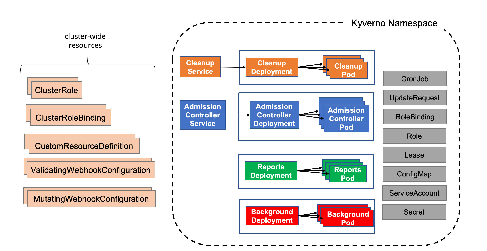

Kyverno는 Helm과 YAML 매니페스트라는 두 가지 설치 방법을 제공한다. 프로덕션 환경에는 Helm을 권장한다. 다양한 사용자 지정 요구를 충족하는 구성 옵션을 편리하게 제공하는 가장 유연한 방법이기 때문이다. 어떤 방법을 쓰든 Kyverno는 항상 전용 네임스페이스에 설치해야 한다. `kube-system` 같은 시스템 네임스페이스를 비롯해 기존 네임스페이스에서 다른 애플리케이션과 함께 두어서는 안 된다. Kyverno 네임스페이스에 관련 없는 다른 애플리케이션과 서비스를 배포하는 것도 피해야 한다.

아래 다이어그램은 사용 가능한 모든 컨트롤러를 갖춘 일반적인 Kyverno 설치 모습이다.



<br />
<br />

표준 Kyverno 설치는 여러 컴포넌트로 이루어지며, 일부는 선택 사항이다.

- **디플로이먼트(Deployment)**
  - 어드미션 컨트롤러(필수): API 서버의 웹훅 콜백을 처리하는 Kyverno의 핵심 컴포넌트이다. 검증, 변경, [정책 예외](/docs/guides/exceptions), 처리 엔진을 담당한다.
  - 백그라운드 컨트롤러(선택): 생성 규칙과 기존 리소스 변경(mutate-existing) 규칙 처리를 담당하는 컴포넌트이다.
  - 리포트 컨트롤러(선택): [정책 리포트](/docs/guides/reports) 처리를 담당하는 컴포넌트이다.
  - 정리 컨트롤러(선택): [DeletingPolicy](/docs/policy-types/deleting-policy)와 [TTL 정리](/docs/guides/ttl-cleanup)를 담당하는 컴포넌트이다.
- **서비스**
  - 웹훅 요청을 받는 데 필요한 서비스
  - 메트릭 모니터링에 필요한 서비스
- **서비스어카운트(ServiceAccount)**
  - 컨트롤러마다 서비스어카운트를 하나씩 두어, 각 컨트롤러가 담당 리소스를 다루는 데 필요한 권한을 분리하고 제한한다.
- **컨피그맵(ConfigMap)**
  - Kyverno의 기본 구성을 담는 컨피그맵
  - 메트릭 구성을 담는 컨피그맵
- **시크릿(Secret)**
  - 웹훅 등록과 API 서버 인증에 쓰는 시크릿
- **롤(Role)과 바인딩**
  - 각 서비스어카운트가 자기 범위의 리소스를 다룰 수 있도록 권한을 부여하는 롤, 클러스터롤(ClusterRole), 롤바인딩(RoleBinding), 클러스터롤바인딩(ClusterRoleBinding)
- **웹훅**
  - 정책과 리소스의 검증 요청을 모두 받는 ValidatingWebhookConfiguration
  - 정책과 리소스의 변경 요청을 모두 받는 MutatingWebhookConfiguration
- **커스텀리소스데피니션(CustomResourceDefinition)**
  - 정책, 리포트, 그 중간 리소스에 해당하는 사용자 정의 리소스를 정의하는 CRD

## 쿠버네티스 호환성

지원하는 릴리스와 호환성은 [릴리스](/docs/installation/releases/)를 참고한다.

## Helm 차트

Helm 차트는 프로덕션 수준의 고가용성 Kyverno 설치에 권장하는 방법이다. 플랫폼별 제어를 포함해 대부분의 프로덕션 요구를 충족하는 데 필요한 쿠버네티스 리소스와 구성 옵션을 모두 제공한다.

Kyverno는 프로덕션 설치에 권장하고 선호하는 방법인 Helm 차트로 배포할 수 있다. 차트는 Kyverno 저장소나 [Artifact Hub](https://artifacthub.io/)에서 받을 수 있으며, Helm으로 정식 릴리스와 프리릴리스를 모두 설치할 수 있다.

환경 유형과 가용성 요구에 맞는 설치 구성 옵션을 선택한다.

- 프로덕션 설치는 아래 [고가용성](#고가용성-설치) 절을 참고한다.
- 비프로덕션 설치는 아래 [비프로덕션 설치](#비프로덕션-설치) 절을 참고한다.

:::note[버전 선택]
Kyverno v1.20.0은 Helm 차트 버전 `3.10.0`으로 설치한다. 차트 버전과 Kyverno 애플리케이션 버전은 다르다. 다른 릴리스를 설치하려면 `appVersion`이 설치하려는 Kyverno 버전과 일치하는 차트 버전을 선택한다.
:::

### 비프로덕션 설치

비프로덕션 환경에서 Helm으로 Kyverno를 설치하려면 다음 명령을 사용한다.

```sh
helm repo add kyverno https://kyverno.github.io/kyverno/
helm repo update
helm install kyverno kyverno/kyverno --version 3.10.0 -n kyverno --create-namespace
```

### 고가용성 설치

Helm으로 네임스페이스를 만들고 Kyverno를 고가용성 구성으로 설치한다.

```sh
helm install kyverno kyverno/kyverno --version 3.10.0 -n kyverno --create-namespace \
--set admissionController.replicas=3 \
--set backgroundController.replicas=2 \
--set cleanupController.replicas=2 \
--set reportsController.replicas=2
```

`3.10.0` 차트는 쿠버네티스 버전 제약 `>=1.25.0-0`을 선언한다. 이는 차트의 설치 제약이다. 릴리스 지원 정보는 [쿠버네티스 호환성](#쿠버네티스-호환성)을 참고한다.

Kyverno는 서로 다른 컨트롤러로 구성되고 각 컨트롤러는 별도의 디플로이먼트에 들어 있다. 그래서 고가용성은 컨트롤러별로 확보한다. 기본 설치는 레플리카가 하나씩인 디플로이먼트 네 개를 제공한다. 추가 가용성이 필요한 컨트롤러에 고가용성을 구성한다. 레플리카가 여러 개라고 해서 모든 컨트롤러의 확장성이나 성능이 반드시 높아지는 것은 아니다. 자세한 내용은 [고가용성 페이지](/docs/guides/high-availability)를 참고한다.

Helm 차트는 컨트롤러마다 레플리카 여러 개를 구성하는 파라미터를 제공한다. 예를 들어 완전한 고가용성 Kyverno 배포는 다음 값으로 구성한다.

```yaml
admissionController:
  replicas: 3
backgroundController:
  replicas: 3
cleanupController:
  replicas: 3
reportsController:
  replicas: 3
```

이 릴리스에서 사용 가능한 모든 값과 기본값은 [Kyverno 3.10.0 차트 README](https://github.com/kyverno/kyverno/tree/v1.20.0/charts/kyverno)를 참고한다. 프로덕션 환경의 요구에 맞추려면 어떤 값을 덮어써야 하는지 판단해야 하므로, 사용 가능한 차트 값과 기본값을 꼼꼼히 살펴야 한다.

:::caution[참고]
모든 Kyverno 설치에는 어드미션 컨트롤러가 배포되어 있어야 한다. 고가용성 설치에는 레플리카가 최소 2개 이상 필요하다. 확장성 요구와 클러스터 토폴로지에 따라 컨트롤러마다 레플리카를 더 구성할 수 있다.
:::

기본적으로 Kyverno 네임스페이스는 [변경 불가능한 레이블](https://kubernetes.io/docs/concepts/overview/working-with-objects/_print/#automatic-labelling) `kubernetes.io/metadata.name`으로 구성한 namespaceSelector로 제외된다. 차트 값을 설정해 다른 네임스페이스도 제외할 수 있다. 제외에는 namespaceSelector와 objectSelector를 모두 사용할 수 있다.

[네임스페이스 셀렉터](/docs/installation/customization#namespace-selectors) 절, 특히 [보안과 운영 가능성](/docs/installation/installation#보안과-운영-가능성) 절도 함께 참고한다.

### Reports Server (선택)

설치할 때 Reports Server를 서브차트로 선택해 활성화할 수 있다. Reports Server를 Kyverno와 함께 배포하고, Kyverno가 정책 리포트에 이를 사용하도록 구성한다. 준비 상태 확인(`reportsServer.waitForReady`, `reportsServer.readinessTimeout`)도 포함되어 있어, Kyverno는 Reports Server가 동작하기를 기다린 뒤 시작한다.

기본 설정으로 활성화하려면 다음 명령을 실행한다.

```sh
helm install kyverno kyverno/kyverno --version 3.10.0 -n kyverno --create-namespace --set reportsServer.enabled=true
```

### 플랫폼별 설정

EKS, AKS, OpenShift 같은 특정 쿠버네티스 플랫폼에 Kyverno를 배포하거나 ArgoCD 같은 특정 GitOps 도구를 사용할 때는 추가 구성 옵션이 필요하거나 권장될 수 있다. 자세한 내용은 [플랫폼별 참고 사항](/docs/installation/platform-notes) 절을 참고한다.

### 프리릴리스 설치

프리릴리스 버전을 설치하려면 게시된 차트 버전을 선택해 `--version`으로 고정한다. 차트의 `appVersion`이 설치하려는 Kyverno 버전과 일치하는지 확인한다. 특정 Kyverno 버전이 필요하다면 `--devel`만 사용하지 않는다. 다른 프리릴리스가 선택될 수 있다.

### Pod Security Policies (선택)

Kyverno를 설치한 뒤에 Kyverno [Pod Security Standard 정책](/docs/guides/pod-security)을 추가로 설치할 수 있다. 이 선택형 차트에는 쿠버네티스 [Pod Security Standards](https://kubernetes.io/docs/concepts/security/pod-security-standards/)를 구현하는 Kyverno 정책 전체가 들어 있다.

```sh
helm install kyverno-policies kyverno/kyverno-policies --version 3.10.0 -n kyverno
```

## YAML로 Kyverno 설치

Kyverno는 단일 설치 매니페스트로도 설치할 수 있다. 다만 프로덕션 설치에는 Helm 차트를 선호하고 권장한다.

Kyverno는 릴리스 브랜치를 사용하지만 태그가 붙은 릴리스의 YAML 매니페스트만 지원한다. Kyverno를 YAML 매니페스트로 설치하려면 태그가 붙은 릴리스에서 받는다.

```sh
KYVERNO_VERSION=v1.20.0
kubectl create -f "https://github.com/kyverno/kyverno/releases/download/${KYVERNO_VERSION}/install.yaml"
```

## main(최신) 설치

아직 릴리스되지 않은 Kyverno 코드를 빠르게 시험해 보고 싶을 수 있다. 이를 위해 Kyverno는 `main` 개발 브랜치에서 알려진 현재 코드베이스 상태를 반영하는 실험용 설치 매니페스트를 제공한다.

:::caution[경고]
이 매니페스트는 테스트나 실험 목적 외에는 절대 사용하지 않는다!
:::

```sh
kubectl create -f https://github.com/kyverno/kyverno/raw/main/config/install-latest-testing.yaml
```

<a id="security-vs-operability"></a>

## 보안과 운영 가능성

프로덕션 설치에서는 Kyverno를 [고가용성 모드](/docs/installation/installation#고가용성-설치)로 설치해야 한다. 설치 방법과 상관없이 웹훅의 위험과 그것이 클러스터 운영 및 보안, 특히 프로덕션 환경에 미칠 영향을 이해하는 것이 중요하다. Kyverno는 리소스 웹훅을 기본적으로 [실패 시 차단(fail closed) 모드](https://kubernetes.io/docs/reference/access-authn-authz/extensible-admission-controllers/#failure-policy)로 구성한다. [구성은 변경할 수 있다](/docs/installation/customization#webhooks). 정책과 일치하는 리소스의 AdmissionReview 요청을 API 서버가 Kyverno에 보내려 했는데 Kyverno에 연결할 수 없으면 그 요청은 실패한다. 예를 들어 모든 파드가 root가 아닌 사용자로 실행되어야 한다고 검사하는 검증 정책이 있다고 하자. 새 파드 생성 요청이 API 서버에 제출되었는데 API 서버가 Kyverno에 연결할 수 없다. 정책을 평가할 수 없으므로 파드 생성 요청은 실패한다. 따라서 Kyverno를 항상 사용할 수 있게 하거나, 주요 네임스페이스(특히 Kyverno의 네임스페이스)를 제외하도록 적절히 구성해 Kyverno가 해당 API 요청을 받을 수 있게 해야 한다. 어느 쪽을 선택하든 기본 보안과 운영 가능성은 서로 맞바꾸는 관계이다.

Kyverno 네임스페이스를 제외하지 않으면 다음 조건이 겹칠 때 클러스터가 동작하지 않을 수 있다.

1. `Pods`에 일치하는 Kyverno 규칙이 하나 이상 실패 시 차단 모드(기본 설정)로 구성되어 있다.
2. 적어도 Kyverno 네임스페이스, 그리고 가능하면 `kube-system` 같은 다른 주요 시스템 네임스페이스의 네임스페이스 제외 설정이 없다.
3. 클러스터 전체 장애나 노드의 부적절한 축소(예: 클라우드 PaaS가 오토스케일링 작업 중 파드를 먼저 cordon하고 drain하지 않은 채 노드 그룹의 노드를 너무 많이 삭제하는 경우)로 모든 Kyverno 파드를 사용할 수 없게 된다.

이런 상황이 발생하면 ValidatingWebhookConfiguration을 수동으로 삭제해 새 Kyverno 파드가 시작되게 하는 것이 유일한 복구 방법이다. 복구 절차는 [문제 해결 절](/docs/guides/troubleshooting#api-server-is-blocked)에 있다.

:::note[참고]
Kubernetes는 ValidatingWebhookConfiguration이나 MutatingWebhookConfiguration 오브젝트를 어드미션 컨트롤러에 보내지 않는다. 따라서 Kyverno 정책으로 이 오브젝트를 검증하거나 변경할 수 없다.
:::

반면 보안을 일부 양보하면 이런 운영상 우려를 줄일 수 있다. 구체적으로 설치할 때 Kyverno 네임스페이스와 다른 시스템 네임스페이스를 제외하면, 앞서 설명한 장애 상황이 발생하더라도 Kyverno가 수동 개입 없이 스스로 복구할 수 있다. Kyverno 네임스페이스 제외는 Helm 차트 버전 2.5.0부터 기본값이 되었으며, 이는 역사적 배경일 뿐 현재 모든 차트 기본값을 뜻하지는 않는다. 게시된 3.10.0 차트에서는 Kyverno 네임스페이스 제외가 기본으로 활성화되어 있고 웹훅 `namespaceSelector`가 `kube-system`을 제외한다. 다른 차트 버전의 기본값은 버전에 맞는 차트 README에서 확인한다. 이런 제외를 구성하면 API 서버가 해당 네임스페이스로 향하는 리소스의 AdmissionReview 요청을 보내지 않으므로, 이후의 정책은 그 리소스에 작용할 수 없다. 따라서 해당 네임스페이스를 통제하는 일은 클러스터 관리자의 몫이다. 예를 들어 쿠버네티스 RBAC로 제외된 네임스페이스에서 누가 무엇을 할 수 있는지 제한할 수 있다.

:::note[참고]
네임스페이스나 네임스페이스 안의 오브젝트는 namespaceSelector와 objectSelector를 비롯한 여러 방식으로 제외할 수 있다. Helm 차트는 두 가지 옵션을 모두 제공하며, 기본적으로는 Kyverno 네임스페이스가 제외된다.
:::

:::caution[참고]
objectSelector를 사용할 때 사용자가 웹훅 구성 방식을 알아내면 웹훅 구성에 쓰인 것과 같은 레이블 키/값을 위조해 리소스가 정책 감지를 피하게 할 수 있다. 이 때문에 변경 불가능한 레이블 `kubernetes.io/metadata.name`을 쓰는 namespaceSelector를 권장한다.
:::

선택지와 그 영향은 다음과 같다.

1. 설치할 때 Kyverno 네임스페이스를 포함한 시스템 네임스페이스를 제외하지 않는다. 기본적으로 더 안전한 상태가 되지만, 일부 장애 상황에서는 수동 복구 절차가 필요할 수 있다.
2. 설치할 때 시스템 네임스페이스를 제외한다. 클러스터 복구는 쉬워지지만, 해당 네임스페이스는 예를 들어 쿠버네티스 RBAC 같은 다른 방법으로 보호해야 할 수 있다. 설치하는 차트 버전의 기본값을 검토한다.

위험 회피 성향, 요구 사항, 운영 관행에 따라 가장 알맞은 선택지를 고른다.

:::note[참고]
Kyverno나 시스템 네임스페이스/오브젝트를 제외하지 않고 정책으로 다루려면, [컨피그맵](/docs/installation/customization#configmap-keys)의 Kyverno [resourceFilters](/docs/installation/customization#resource-filters) 항목에서 해당 항목을 제거해야 할 수 있다.
:::
