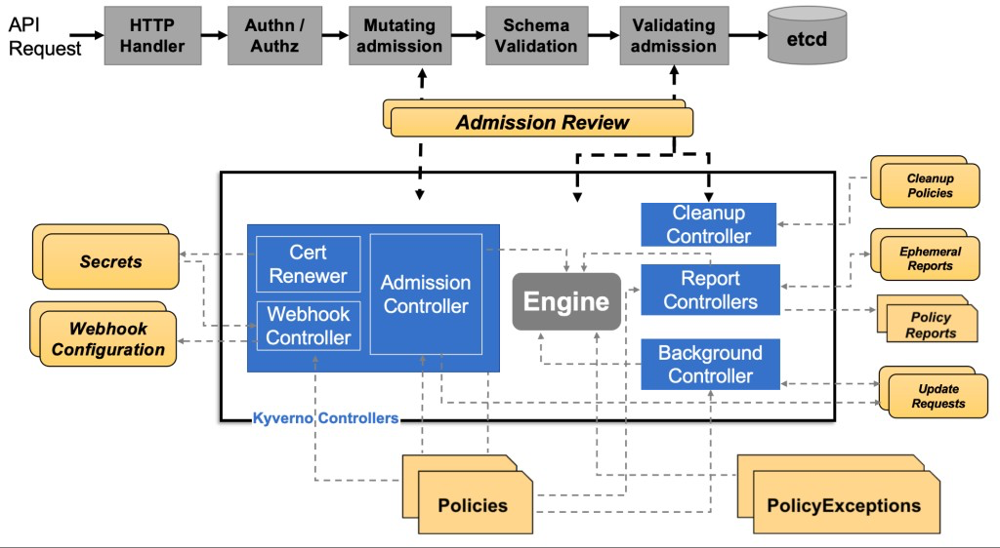

## Kubernetes 컨트롤러

Kyverno는 Kubernetes 클러스터에서 [동적 어드미션 컨트롤러](/docs/guides/admission-controllers)와 선택적인 다른 컨트롤러로 실행됩니다. Kubernetes API 서버가 보내는 검증 및 변경 어드미션 웹훅 HTTP 콜백을 받아 일치하는 정책을 적용하고, 어드미션 정책을 강제하거나 요청을 거부하는 결과를 반환합니다. 또한 일치하는 리소스를 런타임에 스캔합니다.

Kyverno 정책은 리소스 종류, 이름, 레이블 셀렉터 등 다양한 조건으로 리소스를 매칭합니다.

변경 정책은 ([Kustomize](https://kubernetes.io/docs/tasks/manage-kubernetes-objects/kustomization/#bases-and-overlays)와 비슷한) 오버레이나 [RFC 6902 JSON Patch](http://jsonpatch.com/)로 작성합니다. 검증 정책도 오버레이 스타일 구문을 사용하며, 패턴 매칭과 조건부(if-then-else) 처리를 지원합니다.

정책 강제 내역은 Kubernetes 이벤트로 기록됩니다. 허용된 요청과 Kyverno 정책이 도입되기 전에 이미 있던 리소스에 대해서는, 정책에 일치한 리소스의 목록과 상태 등을 계속 갱신하는 정책 리포트(Policy Report)를 클러스터에 생성합니다.

아래 다이어그램은 Kyverno의 상위 수준 논리 아키텍처입니다.

  

**Webhook**은 Kubernetes API 서버가 보내는 AdmissionReview 요청을 받아 **Engine**에 넘겨 처리하는 서버입니다. **Webhook Controller**가 설치된 정책을 감시하면서 웹훅을 수정해, 그 정책에 일치하는 리소스만 요청하도록 웹훅을 동적으로 구성합니다. **Cert Renewer**는 웹훅에 필요하며 Kubernetes 시크릿으로 저장된 인증서를 감시하고 갱신합니다. **Background Controller**는 중간 리소스인 UpdateRequest를 조정(reconcile)해 모든 generate 및 mutate-existing 정책을 처리합니다. **Report Controllers**는 중간 리소스인 Admission Report와 Background Scan Report로 정책 리포트를 생성하고 조정합니다.

Kyverno는 고가용성도 지원합니다. 고가용성 Kyverno 설치란 설치하기로 선택한 컨트롤러를 여러 레플리카로 실행하도록 구성한 설치를 말합니다. 컨트롤러에 따라서는 추가 레플리카가 Kyverno의 확장성을 높이는 역할도 합니다. Kyverno 컨트롤러별 구성 요소와 가용성 처리 방식은 [고가용성 페이지](/docs/guides/high-availability)를 참고하세요.

## 명령줄 인터페이스(CLI)

명령줄 인터페이스(CLI)로 클러스터나 리소스 파일(Kubernetes 리소스 매니페스트, Terraform JSON 플랜, Dockerfile 등)에 Kyverno 정책을 적용할 수 있습니다. 정책은 Kubernetes 리소스 매니페스트에 적용할 수 있습니다.

자세한 내용은 [Kyverno CLI](/docs/subprojects/kyverno-cli/) 문서를 참고하세요.

## 인가 서버

Kyverno 정책을 애플리케이션 인가에 쓸 수 있습니다. Envoy와 HTTP 페이로드를 지원하며, 중앙 서비스나 사이드카 컨테이너로 실행할 수 있습니다.

자세한 내용은 <a href="https://kyverno.github.io/kyverno-authz/latest/" target="_blank" rel="noopener">Kyverno Authz</a> 문서를 참고하세요.

## Kyverno SDK

Kyverno SDK로 자체 애플리케이션이나 서비스에서 Kyverno 엔진을 빌드하고 실행할 수 있습니다.
