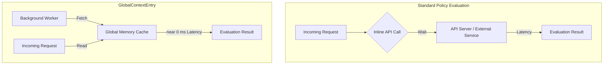

무거운 데이터셋을 중앙에서 미리 가져와 두면, 여러 정책이 CEL 표현식의 `globalContext.Get()`으로 들어오는 변경·검증·생성 요청을 평가할 수 있습니다. 결과는 정책 변수에 저장하고 `variables.<name>`으로 참조합니다.

> **고가용성(HA) 참고:** 고가용성 구성에서는 Kyverno 레플리카마다 독립된 메모리 캐시를 따로 유지합니다. 어드미션 요청을 처리하는 레플리카가 다를 수 있고, 갱신 주기 사이에는 레플리카별 캐시의 최신 정도가 조금씩 다를 수 있습니다. 정상적인 동작이므로, 정책은 레플리카별 최종적 일관성(eventual consistency)을 허용하도록 설계하세요.

---

## 사전 요구 사항

`GlobalContextEntry`를 설정하기 전에 다음을 확인하세요.

- 이 페이지의 `policies.kyverno.io/v1` CEL 정책 예시를 쓰려면 클러스터에 **Kyverno 1.18.0 이상**이 설치되어 있어야 합니다. `GlobalContextEntry` 자체는 v1.12.0에서 도입되었습니다. 버전은 다음 명령으로 확인합니다.

  ```bash
  # Linux/macOS
  kubectl get deployment -n kyverno -o jsonpath='{range .items[*]}{.metadata.name}{": "}{.spec.template.spec.containers[0].image}{"\n"}{end}'

  # Windows PowerShell
  kubectl get deployment -n kyverno -o jsonpath="{range .items[*]}{.metadata.name}{': '}{.spec.template.spec.containers[0].image}{'\n'}{end}"
  ```

- 클러스터 범위 리소스를 만들 수 있는 권한이 있는 **kubectl** 접근 권한이 필요합니다.
- **Kyverno ServiceAccount RBAC:** `kubernetesResource` 모드에서는 Kyverno ServiceAccount에 대상 리소스에 대한 `get`, `list`, `watch` 권한이 있어야 합니다. 커스텀 리소스(CR)일 때 특히 중요합니다.

> **API 버전 참고:** `GlobalContextEntry`는 `apiVersion: kyverno.io/v2`를 사용합니다. 이전 버전인 `kyverno.io/v2alpha1`은 더 이상 사용을 권장하지 않지만(deprecated), `GlobalContextEntry` 리소스 자체는 계속 지원되며 폐기 예정이 아닙니다. CEL 기반 정책 유형과도 계속 함께 쓸 수 있습니다.

### 커스텀 리소스(CR)에 RBAC 권한 부여

CRD가 제공하는 **커스텀 리소스(CR)**를 캐시하려면(예: 커스텀 API 그룹의 리소스), JSON 패치로 Kyverno의 기존 ClusterRole에 규칙을 추가합니다.

```bash
  # Linux/macOS
  kubectl patch clusterrole kyverno:admission-controller --type=json --patch '[{"op":"add","path":"/rules/-","value":{"apiGroups":["your.crd.group"],"resources":["yourresources"],"verbs":["get","list","watch"]}}]'
```

```powershell
  # Windows PowerShell
  kubectl patch clusterrole kyverno:admission-controller --type=json --patch '[{"op":"add","path":"/rules/-","value":{"apiGroups":["your.crd.group"],"resources":["yourresources"],"verbs":["get","list","watch"]}}]'
```

> **참고:** `your.crd.group`과 `yourresources`는 실제 CRD의 API 그룹과 리소스 이름(소문자, 복수형)으로 바꾸세요. 이 명령은 기존 규칙을 덮어쓰지 않고 뒤에 추가합니다. `configmaps`, `secrets` 같은 표준 리소스에는 기본 권한이 이미 있으므로 패치가 필요 없습니다.

---

## 개념과 아키텍처: 왜 필요한가



Kyverno는 Kubernetes 어드미션 컨트롤러 웹훅으로 동작합니다. 리소스 수명 주기 이벤트(예: `kubectl apply`)가 발생하면 Kyverno가 요청을 가로채, 지연을 최소로 유지하면서 허용할지 거부할지 판단해야 합니다.

### 문제: 인라인 조회 방식의 병목

정책이 어드미션 리뷰 페이로드 밖의 데이터를 필요로 할 때가 있습니다. ConfigMap에 저장된 허용 레지스트리 목록이 그런 예입니다. 이때는 CEL [resource 라이브러리](/docs/policy-types/cel-libraries#resource-라이브러리)나 [HTTP 라이브러리](/docs/policy-types/cel-libraries#http-라이브러리)로 인라인 조회를 할 수 있습니다.

클러스터 밀도가 높은 환경에서 CI/CD 엔진(예: Argo CD, Flux)이 마이크로서비스 200개를 한꺼번에 배포한다고 해 봅시다.

- Kyverno는 똑같은 데이터를 가져오려고 Kubernetes API 서버나 외부 웹훅에 **서로 다른 네트워크 호출 200개를 동시에** 보내야 합니다.
- 그 결과 내부 네트워크 지연이 급증하고, API 서버 계층에서 연결 제한이 심해지며, 클러스터 CPU 사용량이 크게 늘어납니다. 어드미션 타임아웃이 발생하기도 합니다.

### 해결: 전역 메모리 캐싱

`GlobalContextEntry`는 정책 실행 경로를 외부 네트워크 의존성에서 완전히 분리합니다.

어드미션 평가 중에 실시간으로 데이터를 가져오는 대신, Kyverno는 리소스 추적을 비동기 백그라운드 워커 루프에 맡깁니다.

1. **백그라운드 수집:** Kyverno가 지정된 클러스터 리소스나 외부 대상을 한 번 조회해 로컬 메모리 구조를 만듭니다.
2. **결정적인 갱신:** `apiCall` 모드에서는 사용자가 설정한 `refreshInterval` 간격으로 대상을 폴링합니다. `kubernetesResource` 모드에서는 Kubernetes watch/informer 메커니즘으로 리소스 변경을 자동 추적하므로 폴링이 필요 없습니다.
3. **즉시 조회:** 마이크로서비스 200개가 같은 시점에 정책 평가를 일으켜도 Kyverno는 로컬 RAM 캐시에서 바로 평가 데이터를 제공합니다. 네트워크 오버헤드가 0ms에 가깝게 줄어서, 대규모 조직 환경에서도 수평 확장이 안정적으로 유지됩니다.

---

## 시작하기

`GlobalContextEntry`를 가장 빠르게 쓰는 방법은 두 단계입니다. 먼저 캐시 항목을 정의하고, 그다음 정책에서 참조합니다.

### 1단계: GlobalContextEntry 만들기

```yaml
apiVersion: kyverno.io/v2
kind: GlobalContextEntry
metadata:
  name: my-first-cache
spec:
  kubernetesResource:
    group: ''
    version: v1
    resource: configmaps
    namespace: default
```

### 2단계: 정책에서 참조하기

```yaml
spec:
  variables:
    - name: cachedConfigmaps
      expression: globalContext.Get("my-first-cache", "")
```

이제 인라인 API 호출 없이 CEL 표현식에서 `variables.cachedConfigmaps`를 쓸 수 있습니다. [전체 정책 예시](#2단계-정책을-항목에-연결하기)와 [설정 모드](#설정-모드)를 참고하세요.

---

## 설정 모드

`GlobalContextEntry`에는 아래 소스 필드 중 정확히 하나만 지정해야 합니다. 두 필드는 함께 쓸 수 없습니다.

- `kubernetesResource`: 클러스터 안의 네이티브 객체를 감시하고 매핑합니다.
- `apiCall`: 외부 엔드포인트를 폴링하거나 구조화된 내부 HTTP 요청을 수행합니다.

두 모드 모두 `projections` 블록을 추가하면 정책이 데이터를 사용하기 전에 JMESPath로 캐시 데이터를 미리 걸러 둘 수 있습니다.

### 1. Kubernetes 리소스 캐싱

내부 토폴로지 데이터, 구조 메타데이터, 공유 설정 경계(예: `ConfigMaps`, `Namespaces`, 커스텀 리소스 설정)를 가져올 때 이 모드를 사용합니다.

| 스키마 필드 | 값 타입 | 필수      | 엔진 검증 제약                                                                                                                                                                                                                                                                              |
| :---------- | :------ | :-------- | :------------------------------------------------------------------------------------------------------------------------------------------------------------------------------------------------------------------------------------------------------------------------------------------ |
| `group`     | string  | 조건부    | Kubernetes API 그룹입니다(예: `apps`). 코어가 아닌 리소스에는 필수입니다. 빈 문자열 `""`은 **`version`도 `v1`일 때만** 쓸 수 있으며, 유효한 코어 API 조합은 이것뿐입니다. 다른 조합(예: `group: ""`와 `version: v1beta1`)은 스키마 검증에 실패합니다.                                        |
| `version`   | string  | **예**    | 명시적인 API 버전입니다(예: `v1`, `v1beta1`).                                                                                                                                                                                                                                              |
| `resource`  | string  | **예**    | **소문자 복수형이어야 합니다**(`ConfigMap`이 아니라 `configmaps`, `secrets` 등).                                                                                                                                                                                                           |
| `namespace` | string  | 아니요    | 대상 네임스페이스 범위입니다. 생략하면 Kyverno가 **모든 네임스페이스**를 전역으로 추적합니다.                                                                                                                                                                                              |

> **중요:** 캐시할 리소스, 특히 커스텀 리소스(CR)에 대해 Kyverno ServiceAccount에 필요한 RBAC 권한(`get`, `list`, `watch`)이 있는지 확인하세요.

#### 문법 예시: 로컬 ConfigMap 추적

```yaml
apiVersion: kyverno.io/v2
kind: GlobalContextEntry
metadata:
  name: configmap-cache
spec:
  kubernetesResource:
    group: ''
    version: v1
    resource: configmaps
    namespace: default
```

### 2. 외부 API 캐싱

Kubernetes 생태계 밖에서 관리하는 권한 목록, 신원 정의, 운영 제약을 가져와 동기화할 때 이 모드를 사용합니다.

| 스키마 필드       | 기본값 | 엔진 검증 제약                                                                                    |
| :---------------- | :----- | :------------------------------------------------------------------------------------------------ |
| `urlPath`         | —      | **로컬 Kubernetes API 서버**를 조회하는 경로입니다. `service.url`과 함께 쓸 수 없습니다.          |
| `service.url`     | —      | **외부 엔드포인트**의 전체 URL입니다. `urlPath`와 함께 쓸 수 없습니다.                            |
| `refreshInterval` | `10m`  | 백그라운드 폴링 주기입니다. 기간 문자열(예: `30s`, `5m`, `2h`)을 받으며 `0s`보다 커야 합니다.     |
| `retryLimit`      | `3`    | 동기화 루프가 오류를 내기 전까지 재시도할 최대 횟수입니다. 최솟값은 `1`입니다.                    |
| `method`          | `GET`  | HTTP 메서드입니다. `data` 페이로드 배열을 지정하면 **반드시 `POST`로 설정해야 합니다.**           |

> **메서드 강제:** `apiCall`에서 `data` 배열 파라미터로 요청 페이로드를 보내면, HTTP 스키마 엔진이 `method`를 **반드시 POST로 설정하도록** 강제합니다.

#### 문법 예시: 외부 메타데이터 가져오기

```yaml
apiVersion: kyverno.io/v2
kind: GlobalContextEntry
metadata:
  name: corporate-teams-cache
spec:
  apiCall:
    service:
      url: 'https://api.internal.corporate/v1/teams'
    refreshInterval: 5m
    retryLimit: 5
```

## 데이터 프로젝션 (JMESPath 슬라이싱)

대규모 외부 API 페이로드나 여러 네임스페이스에 걸친 방대한 컬렉션을 메모리에 캐시하면 시스템 부담이 커질 수 있습니다. Kyverno는 **JMESPath**를 사용하는 `projections`를 지원합니다. 정책은 캐시된 데이터 중 필요한 부분만 좁혀서 볼 수 있습니다.

> **API 소스에 관한 참고:**
>
> - **로컬 Kubernetes API 서버**를 조회할 때(예: 내부 클러스터 리소스 가져오기)는 `urlPath`를 사용합니다.
> - **외부 엔드포인트**를 대상으로 할 때(예: 외부 인벤토리나 보안 서비스)는 `service.url`을 사용합니다.

> 두 필드는 **함께 쓸 수 없습니다.** `apiCall` 항목 하나에는 둘 중 하나만 정의할 수 있습니다.

프로젝션은 복잡한 원본 구조를 정책이 쓰기 쉬운 정확한 키-값이나 명시적인 문자열 배열로 바꾸는 고성능 필터링 계층입니다. 정책 평가가 단순해지고 규칙이 순회해야 하는 데이터가 줄어듭니다. 다만 캐시된 원본 페이로드가 반드시 없어지는 것은 아닙니다.

> **중요:** 프로젝션의 `name`은 `GlobalContextEntry`의 `metadata.name`과 달라야 합니다. 이름이 같으면 스키마 검증에서 `"A projection entry requires a name different from the global context entry name"` 오류가 납니다.
>
> 예를 들어 항목 이름이 `my-k8s-cached-data`라면 프로젝션 이름도 `my-k8s-cached-data`로 지을 수 없습니다. `config-names`처럼 용도를 나타내는 하위 이름을 쓰세요.

프로젝션은 `urlPath`(Kubernetes API 서버)와 `service.url`(외부 엔드포인트) 모두에서 동작합니다. 두 가지 형태는 다음과 같습니다.

**Kubernetes API 서버 응답은** `urlPath`를 사용합니다.

```yaml
apiVersion: kyverno.io/v2
kind: GlobalContextEntry
metadata:
  name: my-k8s-cached-data
spec:
  apiCall:
    urlPath: '/api/v1/namespaces/default/configmaps'
  projections:
    - name: config-names
      jmesPath: 'items[].metadata.name'
```

**외부 엔드포인트 응답은** `service.url`을 사용합니다.

```yaml
apiVersion: kyverno.io/v2
kind: GlobalContextEntry
metadata:
  name: my-external-cached-data
spec:
  apiCall:
    service:
      url: 'https://api.internal.corporate/v1/teams'
    refreshInterval: 5m
  projections:
    - name: team-ids
      jmesPath: 'teams[].id'
```

> `urlPath`와 `service.url`은 **함께 쓸 수 없습니다.** `apiCall` 항목 하나에는 둘 중 하나만 정의할 수 있습니다. 클러스터 내부 Kubernetes API 리소스에는 `urlPath`를, 외부 HTTP 엔드포인트에는 `service.url`을 사용하세요.

### 정책에서 캐시 데이터 참조하기

`globalContext.Get()`으로 `GlobalContextEntry`를 참조합니다. 첫 번째 인자는 항목 이름이고 두 번째 인자는 그 항목에 정의한 프로젝션 이름입니다. 빈 문자열을 넘기면 캐시된 페이로드 전체를 가져오며, 이후 CEL로 필터링합니다.

```yaml
spec:
  variables:
    - name: configmapNames
      expression: globalContext.Get("shared-config-cache", "").map(cm, cm.metadata.name)
```

> **JMESPath 형태 알림:**
>
> - `kubernetesResource` 모드 → `[].metadata.name`을 사용합니다.
> - `apiCall.urlPath` 모드 → `items[].metadata.name`을 사용합니다.

`GlobalContextEntry` 스펙에 `projections`를 정의했다면 두 번째 인자로 프로젝션 이름을 넘깁니다.

```yaml
spec:
  variables:
    - name: configmapNames
      expression: globalContext.Get("my-k8s-cached-data", "config-names")
```

## 최종적 일관성과 운영 참고 사항

**최종적 일관성:** 캐시는 비동기로 갱신됩니다. 갱신 주기 사이에는 정책 평가가 잠시 오래된 데이터를 쓸 수 있습니다. 특히 자주 바뀌는 리소스를 다룰 때는 이 시간차를 허용하도록 정책 로직을 설계하세요.

**운영 환경 보안: 외부 API 호출**

- 자격 증명은 리소스 스펙에 하드코딩하지 말고 Kubernetes `Secrets`에 저장하세요.
- 모든 외부 엔드포인트에 유효한 TLS 인증서를 적용하세요.

**인라인 조회와 `GlobalContextEntry`, 언제 무엇을 쓸까:**

| 항목             | CEL resource 또는 HTTP 조회          | `GlobalContextEntry`                       |
| :--------------- | :----------------------------------- | :----------------------------------------- |
| **성능**         | 오버헤드가 큼(요청마다 호출 1회)     | 성능이 높음(RAM 캐시에서 제공)             |
| **사용 사례**    | 실시간으로 자주 바뀌는 데이터        | 정적이거나 천천히 바뀌는 데이터            |
| **확장성**       | 부하가 크면 API 서버가 과부하될 수 있음 | API 서버 부하를 크게 줄임               |
| **데이터 최신성** | 항상 최신                           | 최종적 일관성                              |

### 캐시 실패 시 동작

`GlobalContextEntry`를 불러오거나 갱신하지 못하면(예: 외부 엔드포인트에 접근할 수 없고 `retryLimit`을 모두 소진한 경우), `globalContext.Get()`으로 이를 참조하는 정책은 동기화에 성공할 때까지 평가 오류가 날 수 있습니다.

운영 클러스터에서는 리소스의 `status.conditions`와 `status.lastRefreshTime`을 모니터링하고, Kyverno 컨트롤러 로그에서 `globalcontext` 오류를 확인하세요.

## 실전 사용 사례와 청사진

### 1. 여러 정책에서 공유 ConfigMap 데이터 참조

클러스터 전체 설정 매핑을 중앙에서 캐시하는 시나리오입니다. 여러 규칙이 각자 클러스터를 조회하는 비용 없이 캐시를 교차 참조할 수 있습니다.

#### 1단계: 캐시 항목 정의

```yaml
apiVersion: kyverno.io/v2
kind: GlobalContextEntry
metadata:
  name: shared-config-cache
spec:
  kubernetesResource:
    group: ''
    version: v1
    resource: configmaps
    namespace: default
```

> **페이로드 구조:** 캐시된 데이터의 형태는 모드에 따라 다릅니다.
>
> - **`kubernetesResource` 모드**는 배열을 반환합니다. CEL에서는 `.map(cm, cm.metadata.name)`을 사용합니다.
> - **`apiCall.urlPath` 모드**는 Kubernetes API 엔벨로프를 반환합니다. CEL에서는 `.items.map(cm, cm.metadata.name)`을 사용합니다.
>
> 표현식을 작성하기 전에 [검증](#검증)의 명령으로 원본 페이로드를 확인하세요.

#### 2단계: 정책을 항목에 연결하기

```yaml
apiVersion: policies.kyverno.io/v1
kind: ValidatingPolicy
metadata:
  name: require-configmap-via-gctx
spec:
  validationActions: [Deny]
  evaluation:
    background:
      enabled: false
  matchConstraints:
    resourceRules:
      - apiGroups: ['apps']
        apiVersions: ['v1']
        operations: ['CREATE', 'UPDATE']
        resources: ['deployments']
  variables:
    - name: configmaps
      expression: globalContext.Get("shared-config-cache", "")
  validations:
    - expression: variables.configmaps.exists(cm, cm.metadata.name == "app-config")
      message: "Required 'app-config' ConfigMap is missing from the cache."
```

### 2. 승인된 컨테이너 레지스트리 캐싱 (외부 API)

외부 인벤토리 카탈로그 관리자에 저장된, 검증된 기업 관리 이미지 도메인에서만 클러스터 배포가 이미지를 가져오도록 하는 구현입니다.

#### 1단계: 캐시 항목 정의

```yaml
apiVersion: kyverno.io/v2
kind: GlobalContextEntry
metadata:
  name: approved-registries-cache
spec:
  apiCall:
    service:
      url: 'https://api.corporate.internal/v1/registries'
    refreshInterval: 30m
    retryLimit: 3
```

#### 2단계: 정책을 항목에 연결하기

API가 `{"allowed": ["internal-registry.io", "gcr.io"]}`를 반환한다고 가정합니다.

```yaml
apiVersion: policies.kyverno.io/v1
kind: ValidatingPolicy
metadata:
  name: restrict-registries-global
spec:
  validationActions: [Deny]
  evaluation:
    background:
      enabled: false
  matchConstraints:
    resourceRules:
      - apiGroups: ['']
        apiVersions: ['v1']
        operations: ['CREATE', 'UPDATE']
        resources: ['pods', 'pods/ephemeralcontainers']
  variables:
    - name: allowedRegistries
      expression: globalContext.Get("approved-registries-cache", "").allowed
  validations:
    - expression: >-
        (object.spec.containers
          + object.spec.?initContainers.orValue([])
          + object.spec.?ephemeralContainers.orValue([])).all(container,
          image(container.image).registry() in variables.allowedRegistries)
      message: 'The container image registry is not approved by enterprise security policy.'
```

> **레지스트리 추출 방식:** CEL [image 라이브러리](/docs/policy-types/cel-libraries#image-라이브러리)가 이미지 참조를 파싱해 레지스트리 호스트 이름을 반환합니다.
>
> `variables.allowedRegistries`에는 전체 이미지 경로가 아니라 레지스트리 호스트 이름만 들어 있어야 합니다(예: `"internal-registry.io"`, `"gcr.io"`).

### 3. RBAC·조직 메타데이터 캐싱

특정 네임스페이스 경계에 걸친 팀 메타데이터 역할을 동적으로 추적하는 것처럼, 성능 부담이 큰 검증 구조에 유용합니다.

#### 1단계: 캐시 항목 정의

```yaml
apiVersion: kyverno.io/v2
kind: GlobalContextEntry
metadata:
  name: rbac-team-cache
spec:
  kubernetesResource:
    group: 'rbac.authorization.k8s.io'
    version: v1
    resource: clusterrolebindings
```

#### 2단계: 정책을 항목에 연결하기

```yaml
apiVersion: policies.kyverno.io/v1
kind: ValidatingPolicy
metadata:
  name: validate-team-namespace-access
spec:
  validationActions: [Deny]
  evaluation:
    background:
      enabled: false
  matchConstraints:
    resourceRules:
      - apiGroups: ['']
        apiVersions: ['v1']
        operations: ['CREATE']
        resources: ['namespaces']
  variables:
    - name: bindings
      expression: globalContext.Get("rbac-team-cache", "")
  validations:
    - expression: >-
        variables.bindings.exists(binding,
          has(binding.subjects) && binding.subjects.exists(subject,
            subject.kind == "User" && subject.name == request.userInfo.username))
      message: 'User initiating namespace creation is not registered in cluster role metadata.'
```

## 검증

> **참고:** `gctxentry`는 항상 `GlobalContextEntry`의 약칭으로 등록됩니다(Kyverno CRD에 `shortName=gctxentry`로 정의됨). 클러스터에서 사용할 수 있는 Kyverno 리소스 약칭은 다음 명령으로 확인할 수 있습니다: `kubectl api-resources | grep kyverno`

```bash
# Linux/macOS
kubectl api-resources | grep kyverno

# Windows
kubectl api-resources | findstr kyverno
```

아래 단계로 `GlobalContextEntry`가 실제로 동기화되고 있는지, 정책이 그 데이터를 제대로 쓸 수 있는지 확인하세요.

### 1. 리소스 상태와 조건 확인

```bash
kubectl get globalcontextentries <entry-name> -o yaml
```

출력에서 `status` 블록을 확인합니다. 정상 항목은 다음과 같습니다.

```yaml
status:
  conditions:
    - type: Ready
      status: 'True'
      reason: Succeeded
      message: 'GlobalContextEntry synced successfully'
```

확인할 핵심 필드는 다음과 같습니다.

| 필드                              | 확인할 내용                                                                                 |
| :-------------------------------- | :------------------------------------------------------------------------------------------ |
| `status.conditions[].type: Ready` | `"True"`여야 합니다. 다른 값이면 캐시가 데이터를 제공하지 못하는 상태입니다.                |
| `status.conditions[].reason`      | `Succeeded`는 정상입니다. `Failed`이면 message 필드에서 오류를 확인하세요.                   |
| `status.lastRefreshTime`          | 마지막으로 동기화에 성공한 시각입니다. 오래되었다면 백그라운드 워커가 멈췄을 수 있습니다.    |

### 2. 실시간 동기화 이벤트 확인

```bash
kubectl get events -n kyverno --field-selector \
  involvedObject.kind=GlobalContextEntry,involvedObject.name=<entry-name>
```

로그를 뒤지지 않고도 동기화 실패, 재시도 한도 소진, RBAC 거부 이벤트를 바로 볼 수 있습니다.

### 3. Kyverno 컨트롤러 로그 확인

먼저 설치 환경에서 쓰는 컴포넌트 레이블을 확인합니다.

```bash
kubectl get pods -n kyverno --show-labels
```

출력에서 `app.kubernetes.io/component` 값을 찾은 다음, 그 값으로 로그를 확인합니다.

```bash
kubectl logs -n kyverno \
  -l app.kubernetes.io/component=<your-component-label> \
  --since=10m \
  | grep -i globalcontext
```

> **참고:** `<your-component-label>`을 위에서 찾은 값으로 바꾸세요. 표준 Kyverno 설치에서는 `admission-controller`가 가장 흔하지만, 커스텀 배포에서는 다를 수 있습니다.

### 4. 원본 페이로드 구조 확인 (JMESPath 작성용)

`GlobalContextEntry`의 status에는 캐시된 페이로드가 나타나지 않습니다. 데이터 구조를 확인하고 올바른 JMESPath 표현식을 작성하려면 원본을 직접 조회하세요.

```bash
# kubernetesResource 모드 (예시)
kubectl get <resource> -n <namespace> -o json | jq .

# apiCall.urlPath 모드 (예시)
kubectl get --raw "<urlPath>" | jq .
```

## 정리

`GlobalContextEntry`를 삭제하려면 다음과 같이 합니다.

```bash
kubectl delete globalcontextentries <entry-name>
```

> **참고:** 실행 중인 정책이 참조하고 있는 `GlobalContextEntry`를 삭제하면, 그 정책은 다음 어드미션 요청에서 `variable evaluation error`를 반환합니다. 먼저 의존하는 정책을 수정하거나 제거하세요.

---

## 문제 해결

`GlobalContextEntry`를 쓰다가 설정이 잘못되면 보통 평가 안의 컨텍스트 변수가 비어 있거나 동기화가 막히는 형태로 나타납니다.

### 자주 겪는 문제

| 증상 / 오류                                                        | 근본 원인                                         | 해결 방법                                                                                                       |
| :----------------------------------------------------------------- | :------------------------------------------------ | :-------------------------------------------------------------------------------------------------------------- |
| `GlobalContextEntry` 생성이 검증/스키마 오류로 실패함              | 소스를 하나만 지정해야 한다는 제약을 위반했습니다. | `kubernetesResource`와 `apiCall` 중 하나만 설정했는지 확인하세요. 둘을 동시에 정의하면 리소스 스키마에 어긋납니다. |
| 리소스 추적 결과가 완전히 빈 배열임                                | 리소스 이름 지정이 잘못되었습니다.                | `resource` 필드는 **소문자 복수형이어야 합니다.** `ConfigMap`이 아니라 `configmaps`를 사용하세요.               |
| 정책이 글로벌 컨텍스트에서 `variable evaluation error`를 반환함    | Kyverno 컨트롤러에 알맞은 RBAC 권한이 없습니다.   | Kyverno의 ClusterRole에 해당 API 그룹에 대한 `get`, `list`, `watch` 권한이 있는지 확인하세요.                   |
| 외부 API 캐싱 루프가 계속 실패함                                   | 사용자 정의 데이터 변수 설정이 잘못되었습니다.    | `apiCall`에 페이로드를 보낸다면 `method: POST`를 명시적으로 설정하세요.                                         |
